# Predictive Risk and Recording Decisions in Partially Observed Neural Networks

Jiayi Du¹*† and Shuaizhi Cheng²†

¹ Stiftung Louisenlund, Germany. ² Department of Computing, Harbin Institute of Technology, China.

† These authors contributed equally. * Correspondence: jiayi.du@mail.louisenlund.de.

## Abstract

Predicting a neural network's response to a planned stimulus requires recordings that constrain the relevant dynamics. We study how calibration at stimulation and readout sites supports this prediction when connectivity is known but neuronal gains are uncertain.

In a 100-unit model, allocating five recordings to the stimulation site, three readouts and one additional site reduced response MSE by 96.44% relative to five ordinary recordings. Independent validation on forty networks gave a change of -98.13% (95% CI -99.19% to -93.94%). The stimulus response was withheld from calibration. A further forty-network study connected this benefit to narrower feasible response ranges, sensitivity to recording precision and the value of endpoint-gain information.

An exact factorization into input, recurrent propagation and readout localized the strongest error contraction to the input and readout factors. Parameter-information controls implicated four recurrent gain combinations in the remaining prediction error. On forty further networks, retaining the four endpoint recordings and choosing a fifth site to constrain these combinations reduced the squared feasible width along a prespecified internal direction by 27.15% relative to a random fifth site (three-comparison-adjusted interval: 12.69%–43.18% reduction). Its additional response-MSE benefit remained uncertain.

Endpoint allocation retained a 92.08% MSE reduction under rank-six augmentation and clear benefits under mild connectivity and initial-state errors. More elaborate selectors showed no robust additional predictive advantage. These results connect endpoint calibration to response uncertainty and show that targeted recordings can constrain internal parameter combinations relevant to the task.

## Introduction

A recording set should be judged by how well its data support the intended prediction. In a neural interface, that prediction may concern the response at a few output sites following a planned stimulus. Cultured networks support decoding of patterned inputs [3] and closed-loop interaction through small electrode sets [28]. Biohybrid systems also couple neural or muscle stimulation to mechanical output [1,2,26,27]. These applications motivate choosing recordings for a specified response. Here we study the neural prediction problem in simulated rate networks with known connectivity, uncertain neuronal parameters and a limited recording budget.

Connectivity constrains neural dynamics but does not fix all neuronal properties. Different circuit parameters can produce similar activity [4], and uncertain parameters can coexist with well-constrained predictions [29]. Connectome-constrained models use partial activity recordings to constrain uncertain physiology [5], while models combining anatomical structure and task optimisation can predict visual responses [6]. For a planned stimulus, the stimulation and readout sites are natural candidates for recording because they determine how the signal enters and is observed. We refer to these sites as the endpoints. Their value can be tested by changing which endpoints occupy a fixed number of calibration slots and evaluating a stimulus response withheld from fitting.

Recording-site selection has an established literature. Brain-computer interfaces select channels for decoding [30], and high-density probes offer more candidate sites than can be read out at once [31]. In nonlinear networks, structural observability and practical state-estimation accuracy are distinct [7]; greedy sensor selection has guarantees for suitable objectives [25]. For the present task, the quantity to assess is the error of the fitted model's response to an unobserved stimulus. Perturbation outcomes are increasingly used to evaluate neural models [8]. We fix the stimulation protocol and choose the calibration recording set; experimental design of the stimulation input addresses a related question [9,32].

Bayesian experimental design values observations by the expected utility of the resulting inference [18,24], with goal-oriented designs focusing on a specified quantity [10]. A local risk criterion can be evaluated at nominal parameters or averaged over a parameter ensemble to account for varying sensitivities [21]; fuller nonlinear approaches model more of the inference problem [11,19,20,22]. We initially tested whether prior averaging improves the predicted response or the forecast of its error. These are separate outcomes: a revised risk estimate can leave the selected recordings unchanged, whereas changing the recordings changes the data available for fitting. We crossed nominal and ensemble criteria with single-readout and shared-readout objectives, using the same information, budget and estimator within each comparison.

The criterion comparisons led to a more specific question about the information supplied by the selected sites. Joint endpoint recording produced a large response-prediction benefit that replicated in independent networks. We then tested whether those observations narrow the responses compatible with the calibration data, and how that constraint changes with recording precision. A decomposition into input, recurrent propagation and readout identifies candidate parameter combinations; information interventions test their predictive value after endpoint gains are known. A final recording experiment tests whether a fifth observation, added to the four endpoints, can acquire information about the recurrent combinations. Structural perturbations examine the scope of the allocation result, and restricted-budget experiments test whether an endpoint-informed search improves on existing selection. Together, these experiments address which calibration information supports a held-out stimulus response and how it constrains the prediction.

## Results

Joint recording of the stimulation and readout sites produced a large, reproducible reduction in response error. We first describe the task and criterion comparisons that motivated the endpoint experiments, then examine the allocation benefit, its information mechanism and its sensitivity to network structure and recording constraints.

### A common information budget separates the prediction objective from the risk approximation

The simulated networks have known numerical connectivity J and uncertain neuronal gains and biases (symbols in the Notation table, Methods). Calibration data were generated from a limited set of nodes; the evaluation target was the time-integrated response to a separate fixed stimulus, relative to an unstimulated control (Fig. 2). Three readouts were chosen using structural reachability before generating physiological parameters or measurement noise. The scalar objective specialised its recording set for one readout, whereas the vector objective used one set for the same three-response family. This construction separates task specialisation from the comparison between nominal and ensemble risk. Throughout the Results, "single-response" (scalar) and "shared" (three-response, vector) name the two objectives; the abbreviations LS, ES, LV and EV, defined in Methods, combine objective and risk criterion.

Box 1 and Fig. 1 summarise the audit. All methods fitted the selected observations with the same Gaussian MAP estimator and predicted the response by nonlinear simulation. The principal candidate pool excluded the stimulation site and all three readouts, preventing direct endpoint recording. All-site recording and a larger budget were retained as additional conditions. Exact dataset reuse avoided redundant fits when methods selected identical nodes; no observations from different scalar designs were pooled. Box 1 (below) defines the three-step audit that structures the Results: Decision, Error and Forecast.

**Box 1 | Three-step audit of a recording criterion.** Inputs: a design pool, a budget M, a stimulus and target q, an estimator, and two criteria A (nominal) and B (prior-averaged).
1. *Decision.* Select a recording set with each criterion. If the sets are identical the fitted data, predictions and errors are identical, so only the remaining designs can differ.
2. *Error.* Fit with the common estimator and compare response error against hidden truth across all designs, including those with identical recording sets, paired by independent network, with a cluster-bootstrap interval.
3. *Forecast.* Fix the recording set, data and point prediction; compare the two risk forecasts of the error with a score that is minimised at the true mean squared error, again paired by network.

Report agreement counts, intervals read as approximate bounds, and the influence of the largest single network.

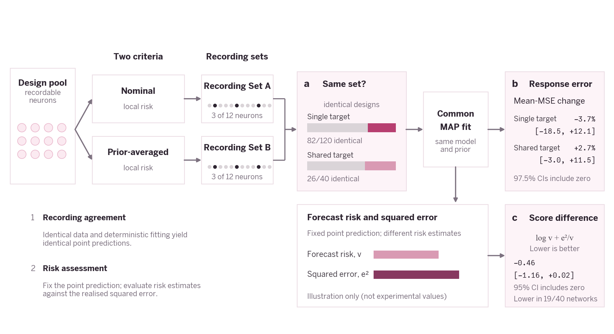

**Fig. 1 | The three-step audit.** Two criteria, nominal and prior-averaged local risk, each select a recording set from the same design pool. Panel a asks whether the two sets are identical; if they are, the common maximum a posteriori fit sees the same data and the response error cannot differ. Panel b compares the response error of the fitted prediction against hidden truth (mean-MSE change with the 97.5% interval for the single-response and shared objectives; both intervals include zero). Panel c fixes the data and the point prediction and compares the two risk forecasts v of the error e with the score log v + e²/v. The reported mean score difference is prior-averaged minus nominal (95% interval includes zero). The counts, effects and intervals are those of Figs. 3–4 and Table 1; the dot and bar icons for the recording sets and for v and e² are illustrative and carry no data. Negative differences favour the prior-averaged criterion.

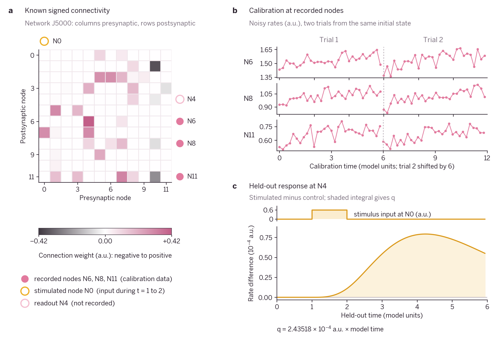

**Fig. 2 | Connectivity, limited recordings and a held-out response in one simulated network.** **a,** Known signed connectivity J for the first frozen network, J5000 (rose positive, deep plum negative weights; symmetric colour limits ±0.42 around exact zero); columns are presynaptic and rows postsynaptic nodes. Filled markers beside the matrix identify the recorded nodes N6, N8 and N11, the open light-rose marker the unrecorded readout N4, and the open amber marker the stimulated node N0. **b,** Actual noisy calibration observations at the three recorded nodes in two trials, each reset to the same known initial state (Gaussian observation noise SD 0.05, stride 4). Trial 2 is shifted by 6 model-time units for display; the dashed line marks the trial boundary, not continuous evolution, and lines connect observations only within a trial. Vertical scales differ between nodes. **c,** Stimulated minus matched zero-input control rate at N4 (displayed in units of 10⁻⁴); the upper strip shows the stimulus input at N0 during model time 1 to 2. The integrated response q = 2.43518 × 10⁻⁴ (a.u. × model time) is Δt times the sum of the 120 frozen-model differences (Δt = 0.05), not a new trapezoidal integral. The case is the fixed first-index instance (broad uncertainty, truth and noise draw 0, target 0, endpoints excluded, M = 3, nominal single-response selection), chosen before its effect was inspected. Independent n = 1 network; no interval is shown and no between-method effect or biological validity is claimed. All quantities are in dimensionless model units.

Before the methods were compared, the code was checked against an independent implementation and a linear-Gaussian case with a known answer. An independent rate/sensitivity implementation agreed within approximately 3.4×10⁻¹⁶, and finite differences supported the analytic derivatives. A nondegenerate linear-Gaussian positive control gave identical nominal and ensemble designs in all 48 design pairs; analytic prediction risk agreed with Monte Carlo MAP error across 144 target/design evaluations (Supplementary Fig. 5). A separate additive-bias control produced the expected zero derivative of the paired stimulus response. These checks validate specific computational operations, rather than biological assumptions.

### Prior averaging often selects the same recordings and did not establish lower error in the primary comparisons

The Decision and Error steps of Box 1 apply to the first frozen evaluation, which used 40 independent J matrices, with three physiological truths, three noise repetitions and three readouts nested within each network. The primary condition combined broad matched uncertainty, excluded endpoints and a budget of three recorded nodes. For each method, errors were first averaged within J; mean risks and paired intervals were then calculated across networks. All fits terminated successfully, with no fallback or invalid task scale.

The two criteria often chose the same recordings (Fig. 3a). A descriptive readback of the frozen designs found identical recording sets in 82 of 120 target-specific designs (68%; three designs per network) and in 26 of 40 shared designs (65%). Because identical sets give identical fitted data and predictions by construction, a difference in error can arise only in the remaining designs. At the network level, the ensemble and nominal MSE were exactly equal in 39 of 80 network–objective cells (13 single-response and 26 three-response networks; Fig. 3b). This count is descriptive and was not a prespecified hypothesis.

The ensemble scalar design had a slightly lower mean MSE than its nominal counterpart, but the paired interval included both improvement and deterioration (Table 1; Fig. 3c). The vector comparison had the opposite point estimate and was also uncertain. Relative mean-MSE changes were −3.74% for ES versus LS and +2.69% for EV versus LV. A leave-one-network diagnostic changed the sign of the scalar mean difference when one influential network was omitted; that network remains in every primary estimate. The results do not establish a stable ensemble advantage or method equivalence.

**Table 1 | Frozen primary response-error comparisons.** Broad matched uncertainty; endpoints excluded; M=3; 40 independent networks. RMSE is the square root of the overall mean network MSE. The primary estimand is the raw paired mean-MSE difference. The relative effect is a ratio of aggregate means minus one, not an average of individual percentage changes. Each prespecified comparison uses a 97.5% paired network-cluster interval.

| Objective | Nominal RMSE | Ensemble RMSE | Mean MSE difference, E−N | 97.5% interval | Relative mean-MSE change [97.5% interval] |
|---|---:|---:|---:|---:|---:|
| Single response | 0.008312 | 0.008155 | −2.586×10⁻⁶ | [−1.471×10⁻⁵, 4.826×10⁻⁶] | −3.74% [−18.48%, 12.12%] |
| Three responses | 0.008451 | 0.008564 | 1.924×10⁻⁶ | [−1.148×10⁻⁶, 6.826×10⁻⁶] | 2.69% [−2.95%, 11.51%] |

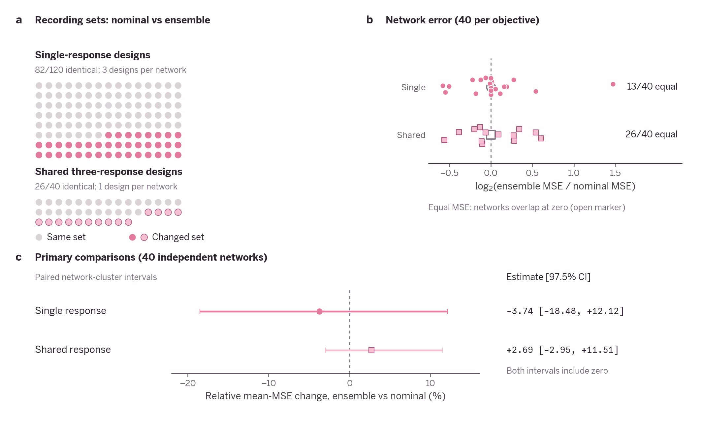

**Fig. 3 | Prior averaging often selects the same recordings; primary error comparisons remain uncertain.** **a,** Each dot is one recording design from the frozen first evaluation (120 single-response designs, three per network; 40 shared designs). Grey dots are designs in which the nominal and ensemble criteria chose identical recording sets; coloured dots are designs in which they differed (82/120 and 26/40 identical). **b,** Descriptive within-network log₂ ratio of ensemble to nominal MSE for the 40 independent networks per objective; the hollow marker at zero stands for networks with exactly equal MSE (13 single-response, 26 three-response), and filled points are the remaining networks. Three truths, three noise repetitions and three readouts are averaged within each network. These ratios are neither the primary estimand nor the ratio of aggregate means. **c,** Relative change in aggregate mean MSE, ensemble versus nominal, with the prespecified 97.5% paired network-cluster bootstrap intervals (same estimates as Table 1). Negative values favour the ensemble. All networks, including influential instances, are retained; Supplementary Fig. 1 shows the complete raw difference distributions. No method-equivalence margin was specified.

Recording constraints changed the achievable error. For nominal scalar design at M=3, RMSE was 0.000929 with all sites available and 0.004046 with endpoints excluded under matched uncertainty; the corresponding broad-condition values were 0.001946 and 0.008312. These exploratory comparisons make direct endpoint access an important part of the task definition. The activity and random references, both budgets, and all uncertainty conditions are retained in Supplementary Figs. 2–4.

### A separately specified forecast test separates risk estimation from point-prediction accuracy

In the first study, an exploratory aggregate comparison suggested that ensemble risk could match actual error better than nominal risk does, even when it did not improve the selected recordings. At the primary nominal scalar recording set, actual MSE divided by nominal forecast risk was approximately 1.615; the ratio using ensemble forecast risk was 1.103. Such a ratio does not establish forecast accuracy across networks. The Forecast step of Box 1 therefore became a separate test, specified by us, using 40 new J matrices, fixing the recording policy, selected data and fitted point predictions while comparing the two risk forecasts.

The primary ensemble-minus-nominal MSE-forecast score difference was −0.45565 (95% paired-cluster interval, −1.15857 to 0.02367; Fig. 4). Nineteen network means favoured the ensemble forecast and 21 favoured the nominal forecast. The shared point predictions had MSE 1.1781×10⁻⁴, so no point-prediction improvement can be attributed to changing the forecast alone. The interval does not establish a stable forecast-score gain. The mean is also dominated by one network: its score difference of −11.67 accounts for about 64% of the summed differences, and the mean of the other 39 is −0.17. In aggregate, the nominal forecast risk (1.19×10⁻⁴) was closer to the actual MSE (1.18×10⁻⁴) than the ensemble forecast risk (1.92×10⁻⁴), so this study does not show that the ensemble forecast is better calibrated than the nominal forecast. The exploratory aggregate hint from the first study (ensemble ratio 1.10 against nominal 1.62) therefore did not replicate. No fit failures, fallbacks or forecast-floor clipping occurred.

A secondary hidden-bias-shift comparison favoured the ensemble forecast by −1.3583 score units (pointwise 95% interval, −2.2143 to −0.6345). Both mean risk forecasts nevertheless remained below actual MSE in that condition. This result describes a relative forecast improvement in one secondary setting; it does not show that the hidden shift was learned or that uncertainty was fully calibrated.

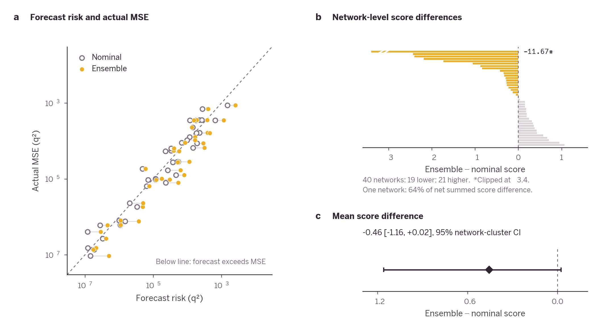

**Fig. 4 | Risk forecasts are evaluated on identical predictions.** The independent follow-up uses the nominal scalar recording policy, broad matched uncertainty, excluded endpoints and M=3 in 40 new networks. **a,** Nominal (open) and ensemble (filled) mean forecast risks are paired with the same actual mean response MSE for each network; horizontal segments link the two forecasts. Axes have identical logarithmic ranges and a dashed identity line; points below the line have a forecast that exceeds the actual error. This network-aggregate comparison is descriptive, not a stand-alone calibration test. **b,** All 40 network-level score differences, sorted; 19 favour the ensemble forecast (amber) and 21 the nominal forecast (grey). One bar (−11.7) is clipped at the axis limit and labelled. **c,** The mean score difference with the prespecified 95% paired network-cluster interval. Panels b and c use different horizontal scales because individual differences and uncertainty about their mean are distinct statistical objects. Scores S(v,e)=log(v)+e²/v are computed for individual target/truth/noise cases and then averaged within network; they are not scores of the aggregate coordinates in a. Negative differences favour the ensemble. The score evaluates an MSE functional, not a complete predictive distribution.

### Independent confirmation narrows the benefit suggested by the 100-unit pilot

An exploratory extension used eight independent 100-unit rank-two tanh networks from a published mathematical family [5], with adapted calibration inputs, measurement noise and inference. It suggested lower response error from prior averaging in several settings, including a −13.56% shared-objective change at five recordings with endpoints excluded (95% CI −28.56% to −4.78%). We therefore fixed that contrast as the primary comparison in 40 new networks before inspecting their outcomes. The original pilot and new confirmation remain separate sampling stages.

In the confirmation, prior averaging changed shared-objective mean MSE by +7.95% (95% CI −23.59% to +20.95%; 17 of 40 networks favoured the ensemble). Thus, the pilot improvement was not established in the larger independent sample. At ten recordings, large fitting errors made the aggregate contrast especially sensitive to individual networks. The complete objective, budget and pool results are retained in the supplement.

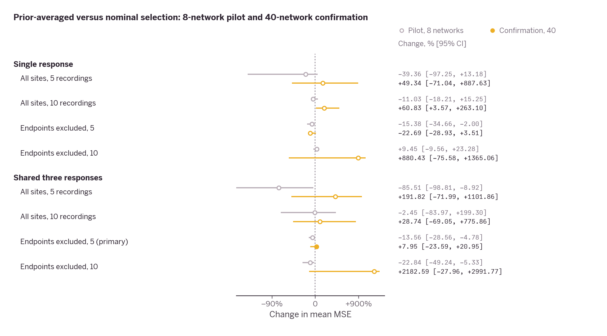

**Fig. 5 | Pilot and independent confirmation in the 100-unit family.** The eight-network pilot and the 40-network confirmation are plotted separately. Relative changes compare prior-averaged with nominal selection, paired within network. The prespecified confirmation contrast is the shared objective with endpoints excluded and five recordings; other conditions are exploratory. Changing from the 12-unit model to this family also changes dynamics and parameterisation.

### Equal-budget endpoint calibration yields a reproducible positive result

When all sites were available and five were recorded, nominal and ensemble shared-objective selectors reduced MSE relative to random recording by 95.95% and 88.17%, respectively. Inspection of the selected sets suggested a concrete source of this benefit: both selectors always recorded the stimulation site, and they included all three readouts in 30 and 38 of the 40 networks. We therefore introduced a simple endpoint baseline and controlled which endpoints occupied the same five recording slots.

Four allocations recorded neither endpoint group, the stimulation site only, the three readouts only, or both groups. Unfilled slots were sampled from the remaining neurons using shared random permutations, with three allocation repeats. All four allocations used the same hidden networks, calibration data, recording count and original estimator. In the first 40 networks, recording both groups changed MSE by -96.44% (95% CI -98.38% to -92.52%) relative to recording neither, with improvement in 38 networks. Relative to stimulation-only and readouts-only allocations, the changes were -95.41% (95% CI -97.79% to -91.69%) and -95.10% (95% CI -97.73% to -90.10%).

A prospective local protocol then fixed the both-versus-neither contrast and evaluated 40 additional, disjoint networks. The primary change was -98.13% (95% CI -99.19% to -93.94%), with improvement in 37 of 40 networks. The secondary changes relative to stimulation-only and readouts-only allocations were -99.28% (95% CI -99.71% to -93.01%) and -95.48% (95% CI -97.58% to -90.42%). Every allocation records calibration activity; the stimulus response being predicted is withheld from fitting.

The simple endpoint baseline also changed the interpretation of the risk-based selectors. In the first 40 networks, nominal selection versus this baseline gave +23.64% (95% CI -41.31% to +161.94%), and ensemble selection gave +260.80% (95% CI -56.39% to +1250.22%). These intervals leave their incremental benefit over endpoint recording uncertain. The positive result is the recording allocation itself: covering both ends produces a large improvement at fixed budget, and that improvement replicates on new networks.

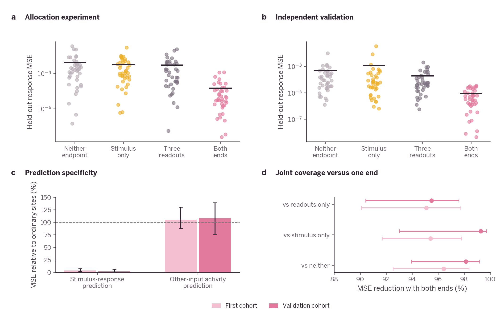

**Fig. 6 | Endpoint allocation and held-out response prediction.** All four allocations record five sites. Panels a and b show network mean response MSE in the first 40 networks and 40 independent validation networks; dots are individual networks and horizontal bars are arithmetic means. Panel c compares the both-end allocation with the neither-end allocation for the intended stimulus response and for whole-network activity under other held-out inputs; bars show ratios of mean MSE and 95% paired network-bootstrap intervals. The other-input analysis is exploratory. Panel d shows MSE reductions and intervals for joint coverage relative to each partial allocation, with a magnified reduction axis. Both-versus-neither is the primary validation comparison; the other validation contrasts are secondary.

### Uncertainty changes decisions while fitting remains a separate source of variation

Within the same 40 confirmation networks, prior and truth standard deviations were varied together over 0.3, 0.6 and 0.9, with common standardised draws. The mean correlation between nominal and ensemble candidate rankings at the first selection step fell from 0.944 to 0.687 to 0.600. All 40 networks showed a decrease between the narrowest and widest distributions. At five recordings, the average fraction of shared selected sites fell from 0.735 to 0.580 to 0.555. Thus uncertainty substantially changes recording choices in this family, while the corresponding response-error comparisons remain variable. Component controls separating target sensitivities and observation information did not establish one consistently dominant source of error reduction.

We also revisited the primary five-recording comparison using one common fitting rule: the original start, two nearby starts and two prior draws, retaining the smallest MAP objective. The selection rule used calibration data and the prior, with no access to response truth. Across the same 40 networks, ensemble versus nominal selection changed MSE by -49.40% (95% CI -70.90% to +3.65%). For nominal and ensemble selection separately, changes from the original fit were -3.07% (95% CI -13.14% to -0.27%) and -54.56% (95% CI -76.12% to +2.26%). One network contributed 80.7% of the absolute between-selector difference after refitting; three nominal fits still had objectives above the objective at the generating parameters. All 320 retained best fits terminated successfully. These are retrospective estimator-sensitivity results, reported alongside the frozen confirmation rather than replacing it.

Endpoint recording improved functional predictions much more clearly than it recovered individual gains. In the first cohort, mean stimulation-gain MSE changed from 0.661 to 0.579 and mean readout-gain MSE from 0.787 to 0.760 between the neither and both allocations. The validation cohort gave corresponding changes from 0.700 to 0.287 and from 0.743 to 0.507. A nominal local calculation predicted marginal variance reductions from approximately 91% of prior variance to 1–2%, which should be distinguished from these nonlinear parameter-estimation errors. In a separate oracle diagnostic on the first cohort, replacing fitted stimulation and readout gains by their true values, while leaving all other fitted parameters fixed, changed the neither-allocation MSE by -45.45% (95% CI -91.95% to +36.98%). These initial diagnostics motivate the next experiment: endpoint observations can change inferred recurrent dynamics and parameter compensation, so the relevant question is how far response predictions can vary among comparably fitted models.

The improvement was specific to the intended response. Under different held-out calibration-style inputs, whole-network activity MSE changed by +5.36% (95% CI -12.00% to +30.00%) in the first cohort and +8.05% (95% CI -23.95% to +39.06%) in the validation cohort, despite the large response-error reductions. In an exact descriptive decomposition of response error into a readout-gain term and a dynamic-response term, their negative cross term offset 93.8% and 83.7% of the sum of their separate squared terms under joint endpoint recording, compared with 23.5% and 2.1% under neither-end recording. This supports studying the predictive combinations constrained by calibration, rather than interpreting parameter accuracy alone as the mechanism.

### Endpoint information constrains response ambiguity across comparably fitted models

Forty additional networks, disjoint from both endpoint cohorts, tested whether endpoint observations narrow the responses permitted by comparably fitted parameter vectors. Every allocation used five recordings and a common five-start MAP estimator. For each readout we searched for the smallest and largest nonlinear response within a MAP-objective allowance of 2 above the best fit. These numerical feasible spans describe prediction ambiguity under a common data-and-prior constraint; they are not calibrated confidence intervals.

Relative to five nonendpoint recordings, joint endpoint recording changed the mean squared response-range width by -99.08% (95% CI -99.62% to -96.10%), with contraction in 40/40 networks. Its response-MSE change was -96.22% (95% CI -99.63% to -79.45%), with improvement in 38/40 networks. Raising the standard deviation of endpoint recording noise to four and sixteen times its original value changed the range metric by +471.43% (95% CI +178.12% to +999.62%) and +3384.93% (95% CI +1215.52% to +8268.23%), respectively, relative to ordinary-precision endpoint recording. The corresponding MSE changes were +156.17% (95% CI +24.32% to +928.87%) and +570.70% (95% CI +125.13% to +3169.11%). Noise levels were included correctly in the likelihood, and standardised noise draws were paired across conditions.

An information intervention distinguished endpoint-gain information from generic parameter knowledge. Keeping the five nonendpoint observations fixed, we revealed either the stimulation gain, all three readout gains, all four endpoint gains or four unrecorded nonendpoint gains, and refitted all remaining gains. Revealing both ends changed response MSE by -98.03% (95% CI -99.26% to -92.77%) relative to the four-ordinary-gain control, with improvement in 39/40 networks. The changes relative to knowing only the stimulation gain or only the readout gains were -92.19% (95% CI -98.98% to -79.73%) and -97.91% (95% CI -99.03% to -91.54%). These oracle controls are mechanism diagnostics; no revealed gain was available to a deployable selector.

Together, the feasible-response, precision and parameter-information comparisons support a specific mechanism in this model family: endpoint calibration constrains uncertainty relevant to the intended intervention response. This complements the earlier observation that accurate response prediction need not coincide with accurate recovery of each individual gain. It does not require interpreting descriptive error cancellation as an independent mechanism test.

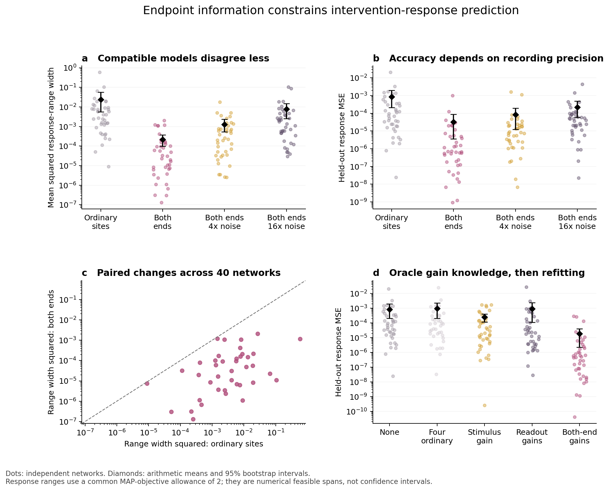

**Fig. 7 | Endpoint information and response ambiguity.** **a,** Mean squared numerical response-range width under the same MAP-objective allowance. **b,** Held-out response MSE under the same allocations and endpoint-noise manipulations. **c,** Paired range changes across the 40 independent networks. **d,** Oracle gain knowledge followed by refitting the remaining parameters, using five nonendpoint recordings in every condition. Dots denote networks; diamonds and error bars denote arithmetic means and 95% network-bootstrap intervals. Both-versus-neither range width is the primary comparison; precision and oracle contrasts are secondary. Numerical feasible response ranges and bootstrap intervals over networks answer different questions.

### Endpoint gains and recurrent combinations have complementary predictive value

The finite stimulus response can be expressed as input, recurrent-propagation and readout factors (Methods). In the small-activity limit, the endpoint gains control how the stimulus enters and how the response is read, while four connectivity-weighted sums of internal gains determine the two-dimensional recurrent dynamics. The endpoint dependence appears through stimulation/readout gain products. This identifies a concrete parameter-combination hypothesis behind the information result: calibration can constrain the response by constraining these factors, without identifying every neuronal gain.

Forty new networks tested the predictive value of this information with identical five-site ordinary calibration data and a common nine-start estimator. Revealing the four endpoint gains and four recurrent combinations changed response MSE by -98.34% (95% CI -99.87% to -93.56%) relative to revealing eight ordinary gains; all 40 networks improved. Relative to knowing the four endpoint gains alone, the additional recurrent information changed mean MSE by -91.37% (95% CI -92.52% to -32.80%), with improvement in 31/40 networks. The reduction remained between 74.81% and 91.71% when each network was omitted in turn. Thus internal propagation retains predictive importance even after endpoint gains are known. The second contrast supplies four additional constraints; the dimension-matched control below separates their specificity from the amount of information.

The exact factor decomposition was independently evaluated on fitted-versus-generating response differences in these same forty networks. Joint endpoint recording changed the mean squared input-factor contribution by -98.69% (95% CI -99.50% to -96.35%) and the readout-factor contribution by -98.79% (95% CI -99.59% to -96.88%). The recurrent-factor change was +16.53% (95% CI -34.62% to +139.45%). This localizes the strongest error contraction to entry and readout, while retaining a role for internal propagation. The reconstructed response agreed with the original integration to a maximum absolute error of 2.20×10⁻¹⁵.

A dimension-matched follow-up kept the same four endpoint gains known in both groups and compared four additional recurrent combinations with four additional ordinary gains. The recurrent combinations changed response MSE by -91.45% (95% CI -92.57% to -24.68%), with improvement in 32/40 networks. Leave-one-network reductions ranged from 72.73% to 91.80%. This comparison supports the predictive specificity of the internal combinations beyond the amount of revealed information. The follow-up was specified after the planned combination results, and uses the same forty networks.

An independent forty-network test fixed this dimension-matched comparison before observing outcomes. Recurrent information changed response MSE by -68.41% (95% CI -94.86% to -10.68%), again improving 32/40 networks. Leave-one-network changes ranged from -91.96% to -57.84%. The interval adjusted across this study's three primary comparisons was -95.57% to +4.51% (Supplementary Fig. 10a). The new cohort supports the direction of the earlier effect, with substantial uncertainty about its size.

The static combinations also captured much of the local response sensitivity. Their median squared-gradient projection fractions were 0.910 under ordinary recordings and 0.898 under endpoint recordings, compared with 0.289 and 0.287 for endpoint coordinates alone and 0.079 and 0.077 for eight random combinations. At parameter RMS perturbations of 0.1 prior SD, preserving the eight combinations reduced mean squared response changes relative to preserving endpoints alone by 42.12% (95% CI 28.97%–70.54%) and 28.97% (95% CI 5.24%–78.00%), respectively. At RMS 0.3, both corresponding intervals crossed zero (Supplementary Fig. 9). The static combinations provide an informative local approximation; finite nonlinear response changes also involve trajectory-dependent slopes.

We next asked whether calibration recordings could acquire this information. On the same new forty networks, all policies retained the four endpoints and selected one additional site using a random choice, an existing A-optimal criterion for the recurrent combinations, or the original response-risk criterion. Combination-targeted recording changed the squared feasible width along a direction fixed from the prior by -27.15% relative to a random fifth site (95% CI -40.09% to -15.18%; three-comparison-adjusted CI -43.18% to -12.69%). The range contracted in 30/40 networks. Selection used a local covariance approximation, whereas the subsequent range search used the nonlinear calibration model and a common MAP-objective allowance (Supplementary Fig. 10b,c).

The corresponding response-MSE change was -8.95% (95% CI -41.49% to +33.68%; adjusted CI -48.91% to +43.09%), leaving the prediction benefit uncertain. Combination estimation MSE changed by -31.31% (95% CI -55.93% to +0.83%). In secondary comparisons with response-targeted recording, combination targeting narrowed the squared profile width by 17.87% (95% CI 3.74%–31.22%) but gave a response-MSE change of +42.04% (95% CI -8.08% to +133.77%; Supplementary Fig. 10d). Thus actual observations can constrain the specified internal direction, while choosing for that constraint alone has not established better response prediction.

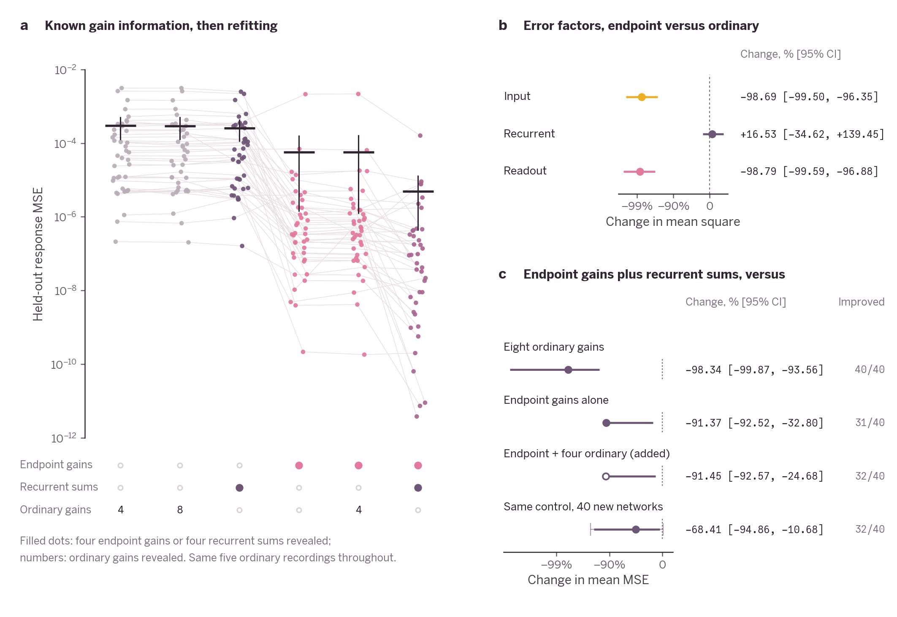

**Fig. 8 | Parameter information and finite-response factors.** **a,** Held-out response MSE after revealing specified gain combinations and refitting all free directions, with the same five ordinary recordings in every condition. Dots are networks; diamonds and bars show means and 95% network-bootstrap intervals. The endpoint-plus-ordinary control was added after the planned combination experiment. Results include additional common fitting for all six policies on one flagged network. **b,** Changes in the mean square of each input, recurrence and readout contribution to the fitted-versus-generating response difference. Contributions use all eight factor hybrids and the exact three-factor Shapley identity. Ratios compare endpoint with ordinary recording across forty new networks. Hybrid factors decompose response differences and do not represent physically realizable neural interventions.

### Endpoint allocation retains value under several structural and model perturbations

The same forty base seeds supplied six paired model conditions, each comparing five ordinary recordings with joint endpoint coverage. In the prespecified rank-six augmentation, endpoint recording changed response MSE by -92.08% (95% CI -95.66% to -85.04%), with improvement in 38/40 networks. Adding an unmodelled connectivity term at 10% relative Frobenius norm gave a change of -87.83% (95% CI -95.32% to -66.50%), and an unknown initial-state offset of SD 0.03 gave -95.85% (95% CI -98.93% to -92.45%). These effects, and the matched rank-two reference (-94.60%), retained negative six-comparison Bonferroni intervals (Fig. 9).

The independently generated Gaussian rank-six condition gave -61.35% (95% CI -84.04% to -7.73%; 30/40 networks improved), with a multiplicity-adjusted interval spanning zero. Positive lognormal gains gave a large point estimate (-98.70%; 38/40 networks improved) but a wide 95% interval (-99.96% to +68.88%). The latter mean comparison is sensitive to the heavy-tailed errors, despite an improvement in most networks. These conditions extend the evaluation beyond the original signed-gain rank-two family while showing that effect magnitude and certainty depend on model structure and parameterization.

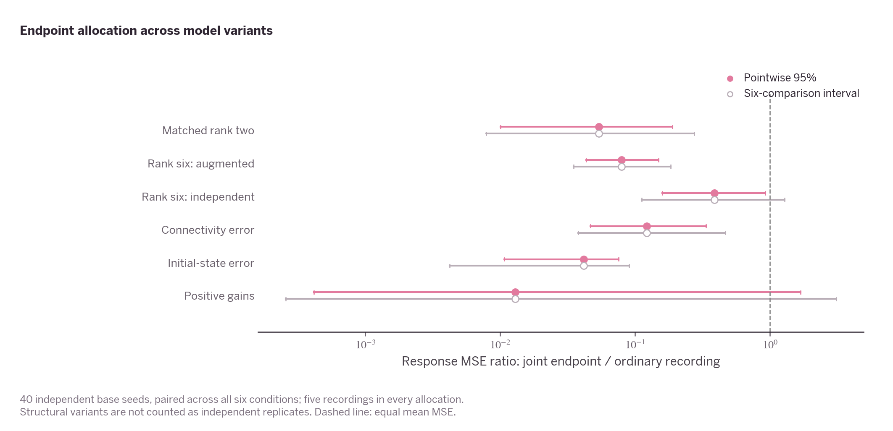

**Fig. 9 | Structural and model-assumption sensitivity.** Ratios of aggregate mean response MSE compare joint endpoint recording with five ordinary recordings. Each condition contains forty independent base seeds; the six conditions remain paired within seed. Filled markers and darker bars show pointwise 95% network-bootstrap intervals; open markers and lighter bars show six-comparison Bonferroni intervals. Rank-six augmentation is the planned primary comparison. The random rank-six and positive-gain comparisons retain greater uncertainty after accounting for the full condition family.

### Limited-budget selection exposes little additional value from pair lookahead

A separate forty-network study tested budgets two and three under uniform noise, fourfold stimulus-site noise SD, and fourfold readout-site noise SD. Endpoint-pair lookahead selected exactly the same sites as ordinary ensemble greedy selection in 237/240 paired settings. Its prespecified aggregate MSE change was -0.00136% (95% CI -0.00555% to 0.00000%), averaging the six settings within each network first. Relative to exact endpoint-only subset enumeration, its change was +2.54% (95% CI -0.11% to +7.68%). The expanded search therefore supplied negligible additional predictive benefit over ensemble greedy selection (Supplementary Fig. 8).

The simple endpoint-only search itself changed mean MSE by -46.29% (95% CI -59.65% to -21.95%) relative to recording the stimulation site first and filling the remaining slots with randomly ordered readouts, in a secondary comparison. Thus the choice among accessible endpoints matters under a restricted budget. The existing ensemble-risk objective already captured most choices supplied by pair seeding in this cohort; these results support a useful endpoint baseline rather than a distinct advantage from the added search procedure.

### Approximation diagnostics constrain the interpretation

Development-only diagnostics measured local Taylor remainders and selection overlap. Mean calibration remainders relative to parameter-induced activity changes were approximately 0.179 under matched uncertainty, 0.334 under broad uncertainty and 0.252 under hidden bias shift. Broader uncertainty changes signal scale and parameter variability as well as nonlinear behaviour, so these differences do not isolate a curvature effect. Local and ensemble sets frequently overlapped. When sets were identical, the fitted data and response predictions were identical by construction, limiting any decision benefit of a changed risk value in those cases.

The matched and hidden-shift conditions used the same public prior and therefore produced exactly the same prospective designs, despite different true responses. This is an information boundary: without a preliminary measurement, the selector cannot infer an undisclosed physiological shift. In the first frozen evaluation, approximate 95% local MAP response intervals for the nominal scalar estimator covered the truth with proportions 0.930, 0.919 and 0.793 for matched, broad and shifted conditions, respectively, at excluded endpoints and M=3. These diagnostics identify limitations of the current information and approximation contract; they do not establish a single biological mechanism for the observed errors.

## Discussion

Joint calibration of the stimulation and readout sites improved prediction of the held-out stimulus response across independent networks. The benefit remained under rank-six augmentation and mild errors in connectivity or initial state. In the original endpoint cohorts, changes in whole-network activity error under other inputs were uncertain, despite the large improvement in the intended response. This supports choosing calibration recordings according to the response to be predicted.

The response-range experiments clarify what changed. Models with similar calibration fits could disagree widely about the stimulus response when endpoints were unobserved. Endpoint recordings narrowed that disagreement; reducing their precision increased both the response range and prediction error. Revealing endpoint gains and refitting the remaining parameters supplied a separate test of the information those sites carry. These observations support a mechanism in which endpoint calibration constrains the response despite residual uncertainty in individual parameters.

The factor decomposition locates the strongest contraction in the input and readout contributions to response error. In the low-activity limit, endpoint gain products and four recurrent gain combinations determine the transfer response. The information controls support additional predictive value for those recurrent combinations after endpoint gains are known. The equal-dimensional comparison gave the same direction of improvement in two independent cohorts, although the new cohort's multiplicity-adjusted interval crossed zero. Earlier connectome-constrained models distinguish stiff parameter combinations from poorly recovered individual gains [5], as does the broader literature on sloppy models [29]. Our experiments identify and test the conditional value of particular combinations for this held-out response. Their static form captures much of the local sensitivity; larger nonlinear changes also depend on activation slopes along the trajectories.

The fifth-recording experiment connects the parameter-information controls to observations. With the four endpoints already recorded, a site selected to constrain recurrent combinations narrowed a nonlinear feasible range more than a random extra site. This establishes that calibration observations can acquire some of the internal information identified by the factorization. Prediction error remained uncertain, and direct response targeting had lower mean error in the secondary comparison. The gap is consistent with the limited scope of the static combinations: they describe the low-activity dynamics, while the finite response also depends on trajectory-dependent slopes and residual endpoint uncertainty. Testing which of these remaining uncertainties matters would clarify when combination information translates into a predictive gain.

The endpoint allocation result also gives the method comparisons a concrete baseline. Recording-site optimisation and goal-oriented design already value observations according to a prediction task [5,10,11,40], and prediction profiles provide tools for examining uncertainty in that prediction [12,23,41,42]. Active photostimulation design chooses informative inputs and has been evaluated on real neural recordings [46]. For our fixed-input task, endpoint coverage explains a large gain over random recording. Prior averaging, covariance-based selection and endpoint-pair lookahead have not established a robust additional benefit under the shared fitting comparisons. The simple endpoint baseline therefore matters when judging what a more elaborate selector adds.

### Limitations

A non-significant interval should be read in terms of the effects it permits [36,37]. In the original 12-unit primary study, the shared-response 97.5% interval (−2.95% to +11.51%) extends from about a 3% mean-MSE reduction to a 12% increase. The single-response interval (−18.48% to +12.12%) permits a larger benefit as well as deterioration. Network differences are heavy-tailed and often exactly zero, so the percentile bootstrap bounds are approximate. No equivalence margin was specified in advance.

The 12-unit and 100-unit families serve different purposes: the former supplies the original factorial and forecast studies, while the latter supplies independent confirmation and focused allocation experiments. The uncertainty-width and fitting analyses reuse the 40-network confirmation cohort. The 40-network endpoint validation uses disjoint networks. The response-range follow-up adds 40 further networks and the indirect-recording comparison adds a separate 40. Their sample sizes and primary comparisons were fixed locally before their respective results; precision and oracle contrasts are secondary. Numerical response ranges use a MAP-objective threshold rather than a calibrated frequentist coverage threshold.

The baseline assumes known numerical connectivity, a correct observation equation, known initial states and a specified stimulus. The structural follow-up includes rank-six families, positive gains, and explicit mild errors in connectivity or initial state. It uses one physiological draw and one noise draw per base seed, paired across conditions. The tested perturbation magnitudes do not characterize arbitrary model error. Full-rank connectivity, process noise, plasticity and biological nonstationarity remain outside this evaluation. The response task has three fixed readouts, and practical endpoint allocation depends on access to those sites during calibration. Local risk, finite prior ensembles, greedy selection and MAP optimisation remain approximations. Multiple starts do not guarantee global optimisation. Joint neural recordings and perturbations would be needed to establish biological validity, and a further neuromuscular layer would be needed for mechanical predictions in biohybrid robots [2,27].

The mechanism concerns the stated dynamics, calibration inputs and response. Its finite-response factorization is exact within the model, while the eight static gain combinations are motivated by the small-activity limit. The combination-information interventions reveal simulated ground truth and diagnose predictive information; recording selectors use only public model and prior information. The hybrid-factor decomposition attributes response differences, while the oracle refits test the value of specified parameter information. The budget experiments assess a task-specific search modification using an established risk objective. The fifth-recording experiment uses an established A-optimal criterion and profiles one internal direction chosen before observing data. Its range contraction does not establish coverage of all four combinations or explain the remaining response errors.

### Implications for recording-design practice

An informative baseline should reflect the known stimulus and readouts. When endpoints are available during calibration, comparing a risk-based selector only with unrestricted random sampling can substantially overstate the value of sophisticated selection. The endpoint baseline offers a direct, inexpensive comparison. When endpoints are inaccessible, the criteria must earn their benefit through indirect recordings, which remains uncertain in the present primary confirmation.

## Conclusions

Joint calibration of stimulation and readout sites improves prediction of a held-out stimulus response in the tested networks, with replication across independent cohorts and support under several structural and model perturbations. Endpoint information narrows the range of compatible responses and reduces input and readout error contributions. Information controls support additional predictive value in recurrent gain combinations. A targeted fifth recording constrains a prespecified internal direction, while its additional prediction benefit remains uncertain. Endpoint coverage therefore provides a useful baseline, and the recurrent combinations provide a concrete target for studying what further recordings contribute.

## Methods

### Notation

| Symbol | Meaning |
|---|---|
| J, N | known connectivity matrix and number of units |
| θ = (η, b) | uncertain log-gains and biases |
| M | recording budget (number of recorded neurons) |
| q, Q | specified target response and the three-response vector |
| F, H | whitened observation sensitivities and local information matrix |
| R | local delta-method risk of a recording set |
| v, e | forecast of the mean squared error and the realised prediction error |
| S(v, e) | forecast score log v + e²/v |
| LS, ES, LV, EV | nominal and ensemble criteria for the single-response and three-response objectives |

### Model, measurements and response

The primary model is

\[
\dot x=-x+Jr+u,\qquad
r_i=\exp(\eta_i)\operatorname{softplus}(x_i+b_i).
\]

N=12, x(0)=0 and J is known. The independent synthetic J matrices have 30% sparse connectivity, zero diagonal, column-wise excitatory/inhibitory signs, and spectral norm 0.65. The uncertain vector is θ=(η,b). The observation is the rate r, not the internal state x. Time and activity are dimensionless.

Two known calibration inputs apply sinusoidal probes to three channels. Euler integration uses a step of 0.05 over six time units. Sampling every fourth step yields 60 observations per recorded neuron across the two calibration trials. Measurement noise is independent Gaussian with standard deviation 0.05.

A separate fixed stimulus of amplitude 0.6 acts during time 1–2. Three readouts are selected from structurally reachable nodes using J before physiological parameters or measurement noise are generated. The target family is

\[
q_k(\theta)=\int_0^6[r_{j_k}(t;\theta,u_*)-r_{j_k}(t;\theta,0)]dt.
\]

The primary implementation evaluates this integral by the matching step-weighted (left-point) sum with dt=0.05. Q consists of these three responses. The vector criterion and primary raw-error evaluation use equal weights over the same target family. Scalar designs specialise for one known target; vector designs use one configuration for all three. No observations from separately selected scalar configurations are pooled.

Recording budgets are M=3 and M=6. The candidate pool either includes all neurons or excludes the stimulation site and all three readouts. The latter pool is shared by every target and method.

### A factorial comparison of existing criteria

In whitened parameter coordinates, the local information matrix for a recording set M at parameter particle ℓ is

\[
H_{M,\ell}=I+\sum_{i\in M} F_{i,\ell}^{T}F_{i,\ell},
\]

where F includes the observation derivatives, prior parameter scale and noise standardisation. With aₖ,ℓ denoting the whitened target gradient, the scalar criterion is

\[
R_{k,\ell}(M)=a_{k,\ell}^{T}H_{M,\ell}^{-1}a_{k,\ell}.
\]

The vector criterion averages these risks over the three readouts. Local designs evaluate at μ=0; ensemble designs average the individually solved risks over 16 common prior draws. Averaging information before solving would define a different criterion and is not used.

| Design | Predictive objective | Parameter representation |
|---|---|---|
| LS | One specified response | Nominal parameter |
| ES | One specified response | Common prior ensemble |
| LV | Three-response vector | Nominal parameter |
| EV | Three-response vector | Common prior ensemble |
| Activity | Full calibration activity | Nominal parameter |
| Random | No risk objective | Five feasible random sets |

All risk-based methods use the same greedy forward selection and deterministic tie convention. These are greedy-selected sets, not certified global optima. Random permutations give nested budgets. The design API receives only the public model, prior, inputs and task. It receives neither generating parameters nor measured evaluation outcomes. There is no uncounted all-neuron pretraining or preliminary dataset.

The ensemble criterion is a **prior average of local delta-method risk**. It does not integrate future measurements and nonlinear posteriors, establish a variance upper bound, or capture all posterior modes.

### Common inference and paired evaluation

After selection, all methods minimise the same Gaussian MAP objective, using analytic sensitivities and the prior mean as the initial parameter. The solver runs at most 80 function evaluations with identical tolerances. A finite final iterate is retained and flagged if convergence is not reached. Exceptions or nonfinite predictions trigger a flagged prior-mean fallback. No instance is silently dropped.

Within each network, true parameter vector and noise repetition, methods receive their selected subsets of one common measurement-noise field. The full field is internal to the generator. Identical recorded datasets receive the same MAP objective, prior-mean starting point, common noise field, solver settings and deterministic solver, so identical sets give identical fits and predictions by construction; they may also reuse a cached fitted solution; this changes compute accounting, not information access. Responses are predicted by nonlinear simulation at the fitted parameter. A passive input not used for fitting gives an additional activity-prediction diagnostic.

### Development and the first frozen evaluation

| Stage | Independent J | Physiological truths/J | Noise repeats/truth | Readouts/J | Conditions |
|---|---:|---:|---:|---:|---|
| Development | 8 | 2 | 2 | 3 | Matched, broad, bias shift, gain-only, bias-only |
| First frozen evaluation | 40 | 3 | 3 | 3 | Matched, broad, bias shift |

Matched and broad conditions use correctly specified Gaussian priors and generating standard deviations 0.18 and 0.35 respectively. Bias shift retains the design prior at 0.18 while adding 0.5 to the hidden true bias mean. The method is not informed of this shift. Development gain-only and bias-only conditions fix the other parameter group. Increasing a prior scale changes parameter variability, signal scale and nonlinearity together; it is not an isolated curvature intervention.

Connectivity, truth, noise, design ensembles, task-scale Monte Carlo, random sets and analysis use separate seed namespaces. The first evaluation uses network IDs 5000–5039, disjoint from development. The execution protocol and computational source were locally frozen before outcomes were inspected. This is not external preregistration.

### Estimands and uncertainty

For each J, squared response errors are averaged across all prescribed truths, noises, targets and random-design repetitions. Network risks are then averaged equally across J. RMSE is the square root of the overall mean squared error. Repeated targets or noises do not create additional independent networks.

Interval key: 97.5% intervals belong to the two prespecified first-study comparisons, the 95% interval to the single prespecified forecast comparison, and other intervals are pointwise 95% unless specified otherwise in the follow-up protocols. The six structural contrasts additionally report six-comparison Bonferroni intervals. Two prespecified primary comparisons, ES−LS and EV−LV, concern broad uncertainty, excluded endpoints and M=3. The paired network-cluster percentile bootstrap [38,39] uses 10,000 resamples of whole networks, so repeated targets and noises do not count as independent. Each primary comparison receives a 97.5% interval as a two-comparison Bonferroni interval arrangement. Other strata, task-specialisation comparisons and factorial interactions have exploratory pointwise 95% intervals. We do not infer equivalence from an interval crossing zero [36,37].

The primary scale is raw response MSE. A secondary scale uses an independent common 64-draw nonlinear prior-Monte-Carlo variance. It is not method-specific. Prescribed targets below a frozen variance floor of 10⁻¹⁶ retain raw results; a complete standardised estimand is NA rather than silently excluding them. Local MAP intervals are approximate diagnostics, not guaranteed confidence intervals.

### Separately specified risk-forecast follow-up

The first study distinguishes selection gains from apparent risk-estimation differences only exploratorily. A subsequent protocol therefore uses new network IDs 6000–6039 and fixes the recording policies to LS and LV. The point predictions and selected data are identical for the two risk forecasts being compared. The forecasts are the nominal and ensemble local risks evaluated at that same recording set.

The risk-forecast score is

\[
S(v,e)=\log v+e^2/v,\qquad v=\max(\hat R,10^{-24}).
\]

For positive v, its conditional expectation is minimised at v=E[e²]. This makes it a consistent score for a positive MSE forecast; it does not establish a full predictive distribution or require the errors to be Gaussian. The log term penalises indiscriminate inflation. This is a use of established scoring principles [14,33], not a new score. The forecast-evaluation literature distinguishes calibration from sharpness [34] and treats calibration as separate from point-prediction accuracy [35]; the nominal-versus-ensemble comparison here mixes both, applies to a mean-squared-error forecast rather than a full predictive distribution, and does not test calibration separately.

The follow-up has one frozen primary comparison: ensemble minus nominal risk-forecast score for the LS recording policy under broad uncertainty, excluded endpoints and M=3. It uses a paired network-cluster 95% interval. Matched/shift conditions and LV are secondary. These results do not redefine the first study's primary hypotheses.

### Numerical and published-model checks

The implementation is checked against an independent NumPy model, analytic finite differences, nonordered observation subsets, a linear bias-cancellation null, and exact small-subset enumeration. A separate nondegenerate linear-Gaussian positive control uses constant observation/target Jacobians, independent prior truths and noise, and exact linear MAP predictions. It checks both nominal–ensemble equivalence and the link between aᵀCa and actual MSE. The original SVD criterion is independently calibrated in its noiseless linear internal-state setting against Monte Carlo reconstruction, rather than mislabelled as a noisy-rate baseline reproduction.

The N=100 model-family extension uses the published rank-two tanh distribution, raw signed gains g~N(1,0.9²), zero bias and τ=0.5 [5]. Its inputs, known initial state, measurement noise and inference are explicit adaptations. Negative gains are retained as mathematical parameters. The coarse Euler implementation did not pass continuous-time convergence checks. The refined implementation uses x=v+Lz, analytic filtering of the known held input, and RK4 on the reduced state and sensitivities. Responses and their complete gradients are integrated at RK4 stages. It is compared with dense RK4 and finer substeps before execution. The initial pilot used eight new networks, two truths, two noise repetitions, three targets, budgets 5/10 and both pools. The prior ensemble has 32 draws and MAP permits 200 evaluations. These settings are frozen before formal extension outcomes, following numerical and timing checks. All initial pilot comparisons are exploratory. This extension changes both model family and N, so it is not a controlled estimate of an N-only scaling law.

### Independent confirmation and focused follow-ups

The 100-unit confirmation used 40 new networks (IDs 20000–20039), two independent physiological draws, two noise draws and three fixed readouts per network, both recording pools and budgets five and ten. The primary contrast was ensemble versus nominal selection for the shared objective, with endpoints excluded and budget five. The original model, integration, noise, 32-particle design ensemble and common MAP rule were retained. The sample size and primary contrast were locally frozen before inspecting outcomes. All other confirmation contrasts use exploratory 95% network-paired bootstrap intervals.

The matched-width analysis reused these networks with prior and truth standard deviations 0.3, 0.6 and 0.9, scaling common normal draws. First-step rank correlations used a common empty selection prefix. Component diagnostics held either target sensitivities or observation information at the nominal values. The fitting follow-up kept the selected sets fixed and fitted from zero, two draws scaled to 0.25 prior standard deviations and two full prior draws. Starts were common to both selectors and data repetitions within a network (seed stream 91631). The fit with the smallest unchanged MAP objective supplied the response prediction. True parameters were used only for diagnostics: a returned objective above the objective at the generating parameters certifies a suboptimal returned fit, but the reverse does not certify optimality.

The endpoint experiment fixed five recordings and used four allocations: five nonendpoints; the stimulus site plus four nonendpoints; the three readouts plus two nonendpoints; and all four endpoints plus one nonendpoint. For each of three allocation repeats, a common random permutation of nonendpoints supplied the remaining sites (streams 1601–1603). Thus policies had identical total measurement counts and shared truth and observation-noise draws. The original zero-start MAP estimator was used throughout. The first cohort reused networks 20000–20039. A separate prospective local protocol fixed both-versus-neither as the primary comparison on 40 new networks (IDs 30000–30039); both-versus-stimulus-only and both-versus-readouts-only were secondary comparisons. All 40 planned networks were retained in each cohort.

Response squared errors were averaged over targets, truth draws, noise draws and allocation repeats within each network. Contrasts are ratios of means across networks minus one, with 10,000 paired network bootstrap resamples. Evaluation rows and fit restarts are not treated as independent observations. Local freezes and code hashes accompany the outputs; they are not public preregistrations.

For the local information diagnostic, parameters were prior-whitened and the nominal Gaussian covariance was C=(I+F_SᵀF_S)⁻¹. Marginal variances were compared with the unit prior variance. If an endpoint parameter block E were known exactly, the conditional covariance would be C−C_:E C_EE⁻¹ C_E:. The reduction in trace(GCGᵀ)/3 quantifies the local risk removable by that additional knowledge, including parameter correlations. This is an approximation diagnostic rather than an empirical variance estimate. A separate nonlinear oracle check substituted true endpoint gains into fitted parameter vectors, held all other fitted values fixed and recomputed the response; oracle outcomes never entered policy or fit selection.

Task specificity was evaluated by simulating the already fitted models under the original other-input test traces and comparing whole-network activity with the teacher. For the descriptive response-error decomposition, write qᵢ=gᵢLᵢ, where Lᵢ is the time-integrated difference of tanh states under stimulated and control trajectories. Then $\hat{q}_i-q_i=(\hat{g}_i-g_i)L_i+\hat{g}_i(\hat{L}_i-L_i)$. We report the mean square of each term and twice their mean product. The cancellation fraction is minus this cross term divided by the sum of the two squared terms, aggregated over the same records as the response MSE. The sum agreed with the response MSE for every saved fit; the decomposition describes compensation in fitted models rather than a separate intervention on biological dynamics.

### Response ambiguity and gain-information interventions

The mechanism study used network IDs 40000–40039, one prespecified physiological draw and noise draw per network, and the same three readouts. Five common starts comprised the nominal mean, two draws at one quarter of the prior standard deviation and two full prior draws (stream 93631). Fitting retained the smallest MAP objective with a 300-evaluation cap. The response-range problem maximised or minimised each target over the full nonlinear MAP sublevel set with allowance delta=2. SLSQP used two starts per direction, a 160-iteration cap, analytic sensitivities and invertible local Gauss-Newton coordinates. The quadratic prior makes the original finite coordinate bounds redundant. Every retained extreme was checked against the original objective; the final numerical envelope also included every known feasible multistart fit, preserving the original search output separately; discovering a lower objective triggered refitting and a repeated range search. Value-only line searches and the coordinate transformation preserved the scientific objective, feasible region, samples and comparisons; their numerical checks and timing amendments were logged before completed validation outputs.

The primary range metric averaged squared marginal response widths across the three targets, then across networks. Secondary experiments multiplied endpoint-noise standard deviations by four and sixteen while keeping their standardised random draws paired. The first eight IDs were fixed for a delta=5 threshold check. The joint-endpoint versus ordinary-site range-metric change was -99.77% (95% CI -99.85% to -93.61%) in that check. Known feasible delta=2 extrema were retained in the wider search envelope. All retained extrema were reevaluated with twice the integration resolution; the maximum response change was 0.00231 of the corresponding range width. The primary comparison retained 479 successfully optimized boundary points and one MAP point. Two of 480 retained points in the noise conditions and two of 96 points in the wider-threshold check had unsuccessful optimizer flags but satisfied the numerical feasibility tolerance. The finer integration changed the primary range-metric effect from -99.08477% to -99.08468%. Ranges are feasible numerical spans, not guarantees of global extrema or calibrated confidence intervals.

Oracle information controls used the same five nonendpoint recordings and fixed the revealed gains to their generating values before refitting every remaining gain. The matched ordinary-gain control revealed four gains outside both the endpoints and the recorded set (stream 93931). These diagnostic gains never entered a recording selector. Statistical comparisons resampled complete networks 10,000 times, keeping all within-network contrasts paired.

### Indirect-recording comparison using joint prior simulations

A separate locally frozen comparison used networks 45000–45039, two physiological draws, two noise draws and three targets per network. All selectors chose five nonendpoint sites and used the same five-start nonlinear MAP estimator. In addition to nominal and prior-averaged local-risk selection, a joint covariance criterion estimated observation–response dependence from 32 prior simulations. A held-out-prior variant evaluated the resulting linear predictor on 32 independent prior simulations and added the analytic contribution of observation noise to its squared error. Greedy choices minimised this surrogate risk. No realised calibration or held-out stimulus response was available during selection. This construction draws on established goal-oriented and simulation-based design ideas [10,22,43].

The held-out-prior versus nominal MSE contrast was primary. Covariance, ensemble and random comparisons were secondary. A retrospective optimization audit identified 11 truth/noise datasets in which at least one selected fit had an objective above that at the generating parameters. All five policies for each flagged dataset received the same eight additional prior-generated starts (stream 94031), plus refinement of the old best fit. The generating parameters flagged the diagnostic but were never starting points or selection criteria. These sensitivity results are reported separately from the frozen comparisons. The final response estimates always came from the common nonlinear fit, so the comparison evaluates whether the surrogate selects useful recordings for that estimator. Numerical tests checked the dual covariance formula against direct observation-space calculations and verified the response and objective derivatives.

### Finite-response factors and parameter-combination controls

For the rank-two family, write the known connectivity as $J=LR$ and each trajectory as $x^{a}=v^{a}+Lz^{a}$, where $a=0,1$ denotes control or stimulation and $\tau\dot v^{a}=-v^{a}+u^{a}$ includes the known initial state. Define the diagonal secant matrix $D(t)$ by

$$
D_{ii}(t)=g_i\frac{\tanh x_i^1(t)-\tanh x_i^0(t)}{x_i^1(t)-x_i^0(t)},
$$

with the continuous derivative limit when the denominator vanishes. Because only site $s$ is stimulated, the exact finite-response equations are

$$
\tau\dot{\delta z}=(-I+A(t))\delta z+b(t),\qquad q=\int_0^T C(t)\delta z(t)\,dt,
$$

where $A=RDL$, $b=R_{:s}D_{ss}\delta v_s$, and $C=D_{\mathcal R\mathcal R}L_{\mathcal R:}$ for the three readouts $\mathcal R$. The input factor, recurrent propagation and readout factor therefore depend on distinct combinations of gains and trajectory-dependent activation slopes. This follows the established low-rank dynamical representation [44]; the secant construction retains the finite stimulus amplitude. Coefficients were saved at the same RK4 stages as the original trajectories. Reintegrating these equations recovers the original response without a small-stimulus approximation.

To locate response disagreement, each retained profile extreme was compared with its corresponding MAP reference in the earlier forty-network mechanism cohort. All eight combinations of reference/extreme input, propagation and readout factors were integrated, and three-factor Shapley contributions assigned their combined response difference. These hybrid paths are a functional decomposition, not physical neural interventions. Squared contributions are not additive fractions of total prediction MSE because cross terms remain. A new forty-network cohort supplied a separate decomposition of fitted-versus-generating response errors.

In the small-activity limit, $D$ approaches $\operatorname{diag}(g)$, suggesting four endpoint gains and four entries of $A_0=R\operatorname{diag}(g)L$ as candidate predictive combinations. In that limit, the stimulus-to-readout transfer has the form

$$
\widehat{\delta r_o}(p)=g_o L_{o:}\big[(\tau p+1)I-A_0\big]^{-1}R_{:s}g_s\,\frac{\widehat u_s(p)}{\tau p+1}.
$$

Here $p$ is the Laplace variable. Thus the endpoint gains set the input and output factors, while the four weighted sums $(A_0)_{ab}=\sum_i R_{ai}L_{ib}g_i$ determine the intervening two-dimensional dynamics. Endpoint dependence enters through the products $g_sg_o$, making the joint input/readout uncertainty explicit. This explains the candidate combinations without requiring recovery of every internal gain; the eight revealed quantities are not asserted to be a minimal parameterization. At finite activity, the exact factors above also depend on trajectory-specific slopes. We tested the static approximation explicitly. In prior-standardized parameter coordinates, the response Jacobian was projected onto the row space of these eight linear combinations, onto four endpoint coordinates alone, or onto eight fixed random linear combinations. Finite perturbations used eight common random directions and both signs, projected into each constraint null space and normalized to parameter RMS changes of 0.1 or 0.3 prior standard deviations. These interventions preserve the specified combinations exactly but do not impose a calibration-likelihood constraint.

Independent gain-information controls used network IDs 50000–50039 and retained five ordinary calibration recordings for every policy. Before refitting, they revealed the four endpoint gains, the four recurrent combinations, both groups, four ordinary gains, or eight ordinary gains. Ordinary controls excluded both endpoints and recorded sites. A singular-value decomposition parameterized the exact constraint null space; the same nine starts were projected into each space. The two specified comparisons were joint eight-combination information versus eight ordinary gains, and its additional value over four endpoint gains. The latter comparison measures the value of extra information and does not hold its dimension fixed. These networks also form the robustness cohort below and are counted once. A retrospective dimension-matched follow-up revealed the same four endpoint gains plus the same four ordinary gains used in the original ordinary-gain control. All forty networks were retained. Any selected fit with an unsuccessful termination or objective above the known feasible generating-parameter objective triggered a matched fitting audit. On the one flagged network, all six oracle policies received seventeen additional common starts: the nine fits to the same ordinary calibration data without oracle knowledge and eight new fixed prior draws, projected into each constraint space. The original nine fits remained candidates. This removed the feasible-cost failure; all final selected oracle fits terminated successfully and satisfied that check. The dimension-matched effect changed from -91.46% to -91.45%. Unrevealed true gains were not supplied as starting values.

### Network structure and model-assumption perturbations

Forty independent base seeds (50000–50039) were evaluated in six paired conditions at budget five. The matched rank-two model supplies a reference. A rank-six augmentation adds four independent Gaussian modes at one half the original connectivity Frobenius norm, then rescales the combined matrix to the original norm. A separately generated Gaussian rank-six matrix also matches that norm. The public stimulation site, three readouts, calibration inputs, standardized gain draws and noise draws remain paired across these structural conditions.

Two separate misspecification conditions change only the generating model: an unmodelled rank-four connectivity term of relative Frobenius norm 0.1, or an unknown initial-state offset with independent entries of SD 0.03. The fitted model retains the original connectivity or initial state, respectively. A final matched condition replaces signed raw gains with positive gains $g=\exp(\theta-0.9^2/2)$, retaining a Gaussian latent prior $\theta\sim N(0,0.9^2I)$ and applying the exact chain rule in fitting.

Each condition compares joint endpoint recording with five ordinary recordings, with one physiological draw, one noise draw and three response targets per base seed. All fits use nine common starts (the prior mean, two quarter-scale and six full prior draws), a 400-evaluation cap, and the same MAP objective. The rank-six augmentation contrast is primary; remaining conditions are secondary. Paired bootstrap summaries include 95% intervals, six-comparison Bonferroni intervals and leave-one-seed influence. Paired structural variants are not counted as additional independent sampling units. Reevaluation with twice the integration resolution changed the six MSE effects by at most 0.00068 percentage points and the three main combination-information effects by at most 0.00042 percentage points. Independent derivative and integration checks preceded the experiments. All selected fits terminated successfully and achieved objective values below their known feasible reference.

### Limited-budget allocation and endpoint-pair lookahead

A separate forty-network cohort (55000–55039) tested budgets two and three under uniform recording noise, fourfold stimulus-site noise SD, and fourfold readout-site noise SD. All noise levels are supplied to both selection and fitting. Six policies were evaluated using the same calibration draws and nine-start MAP rule. The candidate augments ordinary ensemble-risk greedy selection with each of the six endpoint-pair seeds. At budget three, each pair receives its best additional site from the complete candidate pool. The final set minimizes the existing ensemble local-risk objective over these candidates and the original greedy set.

Comparators are ordinary ensemble and nominal greedy selection over all sites; exact enumeration of all endpoint-only subsets; a stimulus-first policy filling remaining slots with a fixed random ordering of readouts; and random all-site recording. The ensemble objective and its 32 prior particles are unchanged. Risk evaluation solves only for the three response-gradient right-hand sides, which is algebraically equivalent to the original full-inverse computation. Identical recording sets reuse the same fit. Shared prior-bank construction and subsequent selection timings are reported separately.

The primary comparison is the candidate versus ordinary ensemble greedy selection, with response MSE averaged equally over the six budget/precision strata within each network. Performance against exact endpoint-only enumeration is an additional required comparator. Individual strata and other comparisons are secondary. Enumeration, batch selection and improvements to greedy design are established approaches [45]; this experiment tests whether endpoint-informed search improves actual nonlinear predictions in this task.

### Acquiring recurrent-combination information through recordings

A further cohort of forty networks (60000–60039) tested the dimension-matched information contrast and the acquisition of recurrent information through calibration recordings. The protocol and numerical sources were fixed before generating this cohort's outcomes. The information comparison retained five ordinary recordings and revealed either four endpoint gains plus four recurrent combinations, or the same endpoint gains plus four unrecorded ordinary gains.

The recording comparison retained the four endpoints and selected a fifth site from the remaining neurons. One policy used a fixed random site, one minimized uncertainty in the recurrent combinations, and one minimized the existing prior-averaged response risk. A four-endpoint allocation measured the effect of adding the fifth observation. Selection used the public model and prior, before generating calibration observations. All policies shared one physiological draw and one noise draw per network; identical sets reused the same fit.

For the combination criterion, endpoint columns were removed from the four rows defining $R\operatorname{diag}(g)L$. An orthonormal basis $B$ for the remaining row space expressed four internal combinations in prior-standardized coordinates. The criterion averaged $\operatorname{tr}(BC_SB^T)/4$ over the same 32 prior particles used by the response criterion, where $C_S=(I+F_S^TF_S)^{-1}$. This is a local A-optimal objective for the specified combinations. The response comparator retained the same four endpoints and chose its fifth site using the original three-response objective. Combination estimation error was the mean square of $B(\hat z-z_{\mathrm{true}})$.

One recurrent direction was fixed before observing calibration data: the leading eigenvector of the prior-averaged combination covariance after four-endpoint recording, mapped back through $B$. The same direction was profiled for every allocation. Its minimum and maximum were sought in the nonlinear MAP-objective sublevel set with allowance 2, using two starts per sign, invertible Gauss–Newton coordinates and a 120-iteration cap. These numerical feasible widths assess one specified direction; they are not confidence intervals for the full combination space. Local covariance traces and estimation errors supplied separate diagnostics.

The three primary comparisons were response MSE in the oracle contrast, squared profile width for combination-targeted versus random fifth-site recording, and response MSE for that same recording contrast. Summaries include paired-network 95% bootstrap intervals and Bonferroni intervals across these three comparisons. Comparisons with response-based selection, combination estimation errors and four-versus-five recording contrasts were secondary. Nine common starts were used initially. An unsuccessful selected fit, an objective above the known feasible generating-parameter objective, or a lower objective found during profiling triggered nine further fits for every policy: its own best or profile point and eight common prior draws. At most two such rounds were allowed. Oracle information was never transferred into the recording policies.

### Study accounting and availability

Core runtime is recorded separately from environment preparation, compilation, literature review and figure production. Dataset reuse avoids repeated optimisation of identical selected observations; evaluation rows are not independent sample counts.

**Table 3 | Study accounting.** Connectivity matrices are the independent sampling units. Truth, measurement noise and readout repeats are nested within J. Timings are core experiment wall times on the study Mac and are not cross-platform performance guarantees.

| Stage | Independent J | Truth × noise × readouts per J | Evaluation records | Actual MAP calls | Core runtime (s) |
|---|---:|---:|---:|---:|---:|
| Development | 8 | 2 × 2 × 3 | 19,200 | 5,696 | 25.4 |
| Frozen recording evaluation | 40 | 3 × 3 × 3 | 129,600 | 38,610 | 356.0 |
| Independent forecast study | 40 new | 3 × 3 × 3 | 6,480 | 3,006 | 17.5 |
| Exploratory 100-unit family | 8 new | 2 × 2 × 3 | 3,072 | 1,436 | 693.1 |

The independent 100-unit confirmation added 40 networks, 15,360 scalar response records and 7,112 actual MAP calls. The matched-width diagnostics reused those networks (11,520 records; 3,296 calls). The focused endpoint experiment reused the same 40 networks (1,920 joint-response fit records; 1,916 calls), and independent endpoint validation added 40 new networks (1,920 records; 1,908 calls). The common five-start fitting analysis reused 320 datasets and made 1,600 fit calls. Two endpoint-validation calls reached the evaluation cap with finite outputs, which were retained. Thirty-seven alternative starts in the fitting follow-up reached the cap; all selected best fits terminated successfully. Before the final follow-ups, the 100-unit evidence comprised eight pilot networks, forty criterion-confirmation networks and forty additional endpoint-validation networks. The final cohorts are accounted for below; none is used to replace an earlier frozen comparison.

The companion package contains the independent implementation, dependency lock, actual execution/source freezes, per-instance outputs, numerical controls, network-level analysis and figure source data. MIASE, DOME and MDAR inform reporting [15,16,17]. No new human or animal measurements were collected. Source equations were independently implemented; unlicensed upstream code is not redistributed. All freezes were local records rather than external preregistrations.

The response-range and indirect-recording studies each add forty independent 100-unit networks. The parameter-combination/structure study and limited-budget study add two further forty-network cohorts. A final forty-network cohort supplies the dimension-matched information confirmation and recording-acquisition comparison. The 100-unit total is 288 independent base networks: eight pilot networks and seven disjoint forty-network cohorts. Structural variants are paired within their forty base seeds. Retrospective factor decomposition reuses the response-range cohort; the first combination interventions and fitted-versus-true decomposition share the structure cohort. The final information and recording comparisons also share their cohort and are counted once. Cohorts are not pooled across differing estimators or experimental questions.

## Data and code availability

The original frozen analysis tables and figure source data remain in the collaborator’s research package. The repository workspace `work/recording_extensions` contains the independent confirmation and matched-width experiments; its `round2` directory contains the endpoint cohorts, common fitting follow-up, source code, protocols, parameter-level outputs and analysis tables. The round3 directory adds the two new independent cohorts, locally frozen protocols, full numerical response searches, gain-information interventions, indirect-recording criteria, numerical audits and source figures. Its round4 directory contains the finite-response decomposition, parameter-combination interventions, structural robustness and limited-budget allocation studies. The round5 directory contains the independent information confirmation and the recording-acquisition comparison, including nonlinear combination profiles. The same workspace contains the extensions, their dependency lock, and integrity checks. Upstream code and weights from the published model family are not redistributed.

## Author contributions

J.D. and S.C. contributed equally to this work, including conceptualisation, methodology, investigation, visualisation and writing.

## Competing interests and funding

The authors declare no competing interests. This work received no specific funding. No human or animal measurements were collected.

## References

1. Kim Y et al. Remote control of muscle-driven miniature robots with battery-free wireless optoelectronics. *Science Robotics* 8, eadd1053 (2023). [DOI](https://doi.org/10.1126/scirobotics.add1053).
2. Min H et al. Optogenetic neuromuscular actuation of a miniature electronic biohybrid robot. *Science Robotics* 10, eadu5830 (2025). [DOI](https://doi.org/10.1126/scirobotics.adu5830).
3. Wang X, Lv B, Tang F, Wang Y, Liu B, Liu L. Biomimetic Visual Information Spatiotemporal Encoding Method for In Vitro Biological Neural Networks. *Biomimetics* 10(6), 359 (2025). [DOI](https://doi.org/10.3390/biomimetics10060359).
4. Prinz AA, Bucher D, Marder E. Similar network activity from disparate circuit parameters. *Nature Neuroscience* (2004). [DOI](https://doi.org/10.1038/nn1352).
5. Beiran M, Litwin-Kumar A. Prediction of neural activity in connectome-constrained recurrent networks. *Nature Neuroscience* (2025). [DOI](https://doi.org/10.1038/s41593-025-02080-4).
6. Lappalainen JK et al. Connectome-constrained networks predict neural activity across the fly visual system. *Nature* (2024). [DOI](https://doi.org/10.1038/s41586-024-07939-3).
7. Haber A, Molnar F, Motter AE. State observation and sensor selection for nonlinear networks. *IEEE TCNS* (2018). [DOI](https://doi.org/10.1109/TCNS.2017.2728201).
8. Sourmpis C et al. Biologically informed cortical models predict optogenetic perturbations. *eLife*, Version of Record 14:RP106827 (2026). [DOI](https://doi.org/10.7554/eLife.106827.3).
9. Ogino M et al. Designing optimal perturbation inputs for system identification in neuroscience. *eLife* reviewed preprint, version 1 (2026; a version 2 appeared 9 September 2026). [Version 1](https://doi.org/10.7554/eLife.110030.1).
10. Attia A, Alexanderian A, Saibaba AK. Goal-oriented optimal design of experiments for large-scale Bayesian linear inverse problems. *Inverse Problems* (2018). [DOI](https://doi.org/10.1088/1361-6420/aad210).
11. Zhong Y, Shen W, Catanach T, Huan X. Goal-Oriented Bayesian Optimal Experimental Design for Nonlinear Models Using Markov Chain Monte Carlo. *SIAM/ASA JUQ* (2026). [DOI](https://doi.org/10.1137/24M1649344).
12. Kreutz C, Raue A, Timmer J. Likelihood based observability analysis and confidence intervals for predictions of dynamic models. *BMC Systems Biology* (2012). [DOI](https://doi.org/10.1186/1752-0509-6-120).
13. White A et al. The Limitations of Model-Based Experimental Design and Parameter Estimation in Sloppy Systems. *PLoS Computational Biology* 12(12), e1005227 (2016). [DOI](https://doi.org/10.1371/journal.pcbi.1005227).
14. Gneiting T, Raftery AE. Strictly Proper Scoring Rules, Prediction, and Estimation. *JASA* 102:359–378 (2007). [DOI](https://doi.org/10.1198/016214506000001437).
15. Waltemath D et al. Minimum Information About a Simulation Experiment (MIASE). *PLoS Computational Biology* (2011). [DOI](https://doi.org/10.1371/journal.pcbi.1001122).
16. Walsh I et al. DOME: recommendations for supervised machine learning validation in biology. *Nature Methods* (2021). [DOI](https://doi.org/10.1038/s41592-021-01205-4).
17. Macleod M et al. The MDAR (Materials Design Analysis Reporting) framework for transparent reporting in the life sciences. *PNAS* (2021). [DOI](https://doi.org/10.1073/pnas.2103238118).
18. Chaloner K, Verdinelli I. Bayesian Experimental Design: A Review. *Statistical Science* 10(3):273–304 (1995). [DOI](https://doi.org/10.1214/ss/1177009939).
19. Ryan EG, Drovandi CC, McGree JM, Pettitt AN. A Review of Modern Computational Algorithms for Bayesian Optimal Design. *International Statistical Review* 84(1):128–154 (2016). [DOI](https://doi.org/10.1111/insr.12107).
20. Rainforth T, Foster A, Ivanova DR, Bickford Smith F. Modern Bayesian Experimental Design. *Statistical Science* 39(1):100–114 (2024). [DOI](https://doi.org/10.1214/23-STS915).
21. Alexanderian A, Petra N, Stadler G, Ghattas O. A Fast and Scalable Method for A-Optimal Design of Experiments for Infinite-Dimensional Bayesian Nonlinear Inverse Problems. *SIAM Journal on Scientific Computing* 38(1):A243–A272 (2016). [DOI](https://doi.org/10.1137/140992564).
22. Huan X, Marzouk YM. Simulation-based optimal Bayesian experimental design for nonlinear systems. *Journal of Computational Physics* 232(1):288–317 (2013). [DOI](https://doi.org/10.1016/j.jcp.2012.08.013).
23. Raue A et al. Structural and practical identifiability analysis of partially observed dynamical models by exploiting the profile likelihood. *Bioinformatics* 25(15):1923–1929 (2009). [DOI](https://doi.org/10.1093/bioinformatics/btp358).
24. Lindley DV. On a Measure of the Information Provided by an Experiment. *Annals of Mathematical Statistics* 27(4):986–1005 (1956). [DOI](https://doi.org/10.1214/aoms/1177728069).
25. Krause A, Singh A, Guestrin C. Near-Optimal Sensor Placements in Gaussian Processes: Theory, Efficient Algorithms and Empirical Studies. *Journal of Machine Learning Research* 9:235–284 (2008).
26. Ricotti L et al. Biohybrid actuators for robotics: A review of devices actuated by living cells. *Science Robotics* 2(12):eaaq0495 (2017). [DOI](https://doi.org/10.1126/scirobotics.aaq0495).
27. Aydin O et al. Neuromuscular actuation of biohybrid motile bots. *PNAS* 116(40):19841–19847 (2019). [DOI](https://doi.org/10.1073/pnas.1907051116).
28. DeMarse TB, Wagenaar DA, Blau AW, Potter SM. The neurally controlled animat: biological brains acting with simulated bodies. *Autonomous Robots* 11(3):305–310 (2001). [DOI](https://doi.org/10.1023/A:1012407611130).
29. Gutenkunst RN et al. Universally sloppy parameter sensitivities in systems biology models. *PLoS Computational Biology* 3(10):e189 (2007). [DOI](https://doi.org/10.1371/journal.pcbi.0030189).
30. Lal TN et al. Support vector channel selection in BCI. *IEEE Transactions on Biomedical Engineering* 51(6):1003–1010 (2004). [DOI](https://doi.org/10.1109/TBME.2004.827827).
31. Jun JJ et al. Fully integrated silicon probes for high-density recording of neural activity. *Nature* 551(7679):232–236 (2017). [DOI](https://doi.org/10.1038/nature24636).
32. Lewi J, Butera R, Paninski L. Sequential optimal design of neurophysiology experiments. *Neural Computation* 21(3):619–687 (2009). [DOI](https://doi.org/10.1162/neco.2008.08-07-594).
33. Gneiting T, Katzfuss M. Probabilistic forecasting. *Annual Review of Statistics and Its Application* 1:125–151 (2014). [DOI](https://doi.org/10.1146/annurev-statistics-062713-085831).
34. Gneiting T, Balabdaoui F, Raftery AE. Probabilistic forecasts, calibration and sharpness. *Journal of the Royal Statistical Society B* 69(2):243–268 (2007). [DOI](https://doi.org/10.1111/j.1467-9868.2007.00587.x).
35. Dawid AP. The well-calibrated Bayesian. *Journal of the American Statistical Association* 77(379):605–610 (1982). [DOI](https://doi.org/10.1080/01621459.1982.10477856).
36. Amrhein V, Greenland S, McShane BB. Scientists rise up against statistical significance. *Nature* 567(7748):305–307 (2019). [DOI](https://doi.org/10.1038/d41586-019-00857-9).
37. Altman DG, Bland JM. Statistics notes: absence of evidence is not evidence of absence. *BMJ* 311(7003):485 (1995). [DOI](https://doi.org/10.1136/bmj.311.7003.485).
38. Efron B. Bootstrap methods: another look at the jackknife. *Annals of Statistics* 7(1):1–26 (1979). [DOI](https://doi.org/10.1214/aos/1176344552).
39. Field CA, Welsh AH. Bootstrapping clustered data. *Journal of the Royal Statistical Society B* 69(3):369–390 (2007). [DOI](https://doi.org/10.1111/j.1467-9868.2007.00593.x).

40. Weber P, Kramer A, Dingler C, Radde N. Trajectory-oriented Bayesian experiment design versus Fisher A-optimal design: an in depth comparison study. *Bioinformatics* 28, i535–i541 (2012). [DOI](https://doi.org/10.1093/bioinformatics/bts377).
41. Raue A et al. Lessons Learned from Quantitative Dynamical Modeling in Systems Biology. *PLOS ONE* 8, e74335 (2013). [DOI](https://doi.org/10.1371/journal.pone.0074335).

42. Flassig RJ, Migal I, van der Zalm E, Rihko-Struckmann L, Sundmacher K. Rational selection of experimental readout and intervention sites for reducing uncertainties in computational model predictions. *BMC Bioinformatics* 16, 13 (2015). [DOI](https://doi.org/10.1186/s12859-014-0436-5).
43. Thibaut R, Compaire N, Lesparre N, Ramgraber M, Laloy E, Hermans T. Comparing Well and Geophysical Data for Temperature Monitoring Within a Bayesian Experimental Design Framework. *Water Resources Research* 58, e2022WR033045 (2022). [DOI](https://doi.org/10.1029/2022WR033045).

44. Mastrogiuseppe F, Ostojic S. Linking Connectivity, Dynamics, and Computations in Low-Rank Recurrent Neural Networks. *Neuron* 99:609–623.e29 (2018). [DOI](https://doi.org/10.1016/j.neuron.2018.07.003).
45. Jagalur-Mohan J, Marzouk Y. Batch greedy maximization of non-submodular functions: Guarantees and applications to experimental design. *Journal of Machine Learning Research* 22(252):1–62 (2021). [Article](https://jmlr.org/papers/v22/20-1023.html).

46. Wagenmaker A, Mi L, Rozsa M, Bull MS, Svoboda K, Daie K, Golub MD, Jamieson K. Active learning of neural population dynamics using two-photon holographic optogenetics. *Advances in Neural Information Processing Systems* 37:31659–31687 (2024). [Paper](https://proceedings.neurips.cc/paper_files/paper/2024/file/381efefc0d765e680451978c0392f637-Paper-Conference.pdf).

## Supplementary figures

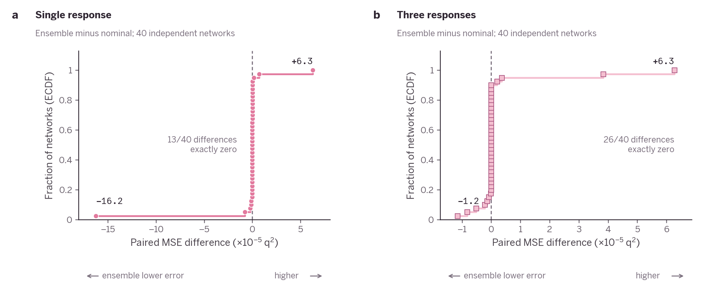

**Supplementary Fig. 1 | Complete paired primary differences.** Each panel shows all 40 independent network-level ensemble-minus-nominal raw-MSE differences for the single-response (a) and three-response (b) comparison, including exact ties and the influential networks; the step curve is the empirical distribution function and every sorted value is drawn as a marker. The horizontal axis is in units of 10⁻⁵ q²; negative values favour the ensemble. Extreme values (−16.2 and +6.3 in a; −1.2 and +6.3 in b) are labelled, not truncated. Exactly 13 (a) and 26 (b) of the 40 differences are zero. The distributions are descriptive; no interval is drawn, and the primary intervals remain those in Table 1 and Fig. 3. No equivalence margin was specified, and nothing here shows that the two selection rules perform alike.

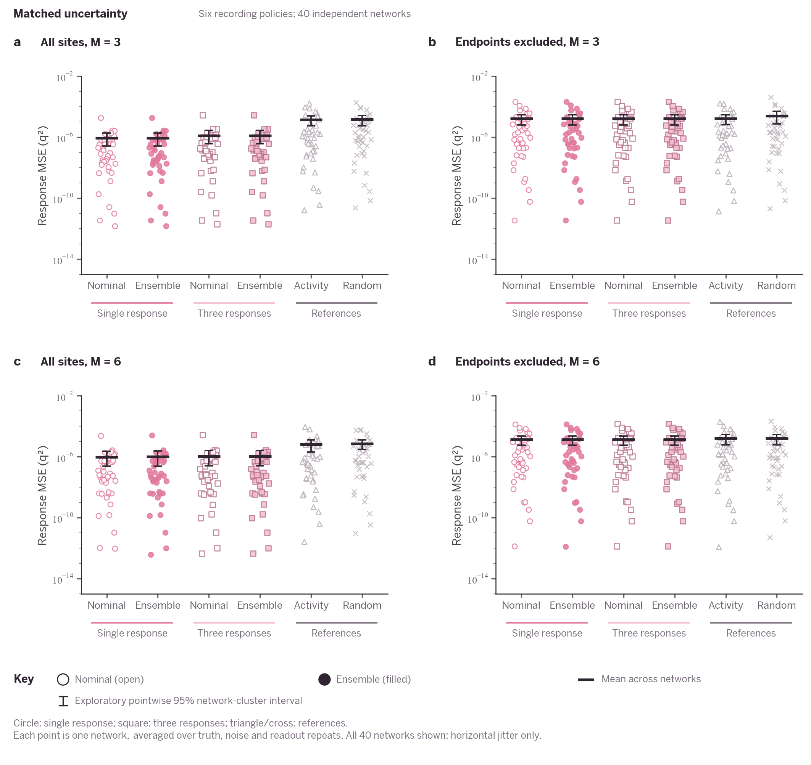

**Supplementary Fig. 2 | All recording conditions under matched uncertainty.** Panels a–d show all-site/M = 3, endpoint-excluded/M = 3, all-site/M = 6 and endpoint-excluded/M = 6. For each of six policies (nominal and ensemble single-response, nominal and ensemble three-response, activity, random) every one of the 40 independent networks is shown as one point, with truth, noise and readout repeats averaged within network. Thick black bars are the aggregate means and thin black lines the exploratory pointwise 95% network-cluster intervals from the frozen summary table. Open markers denote nominal and filled markers ensemble selection; horizontal jitter only separates overlapping points. All panels share the logarithmic response-MSE axis (10⁻¹⁵ to 10⁻²). No point or tail is removed. Intervals are not multiplicity-adjusted and no pairwise or equivalence claim is made.

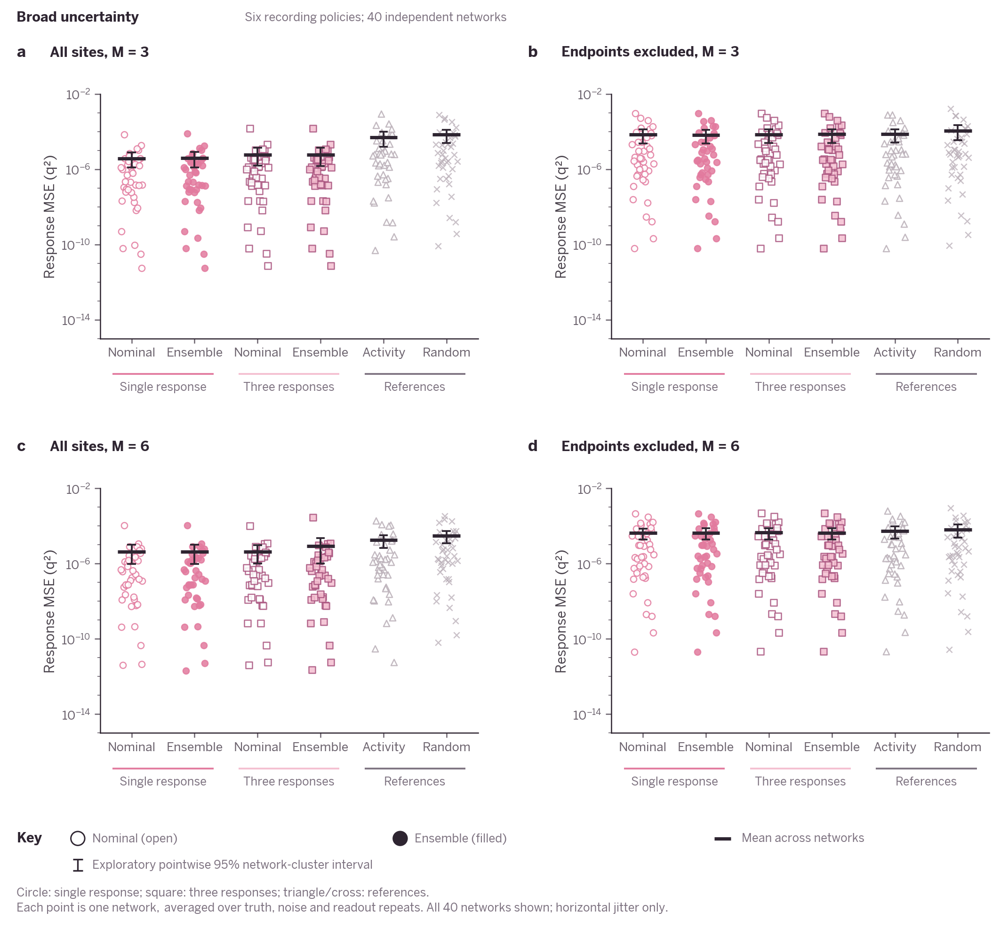

**Supplementary Fig. 3 | All recording conditions under broad uncertainty.** As Supplementary Fig. 2 for the broad prior: panels a–d show all-site/M = 3, endpoint-excluded/M = 3, all-site/M = 6 and endpoint-excluded/M = 6; 40 independent networks per policy and panel; black bars and lines are aggregate means and exploratory pointwise 95% network-cluster intervals; shared logarithmic axes; open nominal, filled ensemble; jitter is horizontal only. The primary comparison in Fig. 3 corresponds to panel b. No method-specific tail is removed, and the panels do not support any claim of equivalence or superiority.

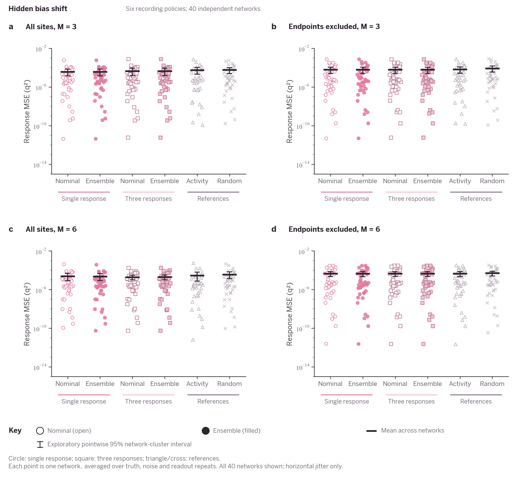

**Supplementary Fig. 4 | All recording conditions under hidden bias shift.** As Supplementary Fig. 2 for the hidden-bias-shift condition: panels a–d show all-site/M = 3, endpoint-excluded/M = 3, all-site/M = 6 and endpoint-excluded/M = 6; 40 independent networks per policy and panel; black bars and lines are aggregate means and exploratory pointwise 95% network-cluster intervals; shared logarithmic axes; open nominal, filled ensemble; jitter is horizontal only. No data are filtered, and the intervals are descriptive and not multiplicity-adjusted.

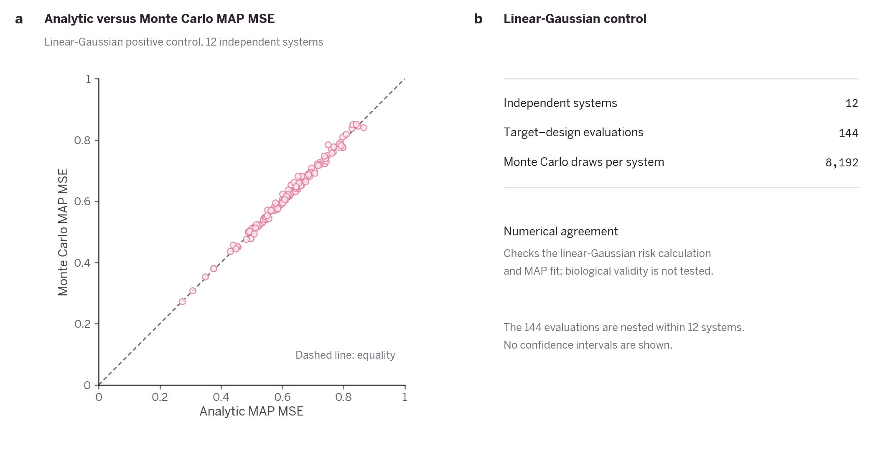

**Supplementary Fig. 5 | Nondegenerate linear-Gaussian positive control.** All 144 target/design evaluations from 12 independent linear systems compare the analytic MAP MSE (horizontal) with the Monte Carlo MSE from 8,192 draws per system (vertical); the dashed identity line is the analytic reference. The independent unit is the system (n = 12); the 144 points are evaluations within systems, not independent neural networks, and no confidence intervals are displayed. Agreement validates this computational special case only; it does not validate biological assumptions.

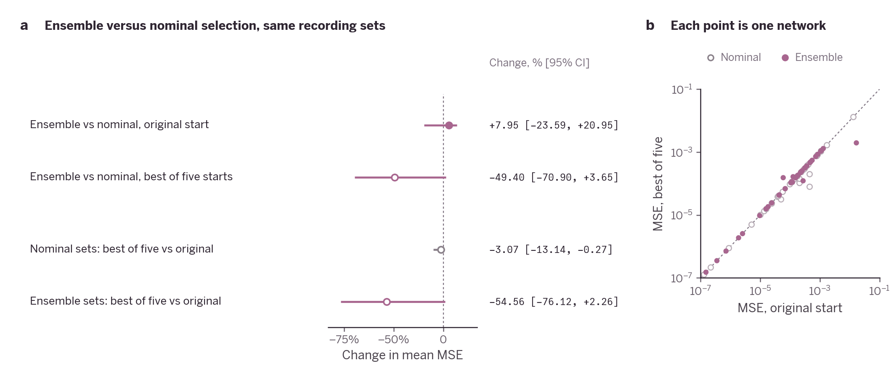

**Supplementary Fig. 6 | Fitting sensitivity in the primary 100-unit condition.** Recording sets are fixed; both selectors receive the same five-start rule and retain the smallest MAP objective. Forty previously evaluated networks; retrospective sensitivity analysis.

### Additional indirect-recording comparison

The held-out-prior versus nominal response-MSE change was -3.48% (95% CI -34.14% to +26.28%). The prespecified comparison did not establish an improvement from the held-out-prior criterion. The internal covariance criterion versus nominal gave -22.77% (95% CI -52.62% to -5.70%); prior-averaged local risk versus nominal gave -13.56% (95% CI -46.73% to -3.90%). All policies used the same budget and inference rule. The covariance-versus-ensemble comparison gave -10.65% (95% CI -18.73% to +3.93%); covariance versus random recording gave -5.50% (95% CI -24.37% to +1.72%). In the retrospective optimization sensitivity check, covariance versus nominal gave -11.50% (95% CI -17.17% to +15.04%). These tests concern an application of established covariance and predictive-validation ideas, not a new general experimental-design principle.

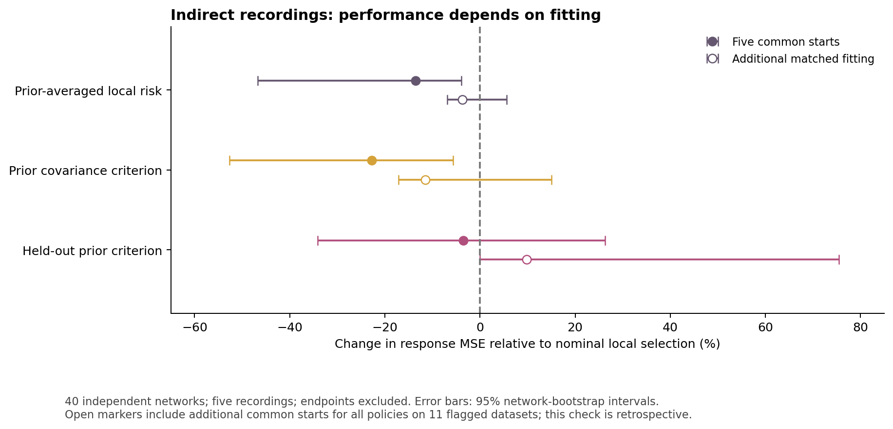

**Supplementary Fig. 7 | Indirect-recording criteria on forty independent networks.** Points and intervals show paired mean-MSE changes and 95% network-bootstrap intervals relative to nominal local selection. Filled markers use five common starts; open markers include additional matched fitting for all policies on eleven flagged datasets. The original held-out-prior comparison is primary; other comparisons and the fitting sensitivity check are exploratory.

### Limited-budget recording comparison

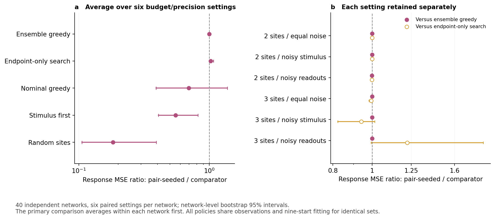

**Supplementary Fig. 8 | Endpoint-pair search under limited budgets and unequal precision.** **a,** Aggregate MSE ratios compare pair-seeded selection with five alternatives, after averaging equally over two budgets and three noise settings within each of forty independent networks. **b,** Separate settings compare the candidate with ordinary ensemble greedy selection and exact endpoint-only subset enumeration. The aggregate comparison against ensemble greedy is primary; individual settings and other comparisons are secondary. Identical recording sets reuse the same observations and fitted solution. Intervals are pointwise 95% paired network-bootstrap intervals. All selected fits terminated successfully and passed the known-feasible objective check. Shared prior-bank construction is separate from selection: mean bank time was 18.89 s, while mean search times were 5.57 s for pair lookahead, 2.70 s for ensemble greedy, and 0.048 s for endpoint-only enumeration. These descriptive times reflect the implementation and concurrent workstation workload.

### Static combination controls

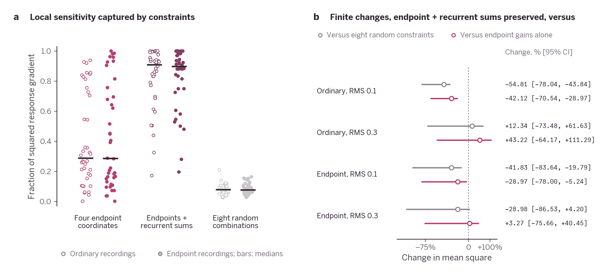

**Supplementary Fig. 9 | Local sensitivity and finite changes preserving gain combinations.** **a,** Fraction of squared response-gradient norm projected onto four endpoint coordinates, endpoint coordinates plus four recurrent combinations, or eight random linear combinations. Dots are independent networks and horizontal marks are medians. **b,** Mean squared response changes after equal-norm parameter perturbations preserve the eight endpoint/recurrent combinations, relative to perturbations preserving eight random combinations or endpoint gains alone. Parameter RMS changes are expressed in prior standard deviations. All forty new networks and both perturbation sizes are retained. Intervals resample networks at the 95% level; the interventions preserve the specified parameter combinations and do not impose a calibration-fit constraint.

### Acquiring recurrent information from recordings

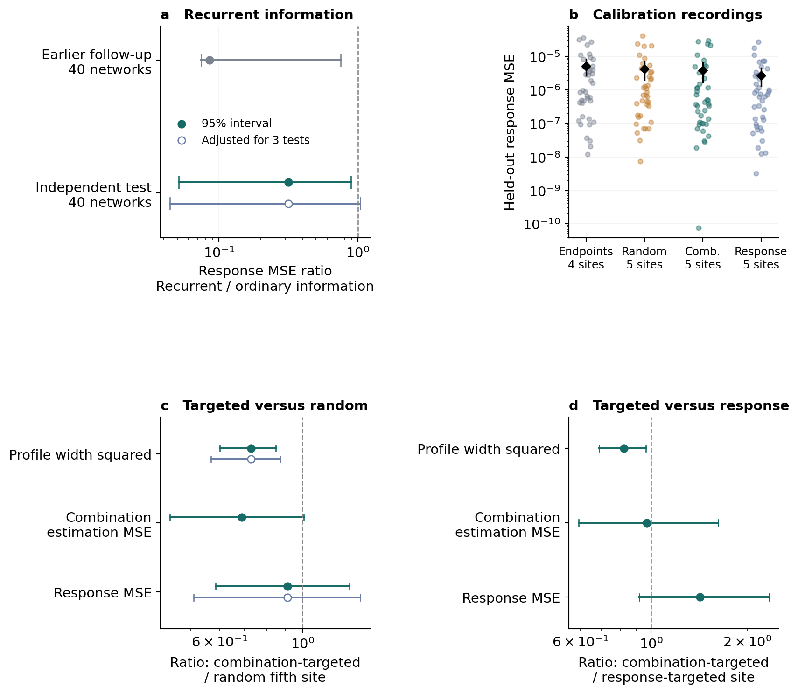

**Supplementary Fig. 10 | From parameter information to calibration recordings.** **a,** Response MSE after revealing endpoint gains plus recurrent combinations, relative to revealing the same endpoints plus four ordinary gains. The earlier forty-network follow-up and independent forty-network confirmation are shown separately. **b,** Prediction errors from actual calibration observations on the new networks. All five-site policies include the four endpoints; the additional site is random, combination-targeted or response-targeted. The four-endpoint condition uses one fewer recording. Dots denote networks; diamonds and bars denote means and 95% network-bootstrap intervals. **c,** Combination-targeted versus random fifth-site recording. The profile follows one recurrent direction fixed from the public prior before calibration outcomes; its squared width measures the searched range under a common MAP-objective allowance. Combination estimation error uses four orthonormal internal coordinates. **d,** The same metrics compared with selection by the original response-risk criterion. Dark bars in a, c and d are paired 95% intervals; open markers show Bonferroni intervals for the three primary comparisons: the new oracle response-MSE contrast, and the profile-width and response-MSE contrasts in c. Other comparisons are secondary. The information and recording experiments share the new cohort.
