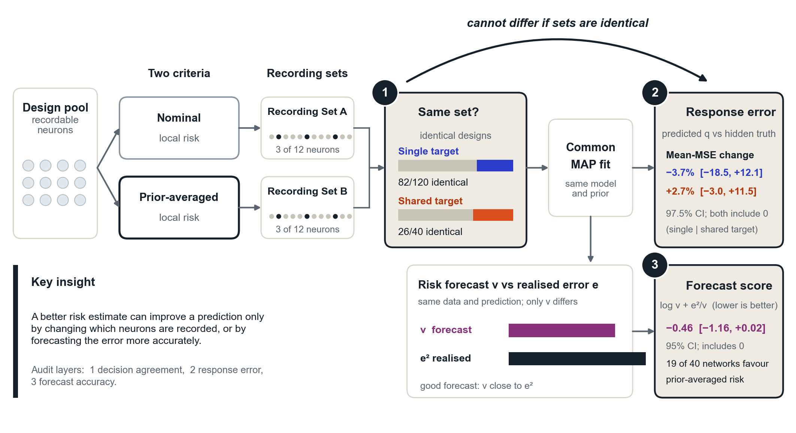
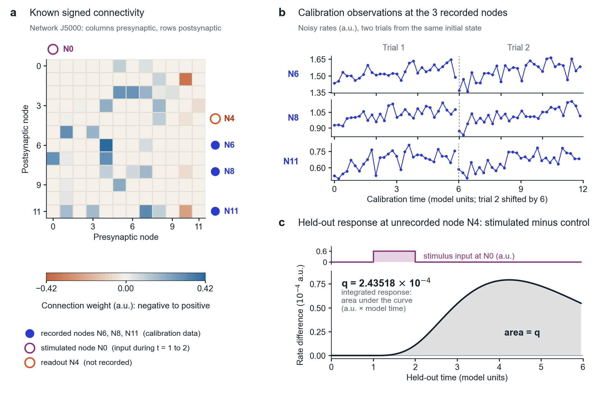
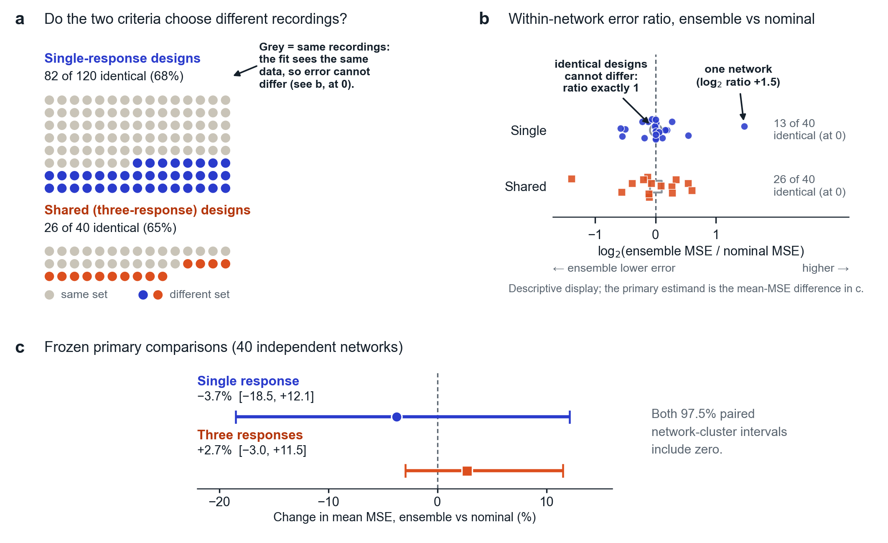
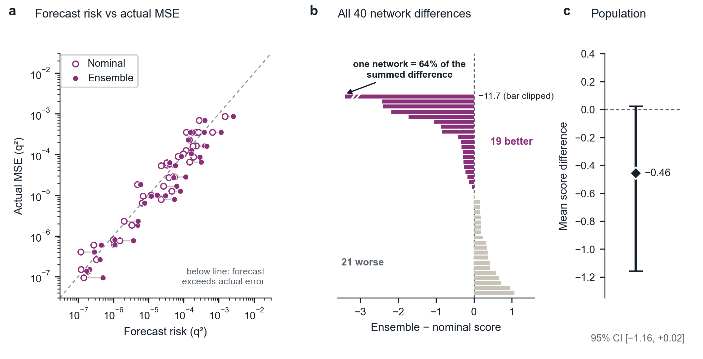
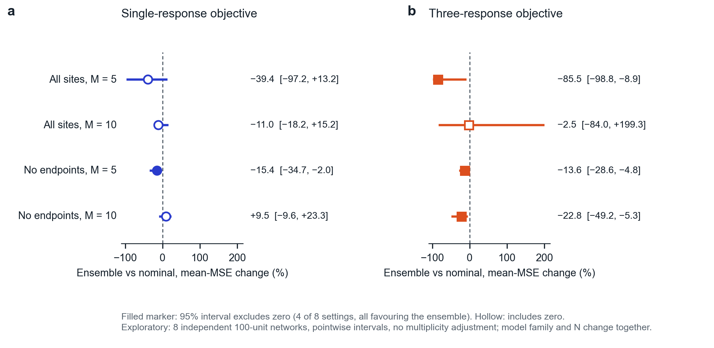
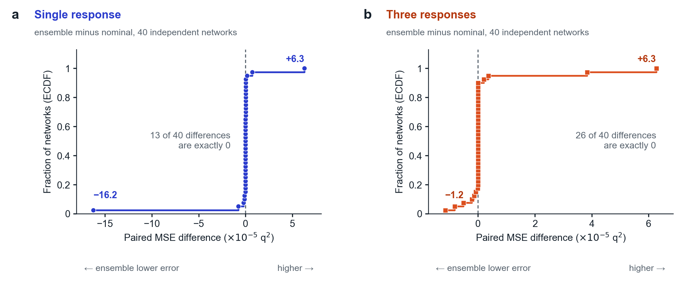
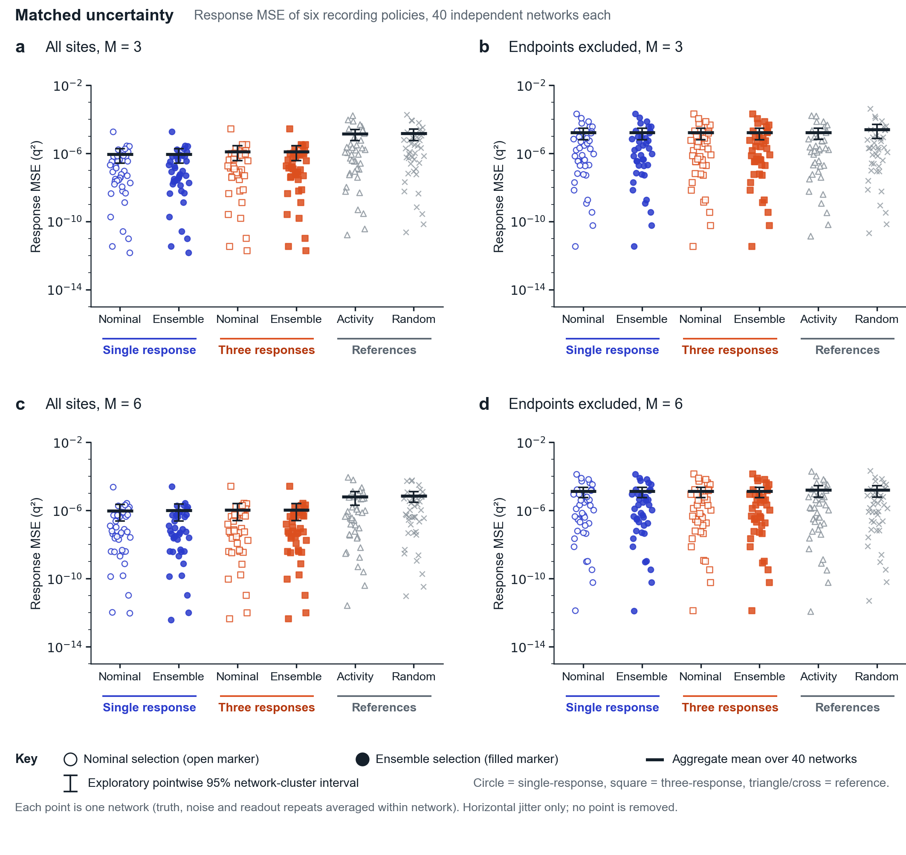
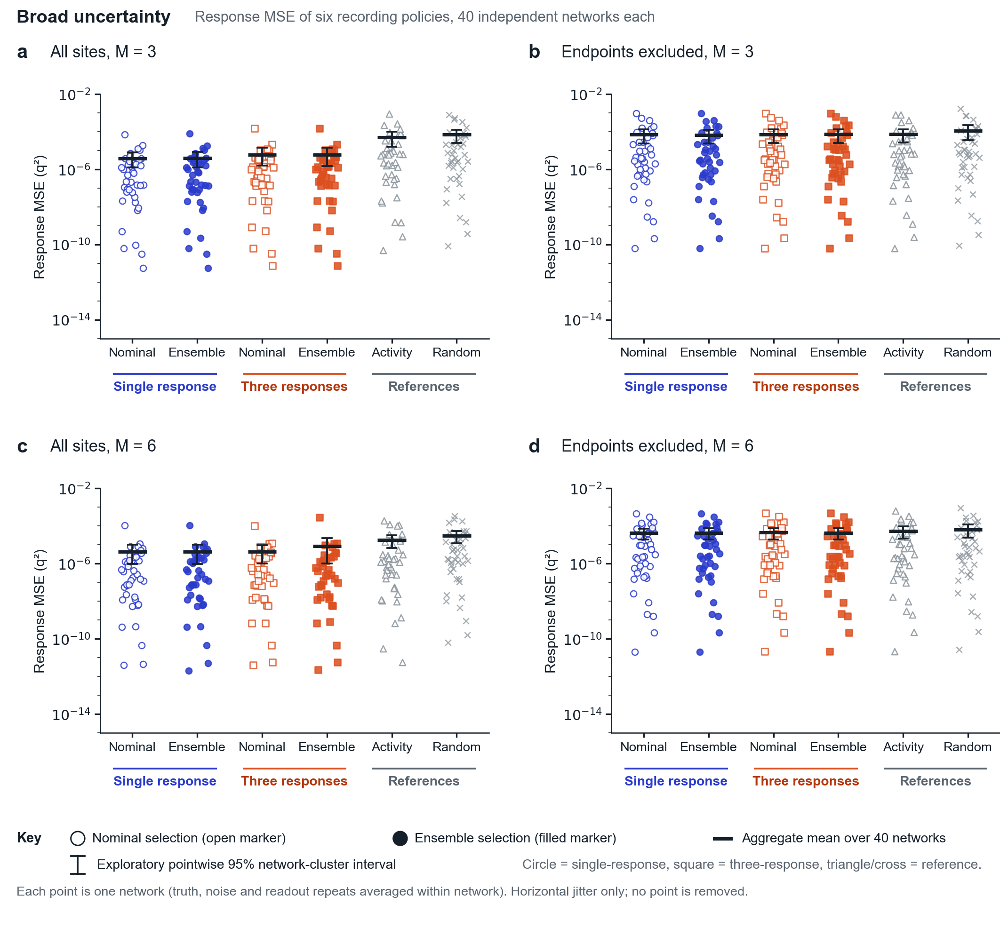
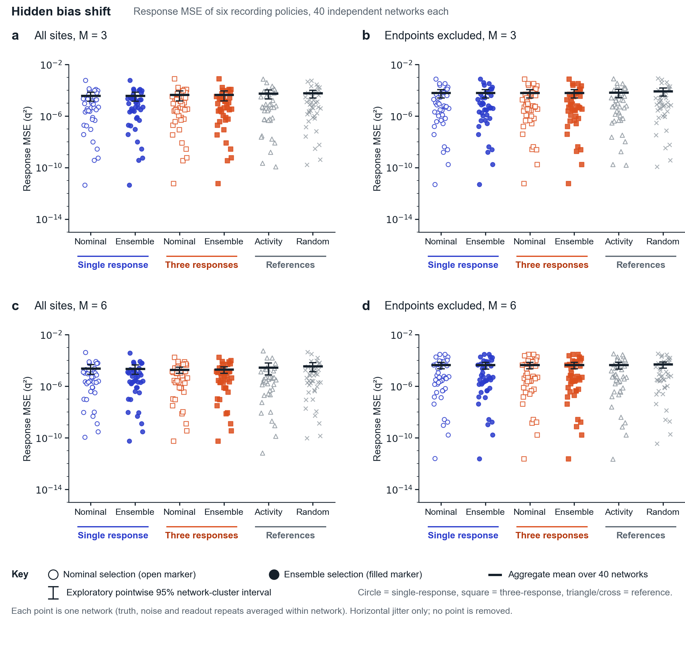
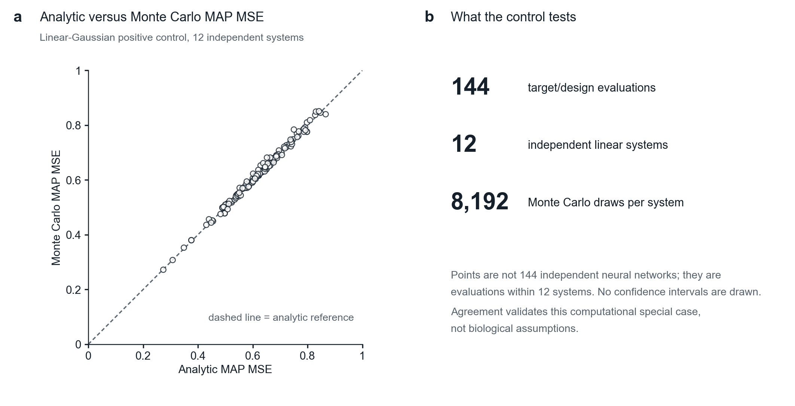

# Predictive Risk and Recording Decisions for Stimulus-Response Estimation in Partially Observed Neural Networks

Jiayi Du¹*† and Shuaizhi Cheng²†

¹ Stiftung Louisenlund, Germany. ² Department of Computing, Harbin Institute of Technology, China.

† These authors contributed equally. * Correspondence: jiayi.du@mail.louisenlund.de.

*Research manuscript v4, 17 October 2026. All data are simulated. v4 changes the organisation, framing and figures; every number is a frozen v2 estimate or a count taken from the frozen records.*

## Abstract

Neural interfaces in biohybrid systems use stimulation and recording to interact with living networks. Under a limited recording budget, choosing where to record becomes part of predicting a specified stimulus response. Goal-oriented design ranks recording sets by their estimated prediction error. We test whether averaging local risk over a parameter prior improves the resulting response prediction or the accuracy of the risk estimate itself.

We compared single-response and shared three-response objectives, each using a nominal-parameter or prior-averaged risk criterion, in simulated 12-unit networks with known connectivity and uncertain neuronal gains and biases. The target was the time-integrated difference between stimulated and control activity. All methods used the same feasible recording sites, measurement budget and maximum a posteriori estimator. The primary evaluation used 40 independent networks under broad, correctly specified parameter uncertainty, with three recorded neurons and stimulation and readout sites excluded. Each network was simulated with several parameter draws, noise draws and readouts; networks were the unit of analysis.

Compared with the nominal criterion, prior averaging changed aggregate mean squared response error by -3.74% for the single-response objective (97.5% paired network-cluster confidence interval, -18.48% to 12.12%) and +2.69% for the three-response objective (-2.95% to 11.51%). Both confidence intervals included zero. The two criteria selected identical recording sets for 82 of 120 target-specific designs (three per network) and 26 of 40 shared designs. To evaluate risk estimates independently of recording selection, a separately specified study used 40 new networks with recordings, data and point predictions held fixed. The primary ensemble-minus-nominal score difference was -0.45565 (95% confidence interval, -1.15857 to 0.02367), using log(v) + e²/v, where v is the estimated mean squared error and e is the response prediction error. Nineteen of 40 networks favoured the ensemble forecast, one network supplied about 64% of the summed difference, and the nominal forecast risk was closer to the actual error in aggregate.

In an exploratory extension to eight independent 100-unit rank-two networks, four of eight settings had 95% intervals that excluded zero, all favouring prior averaging; none excluded zero in the other direction, and one setting reversed in sign. Under the shared fitting procedure, prior averaging can affect response prediction only by changing which neurons are recorded.

## Key points

- **Decisions.** The nominal and prior-averaged criteria chose identical recordings in 68% (82/120) of single-target designs and 65% (26/40) of shared designs, so a gain can arise only in the remaining designs.
- **Error and forecast.** The two frozen primary comparisons and the primary forecast comparison all have intervals that include zero. In this simulated setting the shared-objective interval does not extend below a reduction of about 3% (approximate, heavy-tailed data); the single-response interval is too wide to exclude either a gain or a loss. The forecast mean is driven by one network.
- **Conditional signal.** In an exploratory 100-unit family (n = 8 networks, no multiplicity adjustment) four of eight settings favoured prior averaging with intervals excluding zero and one reversed in sign: a hypothesis for a confirmatory study, not a result.
- **What transfers, and limits.** A three-step audit (decision agreement, response error, forecast accuracy), numerical controls and a proposed confirmatory test. Simulation only, with known connectivity and a correct observation model.

## Contents

Introduction · Results (study design and information budget; recording decisions; risk-forecast study; larger model family; approximation diagnostics) · Discussion (limitations; implications and evidence ledger; scaling and next studies) · Conclusions · Methods · Data and code availability · References

## Introduction

<!-- I1 -->
A recording set should be judged by how well its data support the intended prediction. Biohybrid robots translate optical inputs into motion through directly stimulated muscle or an intervening neuromuscular interface [1,2] (reviewed in [26]), and earlier neuromuscular bots coupled cultured neurons to muscle tissue [27]; cultured neural networks also support decoding of responses to patterned electrical inputs [3], and closed-loop use of cultured networks through a small electrode set has a longer history [28]. These systems motivate a task-specific view of neural measurements, although a neural response is not itself a mechanical output. The inference may concern population activity or the response of a readout to a planned stimulus, and under a limited recording budget these tasks value the same observation differently. A recording-design evaluation must therefore connect the design criterion to the prediction made from the selected data. This paper studies that connection in simulation only: the networks are generic rate models, not a model of any biohybrid platform.

<!-- I2 -->
Connectivity constrains neural dynamics but does not fix all neuronal properties. Different circuit parameters can produce similar activity [4], and models in systems biology show a related pattern in which many parameter combinations are weakly constrained by data although some predictions remain well constrained [29]. Connectome-constrained modelling makes this ambiguity explicit: Beiran and Litwin-Kumar study activity prediction with fixed connectivity, uncertain physiological parameters and partial recordings, including the selection of recording sites [5]. Lappalainen and colleagues combine anatomical structure, simplified dynamics and task optimisation to predict responses in the fly visual system [6]. Both studies lay the foundation for asking how a restricted set of measurements constrains a functional prediction. To our knowledge, neither audits whether a costlier, prior-averaged criterion changes the selected sites or improves the prediction made from them. This paper tests that question.

<!-- I3 -->
Validation must target the held-out response. Channel selection in brain-computer interfaces is usually posed as choosing channels that maximise decoding performance on recorded data [30]; here the choice is made before recording, from a model. Even high-density probes expose more sites than can be read out at once [31], so a choice of recorded sites is still required; biohybrid preparations may be more restricted. Sensor-selection studies in nonlinear networks distinguish structural observability from the practical accuracy of state estimation [7], and budgeted sensor placement is commonly solved by greedy selection with guarantees for suitable objectives [25]. These works treat the selection problem well, but the guarantees concern the selection objective, not the error of a response predicted after fitting. Agreement with the activity used for fitting does not by itself establish accuracy for an unobserved perturbation. Sourmpis and colleagues use perturbation outcomes to assess neural models and the contribution of biological constraints [8]. Here we fix the stimulation protocol and ask which calibration recordings support its response prediction. The variable being designed is the recording set, rather than the stimulation input, which has its own experimental-design literature [9,32].

<!-- I4 -->
Bayesian experimental design values observations by the expected utility of the resulting inference [18,24], and goal-oriented variants value them according to a quantity of interest [10]. A nominal-parameter approximation is inexpensive; averaging local criteria over a parameter ensemble, as in related designs, accounts for variation in sensitivities [21], while more complete nonlinear approaches address a broader inference problem [11,19,20,22]. These designs refine the risk, but local sensitivity-based risk need not track the error of a nonlinear response predicted after fitting. Two benefits must be distinguished: forecasting the prediction error more accurately than the nominal risk, and changing the selected observations enough to reduce that error. A revised risk estimate can leave the recording set unchanged. Conversely, a design specialised for one known readout can outperform a shared design through task specialisation alone. The study therefore compares criteria that differ in only one of these two choices. Hypothesis: prior averaging improves response prediction or the forecast accuracy of the risk; both routes require that the prior-averaged criterion differ from the nominal criterion in the recordings it selects or in the forecast it reports. The key insight is that a risk criterion can change a prediction only through the recordings it selects or through the forecast it reports, so each route can be audited separately.

<!-- I5 -->
A controlled computational study evaluates both routes. Scalar and vector response objectives are crossed with nominal and prior-ensemble local-risk criteria, using the same model information, feasible recording pool, measurement budget and estimator. The evaluation has three layers: whether the criteria choose different recordings, whether the response error of the fitted prediction differs, and whether the prior-averaged risk forecast is more accurate than the nominal forecast for a fixed prediction. The first frozen study tests actual response error in 40 independent networks. An independently specified follow-up evaluates risk forecasts on 40 new networks while holding the data and point predictions fixed. Numerical controls and a larger published model family examine implementation and modelling boundaries. The main finding is that prior averaging often leaves the recording decision unchanged; the primary error and forecast comparisons remain uncertain, and the extension identifies settings in which a benefit may exist.

<!-- I6 -->
The paper makes three contributions. First, a factorial comparison, response objective crossed with risk approximation under one information budget, that keeps task specialisation apart from uncertainty handling. Second, a three-step audit of a recording criterion: how often it changes the recording decision, whether the response error of the fitted prediction changes, and whether the prior-averaged risk forecast is more accurate than the nominal forecast on a fixed prediction, scored with a rule that is consistent for the mean squared error (Box 1). Third, an empirical finding for prior-averaged local risk: it usually selects the same recordings and shows no clear gain in error or forecast accuracy in the primary condition, with a conditional signal in a 100-unit family. The numerical controls, frozen protocol, source tables and validation script support reproduction, and the exploratory signal is turned into a concrete confirmatory hypothesis with planning caveats (Discussion, “Scaling and next studies”).

## Results

### A common information budget separates the prediction objective from the risk approximation

<!-- R1 -->
The simulated networks have known numerical connectivity J and uncertain neuronal gains and biases (symbols in the Notation table, Methods). Calibration data were generated from a limited set of nodes; the evaluation target was the time-integrated response to a separate fixed stimulus, relative to an unstimulated control (Fig. 2). Three readouts were chosen using structural reachability before generating physiological parameters or measurement noise. The scalar objective specialised its recording set for one readout, whereas the vector objective used one set for the same three-response family. This construction separates task specialisation from the comparison between nominal and ensemble risk. Throughout the Results, "single-response" (scalar) and "shared" (three-response, vector) name the two objectives; the abbreviations LS, ES, LV and EV, defined in Methods, combine objective and risk criterion.

<!-- R2 -->
Box 1 and Fig. 1 summarise the audit. All methods fitted the selected observations with the same Gaussian MAP estimator and predicted the response by nonlinear simulation. The principal candidate pool excluded the stimulation site and all three readouts, preventing direct endpoint recording. All-site recording and a larger budget were retained as additional conditions. Exact dataset reuse avoided redundant fits when methods selected identical nodes; no observations from different scalar designs were pooled. Box 1 (below) defines the three-step audit that structures the Results: Decision, Error and Forecast.

**Box 1 | Three-step audit of a recording criterion.** Inputs: a design pool, a budget M, a stimulus and target q, an estimator, and two criteria A (nominal) and B (prior-averaged).
1. *Decision.* Select a recording set with each criterion. If the sets are identical the fitted data, predictions and errors are identical, so only the remaining designs can differ.
2. *Error.* For designs whose sets differ, fit with the common estimator and compare the response error of the prediction against hidden truth, paired by independent network, with a cluster-bootstrap interval.
3. *Forecast.* Fix the recording set, data and point prediction; compare the two risk forecasts of the error with a score that is minimised at the true mean squared error, again paired by network.

Report agreement counts, intervals read as approximate bounds, and the influence of the largest single network.

**Fig. 1 | The three-step audit.** Two criteria, nominal and prior-averaged local risk, each select a recording set from the same design pool. Step 1 asks whether the two sets are identical; if they are, the common maximum a posteriori fit sees the same data and the response error cannot differ. Step 2 compares the response error of the fitted prediction against hidden truth (mean-MSE change with the 97.5% interval for the single-response and shared objectives; both intervals include zero). Step 3 fixes the data and the point prediction and compares the two risk forecasts v of the error e with the score log v + e²/v (95% interval includes zero). The counts, effects and intervals are those of Figs. 3–4 and Table 1; the dot and bar icons for the recording sets and for v and e² are illustrative and carry no data. Negative differences favour the prior-averaged criterion.

**Fig. 2 | Connectivity, limited recordings and a held-out response in one simulated network.** **a,** Known signed connectivity J for the first frozen network, J5000 (blue positive, orange negative weights; symmetric colour limits ±0.42 around exact zero); columns are presynaptic and rows postsynaptic nodes. Filled markers beside the matrix identify the recorded nodes N6, N8 and N11, the open vermilion marker the unrecorded readout N4, and the open plum marker the stimulated node N0. **b,** Actual noisy calibration observations at the three recorded nodes in two trials, each reset to the same known initial state (Gaussian observation noise SD 0.05, stride 4). Trial 2 is shifted by 6 model-time units for display; the dashed line marks the trial boundary, not continuous evolution, and lines connect observations only within a trial. Vertical scales differ between nodes. **c,** Stimulated minus matched zero-input control rate at N4 (displayed in units of 10⁻⁴); the upper strip shows the stimulus input at N0 during model time 1 to 2. The integrated response q = 2.43518 × 10⁻⁴ (a.u. × model time) is Δt times the sum of the 120 frozen-model differences (Δt = 0.05), not a new trapezoidal integral. The case is the fixed first-index instance (broad uncertainty, truth and noise draw 0, target 0, endpoints excluded, M = 3, nominal single-response selection), chosen before its effect was inspected. Independent n = 1 network; no interval is shown and no between-method effect or biological validity is claimed. All quantities are in dimensionless model units.

<!-- R3 -->
Before the methods were compared, the code was checked against an independent implementation and a linear-Gaussian case with a known answer. An independent rate/sensitivity implementation agreed within approximately 3.4×10⁻¹⁶, and finite differences supported the analytic derivatives. A nondegenerate linear-Gaussian positive control gave identical nominal and ensemble designs in all 48 design pairs; analytic prediction risk agreed with Monte Carlo MAP error across 144 target/design evaluations (Supplementary Fig. 5). A separate additive-bias control produced the expected zero derivative of the paired stimulus response. These checks validate specific computational operations, rather than biological assumptions.

### Prior averaging often selects the same recordings and did not establish lower error in the primary comparisons

<!-- R4 -->
The Decision and Error steps of Box 1 apply to the first frozen evaluation, which used 40 independent J matrices, with three physiological truths, three noise repetitions and three readouts nested within each network. The primary condition combined broad matched uncertainty, excluded endpoints and a budget of three recorded nodes. For each method, errors were first averaged within J; mean risks and paired intervals were then calculated across networks. All fits terminated successfully, with no fallback or invalid task scale.

<!-- R5 -->
The two criteria often chose the same recordings (Fig. 2a). A descriptive readback of the frozen designs found identical recording sets in 82 of 120 target-specific designs (68%; three designs per network) and in 26 of 40 shared designs (65%). Because identical sets give identical fitted data and predictions by construction, a difference in error can arise only in the remaining designs. At the network level, the ensemble and nominal MSE were exactly equal in 39 of 80 network–objective cells (13 single-response and 26 three-response networks; Fig. 2b). This count is descriptive and was not a prespecified hypothesis.

<!-- R5b -->
The ensemble scalar design had a slightly lower mean MSE than its nominal counterpart, but the paired interval included both improvement and deterioration (Table 1; Fig. 2c). The vector comparison had the opposite point estimate and was also uncertain. Relative mean-MSE changes were −3.74% for ES versus LS and +2.69% for EV versus LV. A leave-one-network diagnostic changed the sign of the scalar mean difference when one influential network was omitted; that network remains in every primary estimate. The results do not establish a stable ensemble advantage or method equivalence.

**Table 1 | Frozen primary response-error comparisons.** Broad matched uncertainty; endpoints excluded; M=3; 40 independent networks. RMSE is the square root of the overall mean network MSE. The primary estimand is the raw paired mean-MSE difference. The relative effect is a ratio of aggregate means minus one, not an average of individual percentage changes. Each prespecified comparison uses a 97.5% paired network-cluster interval.

| Objective | Nominal RMSE | Ensemble RMSE | Mean MSE difference, E−N | 97.5% interval | Relative mean-MSE change [97.5% interval] |
|---|---:|---:|---:|---:|---:|
| Single response | 0.008312 | 0.008155 | −2.586×10⁻⁶ | [−1.471×10⁻⁵, 4.826×10⁻⁶] | −3.74% [−18.48%, 12.12%] |
| Three responses | 0.008451 | 0.008564 | 1.924×10⁻⁶ | [−1.148×10⁻⁶, 6.826×10⁻⁶] | 2.69% [−2.95%, 11.51%] |

**Fig. 3 | Prior averaging often selects the same recordings; primary error comparisons remain uncertain.** **a,** Each dot is one recording design from the frozen first evaluation (120 single-response designs, three per network; 40 shared designs). Grey dots are designs in which the nominal and ensemble criteria chose identical recording sets; coloured dots are designs in which they differed (82/120 and 26/40 identical). **b,** Descriptive within-network log₂ ratio of ensemble to nominal MSE for the 40 independent networks per objective; the hollow marker at zero stands for networks with exactly equal MSE (13 single-response, 26 three-response), and filled points are the remaining networks. Three truths, three noise repetitions and three readouts are averaged within each network. These ratios are neither the primary estimand nor the ratio of aggregate means. **c,** Relative change in aggregate mean MSE, ensemble versus nominal, with the prespecified 97.5% paired network-cluster bootstrap intervals (same estimates as Table 1). Negative values favour the ensemble. All networks, including influential instances, are retained; Supplementary Fig. 1 shows the complete raw difference distributions. No method-equivalence margin was specified.

<!-- R6 -->
Recording constraints changed the achievable error. For nominal scalar design at M=3, RMSE was 0.000929 with all sites available and 0.004046 with endpoints excluded under matched uncertainty; the corresponding broad-condition values were 0.001946 and 0.008312. These exploratory comparisons make direct endpoint access an important part of the task definition. The activity and random references, both budgets, and all uncertainty conditions are retained in Supplementary Figs. 2–4.

### A separately specified forecast test separates risk estimation from point-prediction accuracy

<!-- R7 -->
In the first study, an exploratory aggregate comparison suggested that ensemble risk could match actual error better than nominal risk does, even when it did not improve the selected recordings. At the primary nominal scalar recording set, actual MSE divided by nominal forecast risk was approximately 1.615; the ratio using ensemble forecast risk was 1.103. Such a ratio does not establish forecast accuracy across networks. The Forecast step of Box 1 therefore became a separate test, specified by us, using 40 new J matrices, fixing the recording policy, selected data and fitted point predictions while comparing the two risk forecasts.

<!-- R8 -->
The primary ensemble-minus-nominal MSE-forecast score difference was −0.45565 (95% paired-cluster interval, −1.15857 to 0.02367; Fig. 4). Nineteen network means favoured the ensemble forecast and 21 favoured the nominal forecast. The shared point predictions had MSE 1.1781×10⁻⁴, so no point-prediction improvement can be attributed to changing the forecast alone. The interval does not establish a stable forecast-score gain. The mean is also dominated by one network: its score difference of −11.67 accounts for about 64% of the summed differences, and the mean of the other 39 is −0.17. In aggregate, the nominal forecast risk (1.19×10⁻⁴) was closer to the actual MSE (1.18×10⁻⁴) than the ensemble forecast risk (1.92×10⁻⁴), so this study does not show that the ensemble forecast is better calibrated than the nominal forecast. The exploratory aggregate hint from the first study (ensemble ratio 1.10 against nominal 1.62) therefore did not replicate. No fit failures, fallbacks or forecast-floor clipping occurred.

<!-- R9 -->
A secondary hidden-bias-shift comparison favoured the ensemble forecast by −1.3583 score units (pointwise 95% interval, −2.2143 to −0.6345). Both mean risk forecasts nevertheless remained below actual MSE in that condition. This result describes a relative forecast improvement in one secondary setting; it does not show that the hidden shift was learned or that uncertainty was fully calibrated.

**Fig. 4 | Risk forecasts are evaluated on identical predictions.** The independent follow-up uses the nominal scalar recording policy, broad matched uncertainty, excluded endpoints and M=3 in 40 new networks. **a,** Nominal (open) and ensemble (filled) mean forecast risks are paired with the same actual mean response MSE for each network; horizontal segments link the two forecasts. Axes have identical logarithmic ranges and a dashed identity line; points below the line have a forecast that exceeds the actual error. This network-aggregate comparison is descriptive, not a stand-alone calibration test. **b,** All 40 network-level score differences, sorted; 19 favour the ensemble forecast (purple) and 21 the nominal forecast (grey). One bar (−11.7) is clipped at the axis limit and labelled. **c,** The mean score difference with the prespecified 95% paired network-cluster interval. Panels b and c use different horizontal and vertical scales because individual differences and uncertainty about their mean are distinct statistical objects. Scores S(v,e)=log(v)+e²/v are computed for individual target/truth/noise cases and then averaged within network; they are not scores of the aggregate coordinates in a. Negative differences favour the ensemble. The score evaluates an MSE functional, not a complete predictive distribution.

### A larger model family suggests condition-dependent effects, several favouring prior averaging

<!-- R10 -->
An exploratory extension used eight independent 100-unit rank-two tanh networks from a published mathematical family [5], with explicitly adapted calibration inputs and measurement noise. A coarse first implementation failed convergence checks and was replaced by a refined, independently verified integrator (Methods). The complete refined experiment required 1,436 MAP calls and 693.1 seconds of core runtime, with successful termination throughout.

<!-- R11 -->
Ensemble designs had lower exploratory mean-MSE estimates than nominal designs in several extension settings, but the direction depended on objective and budget (Fig. 5). Of the eight prescribed settings, four had 95% intervals that excluded zero, and all four favoured the ensemble: the shared objective with all sites and M=5 (−85.51%, −98.81% to −8.92%), the single-response objective with endpoints excluded and M=5 (−15.38%, −34.66% to −2.00%), and the shared objective with endpoints excluded at M=5 (−13.56%, −28.56% to −4.78%) and M=10 (−22.84%, −49.24% to −5.33%). No interval excluded zero in the opposite direction, but the single-response point estimate reversed at M=10 with endpoints excluded (+9.45%, −9.56% to 23.28%). With only eight independent networks, unadjusted pointwise intervals, and simultaneous changes in model family, dynamics and parameter coordinates, the extension describes conditional behaviour and motivates a confirmatory study; it is neither an N-only scaling effect nor a replacement for the primary study.

**Fig. 5 | Selection effects in the exploratory model-family extension.** Relative mean-MSE changes for single-response (a) and three-response (b) objectives in eight independent 100-unit networks. Two physiological truths, two noise repetitions and three readouts are nested within each network. Markers show the ratio-of-aggregate-means effect and lines the pointwise 95% paired network-cluster interval; filled markers denote intervals that exclude zero (four of eight settings, all favouring the ensemble). Both panels share the same effect scale; all eight prescribed settings are retained, with numerical values printed beside each interval. Negative values favour ensemble design. These comparisons are exploratory and not multiplicity-adjusted. The model family and several dynamical assumptions change together with N.

### Approximation diagnostics constrain the interpretation

<!-- R12 -->
Development-only diagnostics measured local Taylor remainders and selection overlap. Mean calibration remainders relative to parameter-induced activity changes were approximately 0.179 under matched uncertainty, 0.334 under broad uncertainty and 0.252 under hidden bias shift. Broader uncertainty changes signal scale and parameter variability as well as nonlinear behaviour, so these differences do not isolate a curvature effect. Local and ensemble sets frequently overlapped. When sets were identical, the fitted data and response predictions were identical by construction, limiting any decision benefit of a changed risk value in those cases.

<!-- R13 -->
The matched and hidden-shift conditions used the same public prior and therefore produced exactly the same prospective designs, despite different true responses. This is an information boundary: without a preliminary measurement, the selector cannot infer an undisclosed physiological shift. In the first frozen evaluation, approximate 95% local MAP response intervals for the nominal scalar estimator covered the truth with proportions 0.930, 0.919 and 0.793 for matched, broad and shifted conditions, respectively, at excluded endpoints and M=3. These diagnostics identify limitations of the current information and approximation contract; they do not establish a single biological mechanism for the observed errors.

## Discussion

<!-- D1 -->
Prior-averaged local risk usually selects the same recordings as the nominal risk, so in those designs it cannot change the prediction. In the remaining designs, neither a lower response error nor a more accurate forecast than the nominal criterion is established. The three-step audit therefore shows cheaply whether a costlier criterion is worth adopting.

This study separates the value of a risk estimate from the value of the decision made with it. In the primary model, prior-averaged local risk usually led to the same recordings, and where it did not, it did not establish lower response error for either prediction objective. The separately specified forecast study also left its primary improvement uncertain. The larger model family produced favourable effects in four of eight exploratory settings and a reversal in another. Together, these results argue for evaluating a recording criterion through the complete inference task, including the estimator and feasible observation pool, rather than assuming that a broader risk approximation necessarily improves the final prediction. They also suggest a practical check, supported here only for a 12-unit model under the primary condition: before paying for a more elaborate criterion, measure how often it changes the design.

<!-- D1b -->
A non-significant interval is more informative when read as an approximate bound than as a verdict [36,37]. For the shared three-response objective, the 97.5% interval (−2.95% to +11.51%) does not extend below a mean-MSE reduction of about 3%, while it does extend to a deterioration of about 12%. For the single-response objective the interval (−18.48% to +12.12%) is too wide to exclude either a substantial gain or a substantial loss, and that comparison is where additional independent networks would be most informative. These readings are approximate: 13 and 26 of the 40 network differences are exactly zero and the rest are heavy-tailed, so percentile bootstrap intervals are not sharp, and no equivalence margin was specified in advance.

<!-- D2 -->
This comparison builds on connectome-constrained inference and goal-oriented design. Partial recordings and recording-site optimisation are already central to the former [5], while valuing observations for a specified functional is established in the latter [10]. The factorial comparison keeps the response objective fixed when assessing ensemble risk, so the familiar advantage of task specialisation cannot by itself explain that contrast. The response test also follows the purpose-matched validation principle illustrated by neural perturbation studies [8]. The present evidence concerns this particular computational comparison; it does not introduce a new optimal-design principle.

<!-- D3 -->
Local risk may differ from actual response error for three reasons. First, the criterion averages delta-method risks over a prior ensemble, whereas the evaluated predictor simulates q at a MAP parameter. Second, it does not average nonlinear posteriors over future data. Third, it does not use the posterior mean of q, the Bayes predictor for squared loss. Prediction-profile and profile-likelihood approaches in dynamic models assess uncertainty in the predicted quantity or in identifiability directly, offering a distinct alternative to local parameter approximations [12,23]. The exact linear-Gaussian control links analytic risk and MAP error under assumptions where those distinctions disappear. In the nonlinear models, measured approximation remainders and overlapping selected sets are concrete diagnostics but do not identify a single cause of the uncertain ensemble benefit. Small models with accurately integrated posteriors would offer a useful next test of approximation error versus nonlinear plug-in prediction error.

### Limitations

The decision-agreement result and the title rest on one condition: broad uncertainty, endpoints excluded, three recordings and 12 units. Agreement for six recordings, other candidate pools and the 100-unit family is left to future work. The objective contrast also changes the number of targets, and the factorial interaction was not estimated, so task specialisation is separated from uncertainty handling only in design, not in a tested interaction.

<!-- D4 -->
The study assumes known numerical J, a correct observation equation, known initial conditions and a specified stimulation action. Experimental-design studies in systems biology show that informative experiments can expose model discrepancy [13], and weakly constrained parameter directions are common in biological models [29]; structural misspecification is left to future work. There is no process noise, plasticity or biological nonstationarity. Forty independent networks quantify uncertainty for the prescribed generating distribution, not for biological networks in general. Finite ensembles, greedy selection and common-start MAP introduce additional approximation and optimisation limits; successful solver termination does not establish global optimality. The 100-unit extension remains synthetic and has only eight independent networks. Jointly mapped neural recordings and perturbations would be needed to assess external validity. Connecting the response functional to mechanical output would require a further neuromuscular validation layer, as illustrated by current biohybrid crawlers [2,27].

<!-- D5 -->
No criterion was uniformly better than the others, so each should be tested on its own task, checking both its forecasts and the recordings it chooses. The comparison sharpens the next question: which part of the risk-to-prediction chain needs a better approximation, and can improving that part change the observations enough to improve the response estimate? The 100-unit extension suggests where to look first: the shared objective, and the endpoints-excluded pool at both budgets tried (M=5 and M=10 each had a shared-objective interval excluding zero). A confirmatory study would fix those settings, the primary comparison and the number of independent networks before any outcome is inspected, and would not reuse the present networks.

### Implications for recording-design practice

**Box 2 | A practical check before adopting a costlier criterion.** (1) Compute both criteria on your design pool. (2) Count the designs with identical recording sets. (3) If agreement is high, keep the cheaper criterion unless a separate reason favours the other. (4) If agreement is low, run the error and forecast checks of Box 1 on new networks and report the intervals as approximate bounds.

**Table 2 | Evidence ledger: what each result does and does not support.**

| Claim | Evidence | Status |
|---|---|---|
| The two criteria usually choose the same recordings | 82/120 target-specific and 26/40 shared designs identical (frozen designs) | Descriptive count from frozen records |
| Prior averaging lowers response error in the primary condition | −3.74% [−18.48, 12.12] and +2.69% [−2.95, 11.51], 97.5% intervals | Not established |
| Ensemble risk forecasts score better on fixed predictions | −0.45565 [−1.15857, 0.02367]; 19 of 40 networks favour the ensemble; one network supplies about 64% of the summed difference; aggregate nominal risk is closer to actual MSE | Not established; interval includes zero and the mean is outlier-driven |
| Ensemble forecasts score lower (better) under a hidden bias shift | −1.3583 [−2.2143, −0.6345], pointwise; both forecasts remain well below actual MSE, so the score gain may reflect larger forecast variance rather than calibration | Exploratory secondary result |
| Ensemble design helps in a 100-unit family | 4 of 8 intervals exclude zero, all favouring the ensemble; one sign reversal; n = 8 | Exploratory; motivates confirmation |
| The pipeline computes what it claims | Linear positive control within 3.15 Monte Carlo SE; independent numerical checks | Supports implementation only |
| Biological or mechanical relevance | None collected | Not tested |

### Scaling and next studies

<!-- F1 -->
**Scaling in independent networks.** The primary comparisons are limited by the number of independent networks, not by computation: the 40-network evaluation took 356 s of core runtime. Planning calculations from the frozen paired differences (a planning aid, not an inference; see Supplementary Note on planning) give the number of new networks a confirmatory study would need for a chosen interval width; they are reported with the caveat that heavy-tailed differences make normal approximations optimistic. With the observed spread, a 97.5% interval whose half-width is 10%, 5% or 2.5% of the nominal mean MSE would need about 80, 320 and more than 640 networks for the single-response comparison (normal approximation: 82, 326 and 1,301), and about 40, 80 and 320 for the shared comparison (normal approximation: 14, 56 and 223). The single-response figures are dominated by one network that supplies 66% of the summed absolute differences; without it the normal-approximation requirement falls to 11, 44 and 176. The forecast score has no natural scale, so for absolute half-widths of 0.4, 0.2 and 0.1 it would need roughly 160, 640 and more than 640 networks (bootstrap). Because 13 of 40 and 26 of 40 network differences are exactly zero and the rest are heavy-tailed, these figures are optimistic and should be read as orders of magnitude (Supplementary planning note).

<!-- F2 -->
**Scaling in model size.** The exploratory 100-unit family cost about 0.48 s per MAP call (693.1 s for 1,436 calls) against about 0.009 s per call at 12 units (356.0 s for 38,610 calls), a roughly fifty-fold increase per fit for an eight-fold increase in units, even with an exact low-rank state reduction. Extrapolating from the measured per-network cost (about 87 s per 100-unit network against 9 s per 12-unit network in the first frozen evaluation), 160 and 640 100-unit networks would take roughly 3.9 and 15.4 hours on the study machine. Extending to larger connectome-scale models will therefore need cheaper sensitivities (adjoint or low-rank updates) rather than more of the same compute.

<!-- F3 -->
**A confirmatory hypothesis.** The exploratory extension points to one prespecified test: in the 100-unit rank-two family with endpoints excluded, prior-averaged local risk lowers mean squared response error for the shared three-response objective at M=5 and M=10. Two cautions apply. These settings were chosen after seeing the eight-network results, so the observed effects are likely to be overestimated, as selecting the most favourable settings after seeing the results typically does, and the planning figures above come from the 12-unit study and are precision-based, not a power calculation for this 100-unit effect; a pilot variance from new 100-unit networks would be needed first. A confirmatory study would then fix this primary comparison, the number of independent networks, disjoint network seeds, the paired network-cluster bootstrap and the decision rule before any outcome is inspected, and would record design agreement alongside error so that a null result remains interpretable.

<!-- F4 -->
**Separating the sources of mismatch.** The three possible reasons local risk can differ from actual error (delta-method approximation, plug-in prediction at the MAP point, and the effect of design selection) are separable in small models whose posteriors can be integrated accurately. Doing so would show which part of the risk-to-prediction chain deserves a better approximation, and would test posterior-based criteria, such as nonlinear expected-information designs, against the local ones under the same audit.

<!-- F5 -->
**Toward biological evidence.** External validity needs jointly mapped neural recordings and perturbations with a one-to-one unit correspondence, the data design emphasised in recent perturbation-based model evaluations [8]. Misspecified observation models, process noise, and a cost model for recording sites would turn the present controlled setting into a design tool; connecting the response functional to mechanical output in a biohybrid robot [1,2] would require a further neuromuscular validation layer.

## Conclusions

Prior-averaged local risk usually leaves the recording decision unchanged in the simulated networks studied here, and it did not establish a stable improvement in response error or in the accuracy of the risk forecast. A larger exploratory family suggests that benefits, where they exist, depend on objective and budget. Our contribution is a three-step audit (decision agreement, response error, forecast accuracy) with open data and a proposed confirmatory test; it is not a new design principle, and it has no biological validation. For interface designers the practical result is a cheap check: count how often a costlier channel-selection criterion changes the channels before adopting it. Whether this holds for living tissue is untested.

## Methods

### Notation

| Symbol | Meaning |
|---|---|
| J, N | known connectivity matrix and number of units |
| θ = (η, b) | uncertain log-gains and biases |
| M | recording budget (number of recorded neurons) |
| q, Q | specified target response and the three-response vector |
| F, H | whitened observation sensitivities and local information matrix |
| R | local delta-method risk of a recording set |
| v, e | forecast of the mean squared error and the realised prediction error |
| S(v, e) | forecast score log v + e²/v |
| LS, ES, LV, EV | nominal and ensemble criteria for the single-response and three-response objectives |

### Model, measurements and response

The primary model is

\[
\dot x=-x+Jr+u,\qquad
r_i=\exp(\eta_i)\operatorname{softplus}(x_i+b_i).
\]

N=12, x(0)=0 and J is known. The independent synthetic J matrices have 30% sparse connectivity, zero diagonal, column-wise excitatory/inhibitory signs, and spectral norm 0.65. The uncertain vector is θ=(η,b). The observation is the rate r, not the internal state x. Time and activity are dimensionless.

Two known calibration inputs apply sinusoidal probes to three channels. Euler integration uses a step of 0.05 over six time units. Sampling every fourth step yields 60 observations per recorded neuron across the two calibration trials. Measurement noise is independent Gaussian with standard deviation 0.05.

A separate fixed stimulus of amplitude 0.6 acts during time 1–2. Three readouts are selected from structurally reachable nodes using J before physiological parameters or measurement noise are generated. The target family is

\[
q_k(\theta)=\int_0^6[r_{j_k}(t;\theta,u_*)-r_{j_k}(t;\theta,0)]dt.
\]

The primary implementation evaluates this integral by the matching step-weighted (left-point) sum with dt=0.05. Q consists of these three responses. The vector criterion and primary raw-error evaluation use equal weights over the same target family. Scalar designs specialise for one known target; vector designs use one configuration for all three. No observations from separately selected scalar configurations are pooled.

Recording budgets are M=3 and M=6. The candidate pool either includes all neurons or excludes the stimulation site and all three readouts. The latter pool is shared by every target and method.

### A factorial comparison of existing criteria

In whitened parameter coordinates, the local information matrix for a recording set M at parameter particle ℓ is

\[
H_{M,\ell}=I+\sum_{i\in M} F_{i,\ell}^{T}F_{i,\ell},
\]

where F includes the observation derivatives, prior parameter scale and noise standardisation. With aₖ,ℓ denoting the whitened target gradient, the scalar criterion is

\[
R_{k,\ell}(M)=a_{k,\ell}^{T}H_{M,\ell}^{-1}a_{k,\ell}.
\]

The vector criterion averages these risks over the three readouts. Local designs evaluate at μ=0; ensemble designs average the individually solved risks over 16 common prior draws. Averaging information before solving would define a different criterion and is not used.

| Design | Predictive objective | Parameter representation |
|---|---|---|
| LS | One specified response | Nominal parameter |
| ES | One specified response | Common prior ensemble |
| LV | Three-response vector | Nominal parameter |
| EV | Three-response vector | Common prior ensemble |
| Activity | Full calibration activity | Nominal parameter |
| Random | No risk objective | Five feasible random sets |

All risk-based methods use the same greedy forward selection and deterministic tie convention. These are greedy-selected sets, not certified global optima. Random permutations give nested budgets. The design API receives only the public model, prior, inputs and task. It receives neither generating parameters nor measured evaluation outcomes. There is no uncounted all-neuron pretraining or preliminary dataset.

The ensemble criterion is a **prior average of local delta-method risk**. It does not integrate future measurements and nonlinear posteriors, establish a variance upper bound, or capture all posterior modes.

### Common inference and paired evaluation

After selection, all methods minimise the same Gaussian MAP objective, using analytic sensitivities and the prior mean as the initial parameter. The solver runs at most 80 function evaluations with identical tolerances. A finite final iterate is retained and flagged if convergence is not reached. Exceptions or nonfinite predictions trigger a flagged prior-mean fallback. No instance is silently dropped.

Within each network, true parameter vector and noise repetition, methods receive their selected subsets of one common measurement-noise field. The full field is internal to the generator. Identical recorded datasets receive the same MAP objective, prior-mean starting point, common noise field, solver settings and deterministic solver, so identical sets give identical fits and predictions by construction; they may also reuse a cached fitted solution; this changes compute accounting, not information access. Responses are predicted by nonlinear simulation at the fitted parameter. A passive input not used for fitting gives an additional activity-prediction diagnostic.

### Development and the first frozen evaluation

| Stage | Independent J | Physiological truths/J | Noise repeats/truth | Readouts/J | Conditions |
|---|---:|---:|---:|---:|---|
| Development | 8 | 2 | 2 | 3 | Matched, broad, bias shift, gain-only, bias-only |
| First frozen evaluation | 40 | 3 | 3 | 3 | Matched, broad, bias shift |

Matched and broad conditions use correctly specified Gaussian priors and generating standard deviations 0.18 and 0.35 respectively. Bias shift retains the design prior at 0.18 while adding 0.5 to the hidden true bias mean. The method is not informed of this shift. Development gain-only and bias-only conditions fix the other parameter group. Increasing a prior scale changes parameter variability, signal scale and nonlinearity together; it is not an isolated curvature intervention.

Connectivity, truth, noise, design ensembles, task-scale Monte Carlo, random sets and analysis use separate seed namespaces. The first evaluation uses network IDs 5000–5039, disjoint from development. The execution protocol and computational source were locally frozen before outcomes were inspected. This is not external preregistration.

### Estimands and uncertainty

For each J, squared response errors are averaged across all prescribed truths, noises, targets and random-design repetitions. Network risks are then averaged equally across J. RMSE is the square root of the overall mean squared error. Repeated targets or noises do not create additional independent networks.

Interval key: 97.5% intervals belong to the two prespecified first-study comparisons, the 95% interval to the single prespecified forecast comparison, and all other intervals are pointwise 95% and exploratory. Two prespecified primary comparisons, ES−LS and EV−LV, concern broad uncertainty, excluded endpoints and M=3. The paired network-cluster percentile bootstrap [38,39] uses 10,000 resamples of whole networks, so repeated targets and noises do not count as independent. Each primary comparison receives a 97.5% interval as a two-comparison Bonferroni interval arrangement. Other strata, task-specialisation comparisons and factorial interactions have exploratory pointwise 95% intervals. We do not infer equivalence from an interval crossing zero [36,37].

The primary scale is raw response MSE. A secondary scale uses an independent common 64-draw nonlinear prior-Monte-Carlo variance. It is not method-specific. Prescribed targets below a frozen variance floor of 10⁻¹⁶ retain raw results; a complete standardised estimand is NA rather than silently excluding them. Local MAP intervals are approximate diagnostics, not guaranteed confidence intervals.

### Separately specified risk-forecast follow-up

The first study distinguishes selection gains from apparent risk-estimation differences only exploratorily. A subsequent protocol therefore uses new network IDs 6000–6039 and fixes the recording policies to LS and LV. The point predictions and selected data are identical for the two risk forecasts being compared. The forecasts are the nominal and ensemble local risks evaluated at that same recording set.

The risk-forecast score is

\[
S(v,e)=\log v+e^2/v,\qquad v=\max(\hat R,10^{-24}).
\]

For positive v, its conditional expectation is minimised at v=E[e²]. This makes it a consistent score for a positive MSE forecast; it does not establish a full predictive distribution or require the errors to be Gaussian. The log term penalises indiscriminate inflation. This is a use of established scoring principles [14,33], not a new score. The forecast-evaluation literature distinguishes calibration from sharpness [34] and treats calibration as separate from point-prediction accuracy [35]; the nominal-versus-ensemble comparison here mixes both, applies to a mean-squared-error forecast rather than a full predictive distribution, and does not test calibration separately.

The follow-up has one frozen primary comparison: ensemble minus nominal risk-forecast score for the LS recording policy under broad uncertainty, excluded endpoints and M=3. It uses a paired network-cluster 95% interval. Matched/shift conditions and LV are secondary. These results do not redefine the first study's primary hypotheses.

### Numerical and published-model checks

The implementation is checked against an independent NumPy model, analytic finite differences, nonordered observation subsets, a linear bias-cancellation null, and exact small-subset enumeration. A separate nondegenerate linear-Gaussian positive control uses constant observation/target Jacobians, independent prior truths and noise, and exact linear MAP predictions. It checks both nominal–ensemble equivalence and the link between aᵀCa and actual MSE. The original SVD criterion is independently calibrated in its noiseless linear internal-state setting against Monte Carlo reconstruction, rather than mislabelled as a noisy-rate baseline reproduction.

The N=100 model-family extension uses the published rank-two tanh distribution, raw signed gains g~N(1,0.9²), zero bias and τ=0.5 [5]. Its inputs, known initial state, measurement noise and inference are explicit adaptations. Negative gains are retained as mathematical parameters. The coarse Euler implementation did not pass continuous-time convergence checks. The refined implementation uses x=v+Lz, analytic filtering of the known held input, and RK4 on the reduced state and sensitivities. Responses and their complete gradients are integrated at RK4 stages. It is compared with dense RK4 and finer substeps before execution. Eight new networks, two truths, two noise repetitions, three targets, budgets 5/10 and both pools are used. The prior ensemble has 32 draws and MAP permits 200 evaluations. These settings are frozen before formal extension outcomes, following numerical and timing checks. All extension comparisons are exploratory. This extension changes both model family and N, so it is not a controlled estimate of an N-only scaling law.

### Study accounting and availability

Core runtime is recorded separately from environment preparation, compilation, literature review and figure production. Dataset reuse avoids repeated optimisation of identical selected observations; evaluation rows are not independent sample counts.

**Table 3 | Study accounting.** Connectivity matrices are the independent sampling units. Truth, measurement noise and readout repeats are nested within J. Timings are core experiment wall times on the study Mac and are not cross-platform performance guarantees.

| Stage | Independent J | Truth × noise × readouts per J | Evaluation records | Actual MAP calls | Core runtime (s) |
|---|---:|---:|---:|---:|---:|
| Development | 8 | 2 × 2 × 3 | 19,200 | 5,696 | 25.4 |
| Frozen recording evaluation | 40 | 3 × 3 × 3 | 129,600 | 38,610 | 356.0 |
| Independent forecast study | 40 new | 3 × 3 × 3 | 6,480 | 3,006 | 17.5 |
| Exploratory 100-unit family | 8 new | 2 × 2 × 3 | 3,072 | 1,436 | 693.1 |

The companion package contains the independent implementation, dependency lock, actual execution/source freezes, per-instance outputs, numerical controls, network-level analysis and figure source data. MIASE, DOME and MDAR inform reporting [15,16,17]. No new human or animal measurements were collected. Source equations were independently implemented; unlicensed upstream code is not redistributed. All freezes were local records rather than external preregistrations.

## Data and code availability

All frozen analysis tables, the Fig. 2 arrays, the figure and validation scripts, and the planning calculations are in the accompanying package (`05_data_and_code/`, `03_figures/render_v4.py`, `validate_pack.py`). The full per-instance simulation outputs and the independent implementation are in the companion v2 research package, which also contains its dependency lock and its own integrity checks. Upstream code and weights from the published model family are not redistributed.

## Author contributions

J.D. and S.C. contributed equally to this work, including conceptualisation, methodology, investigation, visualisation and writing. Both authors approved the final manuscript.

## Competing interests and funding

The authors declare no competing interests. This work received no specific funding. No human or animal measurements were collected.

## References

1. Kim Y et al. Remote control of muscle-driven miniature robots with battery-free wireless optoelectronics. *Science Robotics* 8, eadd1053 (2023). [DOI](https://doi.org/10.1126/scirobotics.add1053).
2. Min H et al. Optogenetic neuromuscular actuation of a miniature electronic biohybrid robot. *Science Robotics* 10, eadu5830 (2025). [DOI](https://doi.org/10.1126/scirobotics.adu5830).
3. Wang X, Lv B, Tang F, Wang Y, Liu B, Liu L. Biomimetic Visual Information Spatiotemporal Encoding Method for In Vitro Biological Neural Networks. *Biomimetics* 10(6), 359 (2025). [DOI](https://doi.org/10.3390/biomimetics10060359).
4. Prinz AA, Bucher D, Marder E. Similar network activity from disparate circuit parameters. *Nature Neuroscience* (2004). [DOI](https://doi.org/10.1038/nn1352).
5. Beiran M, Litwin-Kumar A. Prediction of neural activity in connectome-constrained recurrent networks. *Nature Neuroscience* (2025). [DOI](https://doi.org/10.1038/s41593-025-02080-4).
6. Lappalainen JK et al. Connectome-constrained networks predict neural activity across the fly visual system. *Nature* (2024). [DOI](https://doi.org/10.1038/s41586-024-07939-3).
7. Haber A, Molnar F, Motter AE. State observation and sensor selection for nonlinear networks. *IEEE TCNS* (2018). [DOI](https://doi.org/10.1109/TCNS.2017.2728201).
8. Sourmpis C et al. Biologically informed cortical models predict optogenetic perturbations. *eLife*, Version of Record 14:RP106827 (2026). [DOI](https://doi.org/10.7554/eLife.106827.3).
9. Ogino M et al. Designing optimal perturbation inputs for system identification in neuroscience. *eLife* reviewed preprint, version 1 (2026; a version 2 appeared 9 September 2026). [Version 1](https://doi.org/10.7554/eLife.110030.1).
10. Attia A, Alexanderian A, Saibaba AK. Goal-oriented optimal design of experiments for large-scale Bayesian linear inverse problems. *Inverse Problems* (2018). [DOI](https://doi.org/10.1088/1361-6420/aad210).
11. Zhong Y, Shen W, Catanach T, Huan X. Goal-Oriented Bayesian Optimal Experimental Design for Nonlinear Models Using Markov Chain Monte Carlo. *SIAM/ASA JUQ* (2026). [DOI](https://doi.org/10.1137/24M1649344).
12. Kreutz C, Raue A, Timmer J. Likelihood based observability analysis and confidence intervals for predictions of dynamic models. *BMC Systems Biology* (2012). [DOI](https://doi.org/10.1186/1752-0509-6-120).
13. White A et al. The Limitations of Model-Based Experimental Design and Parameter Estimation in Sloppy Systems. *PLoS Computational Biology* 12(12), e1005227 (2016). [DOI](https://doi.org/10.1371/journal.pcbi.1005227).
14. Gneiting T, Raftery AE. Strictly Proper Scoring Rules, Prediction, and Estimation. *JASA* 102:359–378 (2007). [DOI](https://doi.org/10.1198/016214506000001437).
15. Waltemath D et al. Minimum Information About a Simulation Experiment (MIASE). *PLoS Computational Biology* (2011). [DOI](https://doi.org/10.1371/journal.pcbi.1001122).
16. Walsh I et al. DOME: recommendations for supervised machine learning validation in biology. *Nature Methods* (2021). [DOI](https://doi.org/10.1038/s41592-021-01205-4).
17. Macleod M et al. The MDAR (Materials Design Analysis Reporting) framework for transparent reporting in the life sciences. *PNAS* (2021). [DOI](https://doi.org/10.1073/pnas.2103238118).
18. Chaloner K, Verdinelli I. Bayesian Experimental Design: A Review. *Statistical Science* 10(3):273–304 (1995). [DOI](https://doi.org/10.1214/ss/1177009939).
19. Ryan EG, Drovandi CC, McGree JM, Pettitt AN. A Review of Modern Computational Algorithms for Bayesian Optimal Design. *International Statistical Review* 84(1):128–154 (2016). [DOI](https://doi.org/10.1111/insr.12107).
20. Rainforth T, Foster A, Ivanova DR, Bickford Smith F. Modern Bayesian Experimental Design. *Statistical Science* 39(1):100–114 (2024). [DOI](https://doi.org/10.1214/23-STS915).
21. Alexanderian A, Petra N, Stadler G, Ghattas O. A Fast and Scalable Method for A-Optimal Design of Experiments for Infinite-Dimensional Bayesian Nonlinear Inverse Problems. *SIAM Journal on Scientific Computing* 38(1):A243–A272 (2016). [DOI](https://doi.org/10.1137/140992564).
22. Huan X, Marzouk YM. Simulation-based optimal Bayesian experimental design for nonlinear systems. *Journal of Computational Physics* 232(1):288–317 (2013). [DOI](https://doi.org/10.1016/j.jcp.2012.08.013).
23. Raue A et al. Structural and practical identifiability analysis of partially observed dynamical models by exploiting the profile likelihood. *Bioinformatics* 25(15):1923–1929 (2009). [DOI](https://doi.org/10.1093/bioinformatics/btp358).
24. Lindley DV. On a Measure of the Information Provided by an Experiment. *Annals of Mathematical Statistics* 27(4):986–1005 (1956). [DOI](https://doi.org/10.1214/aoms/1177728069).
25. Krause A, Singh A, Guestrin C. Near-Optimal Sensor Placements in Gaussian Processes: Theory, Efficient Algorithms and Empirical Studies. *Journal of Machine Learning Research* 9:235–284 (2008).
26. Ricotti L et al. Biohybrid actuators for robotics: A review of devices actuated by living cells. *Science Robotics* 2(12):eaaq0495 (2017). [DOI](https://doi.org/10.1126/scirobotics.aaq0495).
27. Aydin O et al. Neuromuscular actuation of biohybrid motile bots. *PNAS* 116(40):19841–19847 (2019). [DOI](https://doi.org/10.1073/pnas.1907051116).
28. DeMarse TB, Wagenaar DA, Blau AW, Potter SM. The neurally controlled animat: biological brains acting with simulated bodies. *Autonomous Robots* 11(3):305–310 (2001). [DOI](https://doi.org/10.1023/A:1012407611130).
29. Gutenkunst RN et al. Universally sloppy parameter sensitivities in systems biology models. *PLoS Computational Biology* 3(10):e189 (2007). [DOI](https://doi.org/10.1371/journal.pcbi.0030189).
30. Lal TN et al. Support vector channel selection in BCI. *IEEE Transactions on Biomedical Engineering* 51(6):1003–1010 (2004). [DOI](https://doi.org/10.1109/TBME.2004.827827).
31. Jun JJ et al. Fully integrated silicon probes for high-density recording of neural activity. *Nature* 551(7679):232–236 (2017). [DOI](https://doi.org/10.1038/nature24636).
32. Lewi J, Butera R, Paninski L. Sequential optimal design of neurophysiology experiments. *Neural Computation* 21(3):619–687 (2009). [DOI](https://doi.org/10.1162/neco.2008.08-07-594).
33. Gneiting T, Katzfuss M. Probabilistic forecasting. *Annual Review of Statistics and Its Application* 1:125–151 (2014). [DOI](https://doi.org/10.1146/annurev-statistics-062713-085831).
34. Gneiting T, Balabdaoui F, Raftery AE. Probabilistic forecasts, calibration and sharpness. *Journal of the Royal Statistical Society B* 69(2):243–268 (2007). [DOI](https://doi.org/10.1111/j.1467-9868.2007.00587.x).
35. Dawid AP. The well-calibrated Bayesian. *Journal of the American Statistical Association* 77(379):605–610 (1982). [DOI](https://doi.org/10.1080/01621459.1982.10477856).
36. Amrhein V, Greenland S, McShane BB. Scientists rise up against statistical significance. *Nature* 567(7748):305–307 (2019). [DOI](https://doi.org/10.1038/d41586-019-00857-9).
37. Altman DG, Bland JM. Statistics notes: absence of evidence is not evidence of absence. *BMJ* 311(7003):485 (1995). [DOI](https://doi.org/10.1136/bmj.311.7003.485).
38. Efron B. Bootstrap methods: another look at the jackknife. *Annals of Statistics* 7(1):1–26 (1979). [DOI](https://doi.org/10.1214/aos/1176344552).
39. Field CA, Welsh AH. Bootstrapping clustered data. *Journal of the Royal Statistical Society B* 69(3):369–390 (2007). [DOI](https://doi.org/10.1111/j.1467-9868.2007.00593.x).

## Supplementary figures

**Supplementary Fig. 1 | Complete paired primary differences.** Each panel shows all 40 independent network-level ensemble-minus-nominal raw-MSE differences for the single-response (a) and three-response (b) comparison, including exact ties and the influential networks; the step curve is the empirical distribution function and every sorted value is drawn as a marker. The horizontal axis is in units of 10⁻⁵ q²; negative values favour the ensemble. Extreme values (−16.2 and +6.3 in a; −1.2 and +6.3 in b) are labelled, not truncated. Exactly 13 (a) and 26 (b) of the 40 differences are zero. The distributions are descriptive; no interval is drawn, and the primary intervals remain those in Table 1 and Fig. 3. No equivalence margin was specified, and nothing here shows that the two selection rules perform alike.

**Supplementary Fig. 2 | All recording conditions under matched uncertainty.** Panels a–d show all-site/M = 3, endpoint-excluded/M = 3, all-site/M = 6 and endpoint-excluded/M = 6. For each of six policies (nominal and ensemble single-response, nominal and ensemble three-response, activity, random) every one of the 40 independent networks is shown as one point, with truth, noise and readout repeats averaged within network. Thick black bars are the aggregate means and thin black lines the exploratory pointwise 95% network-cluster intervals from the frozen summary table. Open markers denote nominal and filled markers ensemble selection; horizontal jitter only separates overlapping points. All panels share the logarithmic response-MSE axis (10⁻¹⁵ to 10⁻²). No point or tail is removed. Intervals are not multiplicity-adjusted and no pairwise or equivalence claim is made.

**Supplementary Fig. 3 | All recording conditions under broad uncertainty.** As Supplementary Fig. 2 for the broad prior: panels a–d show all-site/M = 3, endpoint-excluded/M = 3, all-site/M = 6 and endpoint-excluded/M = 6; 40 independent networks per policy and panel; black bars and lines are aggregate means and exploratory pointwise 95% network-cluster intervals; shared logarithmic axes; open nominal, filled ensemble; jitter is horizontal only. The primary comparison in Fig. 3 corresponds to panel b. No method-specific tail is removed, and the panels do not support any claim of equivalence or superiority.

**Supplementary Fig. 4 | All recording conditions under hidden bias shift.** As Supplementary Fig. 2 for the hidden-bias-shift condition: panels a–d show all-site/M = 3, endpoint-excluded/M = 3, all-site/M = 6 and endpoint-excluded/M = 6; 40 independent networks per policy and panel; black bars and lines are aggregate means and exploratory pointwise 95% network-cluster intervals; shared logarithmic axes; open nominal, filled ensemble; jitter is horizontal only. No data are filtered, and the intervals are descriptive and not multiplicity-adjusted.

**Supplementary Fig. 5 | Nondegenerate linear-Gaussian positive control.** All 144 target/design evaluations from 12 independent linear systems compare the analytic MAP MSE (horizontal) with the Monte Carlo MSE from 8,192 draws per system (vertical); the dashed identity line is the analytic reference. The independent unit is the system (n = 12); the 144 points are evaluations within systems, not independent neural networks, and no confidence intervals are displayed. Agreement validates this computational special case only; it does not validate biological assumptions.

