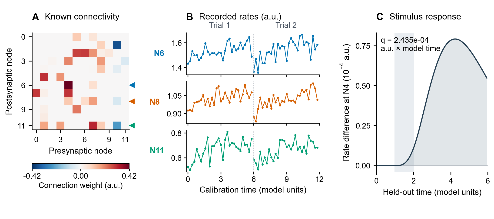
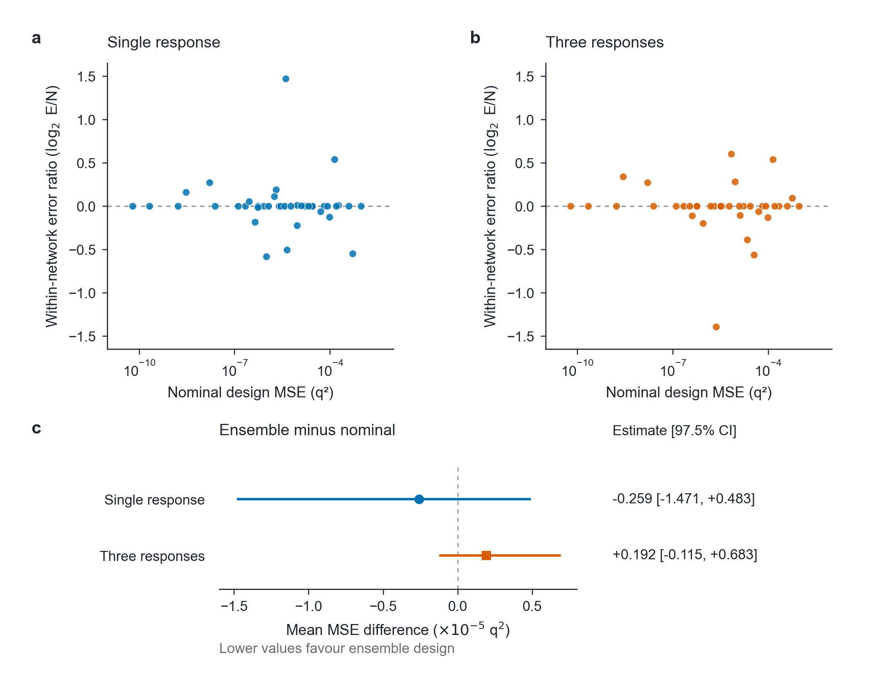
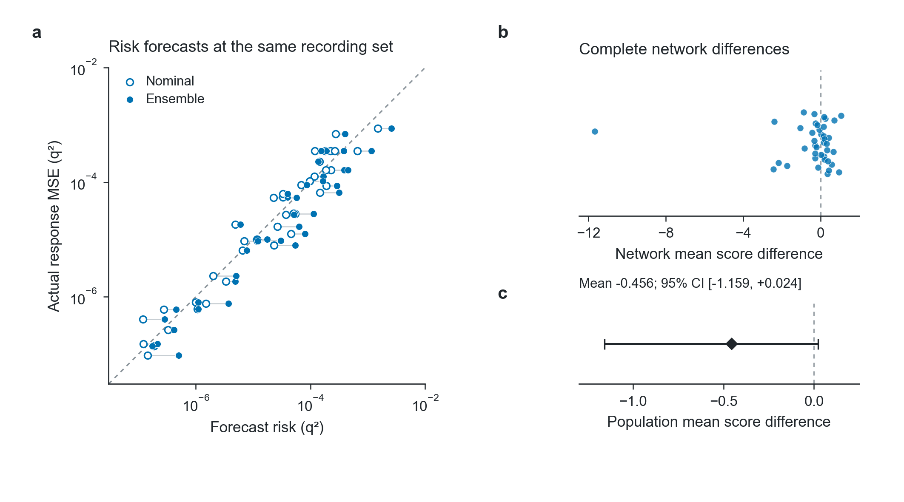
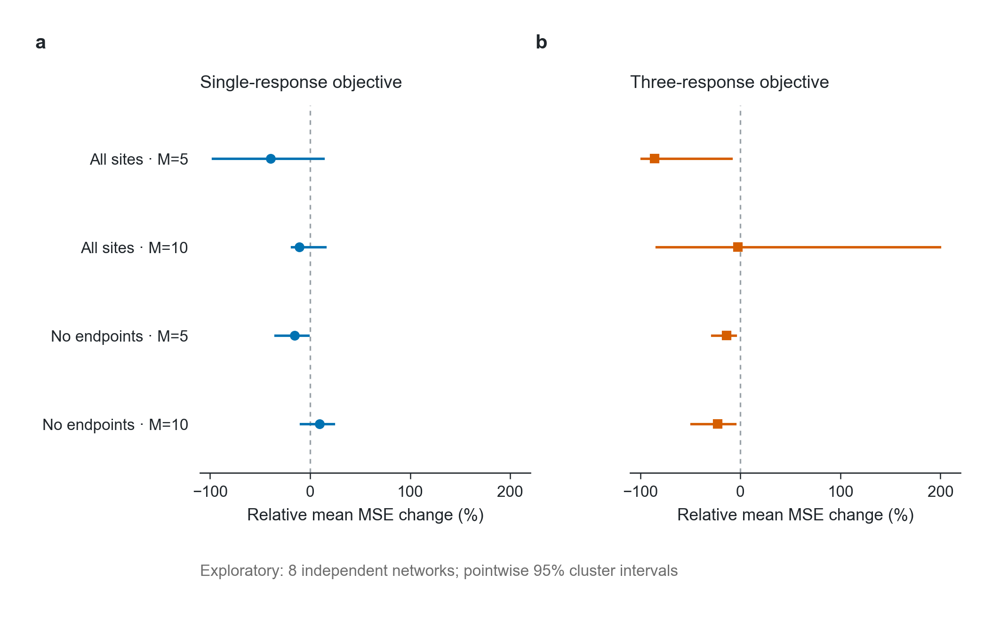

# Predictive Risk and Recording Decisions for Stimulus-Response Estimation in Partially Observed Neural Networks

Jiayi Du¹*† and Shuaizhi Cheng²†

¹ Stiftung Louisenlund, Germany. ² Department of Computing, Harbin Institute of Technology, China.

† These authors contributed equally. * Correspondence: jiayi.du@mail.louisenlund.de.

*Research manuscript, local editorial revision, 17 October 2026. All data are simulated. This revision changes presentation, not the frozen experiments or statistical analyses.*

## Abstract

Neural interfaces in biohybrid systems use stimulation and recording to interact with living networks. Under a limited recording budget, choosing where to record becomes part of predicting a specified stimulus response. Goal-oriented design ranks recording sets by their estimated prediction error. We test whether averaging local risk over a parameter prior improves the resulting response prediction or the accuracy of the risk estimate itself.

We compared single-response and shared three-response objectives, each using a nominal-parameter or prior-averaged risk criterion, in simulated 12-unit networks with known connectivity and uncertain neuronal gains and biases. The target was the time-integrated difference between stimulated and control activity. All methods used the same feasible recording sites, measurement budget and maximum a posteriori estimator. The primary evaluation used 40 independent networks under broad, correctly specified parameter uncertainty, with three recorded neurons and stimulation and readout sites excluded. Truth, noise and readout repetitions were nested within networks.

Compared with the nominal criterion, prior averaging changed aggregate mean squared response error by -3.74% for the single-response objective (97.5% paired network-cluster confidence interval, -18.48% to 12.12%) and +2.69% for the three-response objective (-2.95% to 11.51%). Both confidence intervals included zero. The two criteria selected identical recording sets for 82 of 120 target-specific designs (three per network) and 26 of 40 shared designs. To evaluate risk estimates independently of recording selection, a separately specified study used 40 new networks with recordings, data and point predictions held fixed. The primary ensemble-minus-nominal score difference was -0.45565 (95% confidence interval, -1.15857 to 0.02367), using log(v) + e²/v, where v is the estimated mean squared error and e is the response prediction error.

In an exploratory extension to eight independent 100-unit rank-two networks, the direction of the error difference varied with the response objective and recording budget. Under the shared fitting procedure, prior averaging can affect response prediction only by changing which neurons are recorded.

## Introduction

<!-- I1 -->
A recording configuration is useful insofar as it supports the inference for which its measurements are collected. Biohybrid robots translate optical inputs into motion through directly stimulated muscle or an intervening neuromuscular interface [1,2]; cultured neural networks also support decoding of responses to patterned electrical inputs [3]. These systems motivate a task-specific view of neural measurements, although a neural response is not itself a mechanical output. For a neural model, the inference might concern population activity or the response of a particular readout to a planned stimulus. Under a limited recording budget, these tasks can assign different values to the same observation. A practical evaluation of recording design must therefore connect the design criterion to the prediction made from the selected data.

<!-- I2 -->
Connectivity provides an important constraint on neural dynamics, but does not specify all neuronal properties. Different circuit parameters can produce similar activity [4]. Connectome-constrained modelling makes this ambiguity explicit: Beiran and Litwin-Kumar studied activity prediction with fixed connectivity, uncertain physiological parameters and partial recordings, including the selection of recording sites [5]. Lappalainen and colleagues combined anatomical structure, simplified dynamics and task optimisation to predict responses in the fly visual system [6]. These studies establish a direct foundation for asking how a restricted set of measurements constrains a functional prediction.

<!-- I3 -->
The validation target is consequential. Sensor-selection studies in nonlinear networks distinguish structural observability from the practical accuracy of state estimation [7]. Likewise, agreement with the activity used for fitting does not by itself establish accuracy for an unobserved perturbation. Sourmpis and colleagues used perturbation outcomes to assess neural models and the contribution of biological constraints [8]. Here, we fix the stimulation protocol and ask which calibration recordings support its response prediction. The variable being designed is the recording set, rather than the stimulation input, which has its own experimental-design literature [9].

<!-- I4 -->
Goal-oriented experimental design provides established criteria for valuing observations according to a quantity of interest [10]. A nominal-parameter approximation is inexpensive; averaging local criteria over a parameter ensemble accounts for variation in sensitivities, while more complete nonlinear approaches address a broader inference problem [11]. The difficulty is that local sensitivity-based risk need not track the error of a nonlinear response predicted after fitting. Two benefits must be distinguished: estimating future prediction error more accurately, and changing the selected observations enough to reduce that error. A revised risk estimate can leave the recording set unchanged. Conversely, a design specialised for one known readout can outperform a shared design through task specialisation alone. These distinctions call for comparisons that separate the prediction objective from its uncertainty approximation.

<!-- I5 -->
We evaluate those factors in a controlled computational study. Scalar and vector response objectives are crossed with nominal and prior-ensemble local-risk criteria, using the same model information, feasible recording pool, measurement budget and estimator. The first frozen study tests actual response error in 40 independent networks. An independently specified follow-up evaluates risk forecasts on 40 new networks while holding the data and point predictions fixed. Numerical controls and a larger published model family examine implementation and modelling boundaries. The primary comparisons remain uncertain, and the extension shows that favourable effects in some settings do not establish a general recording advantage.

## Results

### A common information budget separates the prediction objective from the risk approximation

<!-- R1 -->
We considered networks with known numerical connectivity J and uncertain neuronal gains and biases. Calibration data were collected from a limited set of nodes; the evaluation target was the time-integrated response to a separate fixed stimulus, relative to an unstimulated control (Fig. 1). Three readouts were chosen using structural reachability before generating physiological parameters or measurement noise. The scalar objective specialised its recording set for one readout, whereas the vector objective used one set for the same three-response family. This construction keeps task specialisation distinct from the comparison between nominal and ensemble risk.

**Fig. 1 | Connectivity, limited recordings and a held-out response in one simulated network.** **A,** Known signed connectivity J for the first frozen network, J5000; columns are presynaptic and rows postsynaptic nodes. Arrowheads mark recorded nodes N6, N8 and N11. **B,** Actual noisy calibration observations at these nodes in two trials, each reset to the same known initial state. Trials are concatenated for display; the dashed boundary is not continuous evolution. Lines connect observations only within trials, and vertical scales differ between nodes. **C,** Stimulated minus control rate at the unrecorded readout N4; shading marks the stimulus at N0 during model time 1–2. The integrated response q=2.43518×10⁻⁴ uses the original step-weighted sum with dt=0.05, rather than a new trapezoidal calculation. Broad uncertainty, first truth and noise draws, target 0, excluded endpoints, M=3 and nominal scalar selection are shown. This fixed first-index instance is illustrative (n=1), not an estimate of method performance. All quantities use dimensionless model units. Colours in B identify nodes; subsequent figures use objective-based colours.

<!-- R2 -->
All methods fitted the selected observations with the same Gaussian MAP estimator and predicted the response by nonlinear simulation. The principal candidate pool excluded the stimulation site and all three readouts, preventing direct endpoint recording. All-site recording and a larger budget were retained as additional conditions. Exact dataset reuse avoided redundant fits when methods selected identical nodes; no observations from different scalar designs were pooled.

<!-- R3 -->
Implementation controls established the expected numerical behaviour before interpreting method differences. An independent rate/sensitivity implementation agreed within approximately 3.4×10⁻¹⁶, and finite differences supported the analytic derivatives. A nondegenerate linear-Gaussian positive control gave identical nominal and ensemble designs in all 48 design pairs; analytic prediction risk agreed with Monte Carlo MAP error across 144 target/design evaluations (Supplementary Fig. 5). A separate additive-bias control produced the expected zero derivative of the paired stimulus response. These checks validate specific computational operations, rather than biological assumptions.

### Prior-averaged local risk did not establish lower prediction error in the primary comparisons

<!-- R4 -->
The first frozen evaluation included 40 independent J matrices, with three physiological truths, three noise repetitions and three readouts nested within each network. The primary condition combined broad matched uncertainty, excluded endpoints and a budget of three recorded nodes. For each method, errors were first averaged within J; mean risks and paired intervals were then calculated across networks. All fits terminated successfully, with no fallback or invalid task scale.

<!-- R5 -->
The ensemble scalar design had a slightly lower mean MSE than its nominal counterpart, but the paired interval included both improvement and deterioration (Table 1; Fig. 2). The vector comparison had the opposite point estimate and was also uncertain. Relative mean-MSE changes were −3.74% for ES versus LS and +2.69% for EV versus LV. Exact network-risk ties occurred in 13 and 26 networks, respectively. A descriptive check of the frozen selections found identical recording sets in 82 of 120 target-specific designs (three per network) and 26 of 40 shared designs. A leave-one-network diagnostic changed the sign of the scalar mean difference when one influential network was omitted; that network remains in every primary estimate. The results do not establish a stable ensemble advantage or method equivalence.

**Table 1 | Frozen primary response-error comparisons.** Broad matched uncertainty; endpoints excluded; M=3; 40 independent networks. RMSE is the square root of the overall mean network MSE. The primary estimand is the raw paired mean-MSE difference. The relative effect is a ratio of aggregate means minus one, not an average of individual percentage changes. Each prespecified comparison uses a 97.5% paired network-cluster interval.

| Objective | Nominal RMSE | Ensemble RMSE | Mean MSE difference, E−N | 97.5% interval | Relative mean-MSE change [97.5% interval] |
|---|---:|---:|---:|---:|---:|
| Single response | 0.008312 | 0.008155 | −2.586×10⁻⁶ | [−1.471×10⁻⁵, 4.826×10⁻⁶] | −3.74% [−18.48%, 12.12%] |
| Three responses | 0.008451 | 0.008564 | 1.924×10⁻⁶ | [−1.148×10⁻⁶, 6.826×10⁻⁶] | 2.69% [−2.95%, 11.51%] |

**Fig. 2 | Primary recording comparisons remain uncertain.** **a,b,** Each point represents one independent network for the single-response (a) and three-response (b) objectives. The horizontal axis is nominal-design MSE on a common logarithmic scale; the vertical axis is the descriptive within-network log₂ ratio of ensemble to nominal MSE. Zero denotes equal error. Forty networks are shown per panel, including ties; three truths, three noise repetitions and three readouts are averaged within each J. These individual ratios are neither the primary estimand nor the ratio of aggregate means in Table 1. **c,** Paired raw mean-MSE differences and 97.5% network-cluster bootstrap intervals for the two prespecified comparisons, displayed in units of 10⁻⁵ q². Negative differences favour the ensemble. All networks, including influential instances, are retained. Supplementary Fig. 1 shows the complete raw difference distributions; Table 1 separately reports relative effects. No method-equivalence margin was specified.

<!-- R6 -->
Recording constraints changed the achievable error. For nominal scalar design at M=3, RMSE was 0.000929 with all sites available and 0.004046 with endpoints excluded under matched uncertainty; the corresponding broad-condition values were 0.001946 and 0.008312. These exploratory comparisons make direct endpoint access an important part of the task definition. The activity and random references, both budgets, and all uncertainty conditions are retained in Supplementary Figs. 2–4.

### An independent forecast test separates risk estimation from point-prediction accuracy

<!-- R7 -->
In the first study, an exploratory aggregate comparison suggested that ensemble risk could better match actual error even when it did not improve the selected recordings. At the primary nominal scalar recording set, actual MSE divided by nominal forecast risk was approximately 1.615; the ratio using ensemble forecast risk was 1.103. Such a ratio does not establish forecast accuracy across networks. We therefore specified a separate test using 40 new J matrices, fixing the recording policy, selected data and fitted point predictions while comparing the two risk forecasts.

<!-- R8 -->
The primary ensemble-minus-nominal MSE-forecast score difference was −0.45565 (95% paired-cluster interval, −1.15857 to 0.02367; Fig. 3). Nineteen network means favoured the ensemble forecast and 21 favoured the nominal forecast. The shared point predictions had MSE 1.1781×10⁻⁴, so no point-prediction improvement can be attributed to changing the forecast alone. The interval does not establish a stable forecast-score gain. No fit failures, fallbacks or forecast-floor clipping occurred.

<!-- R9 -->
A secondary hidden-bias-shift comparison favoured the ensemble forecast by −1.3583 score units (pointwise 95% interval, −2.2143 to −0.6345). Both mean risk forecasts nevertheless remained below actual MSE in that condition. This result describes a relative forecast improvement in one secondary setting; it does not show that the hidden shift was learned or that uncertainty was fully calibrated.

**Fig. 3 | Risk forecasts are evaluated on identical predictions.** The independent follow-up uses the nominal scalar recording policy, broad matched uncertainty, excluded endpoints and M=3 in 40 new networks. **a,** Nominal (open blue) and ensemble (filled blue) mean forecast risks are paired with the same actual mean response MSE for each J; horizontal segments link the two forecasts. Axes have identical logarithmic ranges and a dashed identity line. This network-aggregate comparison is descriptive, not a stand-alone calibration test. **b,** All 40 network-level score differences; vertical jitter only separates overlapping points. **c,** Their mean and the prespecified 95% paired network-cluster interval. Panels b and c use different, explicitly labelled horizontal scales because individual differences and uncertainty about their mean are distinct statistical objects. Scores S(v,e)=log(v)+e²/v are computed for individual target/truth/noise cases and then averaged within J; they are not scores of the aggregate coordinates in a. Negative differences favour the ensemble. The score evaluates an MSE functional, not a complete predictive distribution.

### A larger model family shows condition-dependent selection effects

<!-- R10 -->
An exploratory extension used eight independent 100-unit rank-two tanh networks from a published mathematical family [5], with explicitly adapted calibration inputs and measurement noise. Numerical refinement was necessary: the initial coarse Euler implementation failed the convergence checks. An exact low-rank state reduction with RK4 integration agreed with dense RK4 and finer substeps in independent numerical cases. The complete refined experiment required 1,436 MAP calls and 693.1 seconds of core runtime, with successful termination throughout.

<!-- R11 -->
Ensemble designs had lower exploratory mean-MSE estimates in several extension settings, but the direction depended on objective and budget (Fig. 4). With endpoints excluded and M=5, relative mean-MSE changes were −15.38% for the scalar objective and −13.56% for the vector objective. At M=10, the scalar point estimate reversed to +9.45%, whereas the vector estimate was −22.84%. All eight comparisons and their pointwise 95% intervals are displayed. With only eight independent networks and simultaneous changes in model family, dynamics and parameter coordinates, the extension describes conditional behaviour rather than an N-only scaling effect or a replacement for the primary study.

**Fig. 4 | Selection effects vary across the exploratory model-family extension.** Relative mean-MSE changes for single-response (a) and three-response (b) objectives in eight independent 100-unit networks. Two physiological truths, two noise repetitions and three readouts are nested within J. Points and lines show the ratio-of-aggregate-means effect and pointwise 95% paired network-cluster interval. Both panels share the same effect scale; all intervals and all eight prescribed settings are retained. Negative values favour ensemble design. These comparisons are exploratory and not multiplicity-adjusted primary tests. The model family and several dynamical assumptions change together with N.

### Approximation diagnostics constrain the interpretation

<!-- R12 -->
Development-only diagnostics measured local Taylor remainders and selection overlap. Mean calibration remainders relative to parameter-induced activity changes were approximately 0.179 under matched uncertainty, 0.334 under broad uncertainty and 0.252 under hidden bias shift. Broader uncertainty changes signal scale and parameter variability as well as nonlinear behaviour, so these differences do not isolate a curvature effect. Local and ensemble sets frequently overlapped. When sets were identical, the fitted data and response predictions were identical by construction, limiting any decision benefit of a changed risk value in those cases.

<!-- R13 -->
The matched and hidden-shift conditions used the same public prior and therefore produced exactly the same prospective designs, despite different true responses. This is an information boundary: without a preliminary measurement, the selector cannot infer an undisclosed physiological shift. In the first frozen evaluation, approximate 95% local MAP response intervals for the nominal scalar estimator covered the truth with proportions 0.930, 0.919 and 0.793 for matched, broad and shifted conditions, respectively, at excluded endpoints and M=3. These diagnostics identify limitations of the current information and approximation contract; they do not establish a unique biological mechanism for the observed errors.

## Discussion

<!-- D1 -->
This study distinguishes the value of a risk estimate from the value of the decision made with it. In the primary model, prior-averaged local risk did not establish lower response error for either prediction objective. The independently specified forecast study also left its primary improvement uncertain. The larger model family produced favourable effects in some settings and weak or reversed effects in others. Together, these results argue for evaluating a recording criterion through the complete inference task, including the estimator and feasible observation pool, rather than assuming that a broader risk approximation necessarily improves the final prediction.

<!-- D2 -->
The comparison builds directly on connectome-constrained inference and goal-oriented design. Partial recordings and recording-site optimisation are already central to the former [5], while valuing observations for a specified functional is established in the latter [10]. Our factorial comparison keeps the response objective fixed when assessing ensemble risk, so a familiar advantage of task specialisation cannot by itself explain that contrast. The response test also follows the purpose-matched validation principle illustrated by neural perturbation studies [8]. The present evidence concerns this particular computational comparison; it does not introduce a new optimal-design principle.

<!-- D3 -->
Several features can separate local risk from actual response error. The criterion averages delta-method risks over a prior ensemble, whereas the evaluated predictor simulates q at a MAP parameter. It neither averages nonlinear posteriors over future data nor uses the posterior mean of q, the Bayes predictor for squared loss. Prediction-profile approaches in dynamic models assess uncertainty in the predicted quantity directly, offering a distinct alternative to local parameter approximations [12]. The exact linear-Gaussian control links analytic risk and MAP error under assumptions where those distinctions disappear. In the nonlinear models, measured approximation remainders and overlapping selected sets provide concrete diagnostics, but do not identify a single cause of the uncertain ensemble benefit. Small models with accurately integrated posteriors would offer a useful next test of approximation error versus nonlinear plug-in prediction error.

<!-- D4 -->
The study assumes known numerical J, a correct observation equation, known initial conditions and a specified stimulation action. Experimental-design studies in systems biology show that informative experiments can expose model discrepancy [13]; structural misspecification is not tested here. There is no process noise, plasticity or biological nonstationarity. Forty independent networks quantify uncertainty for the prescribed generating distribution, not for biological networks in general. Finite ensembles, greedy selection and common-start MAP introduce additional approximation and optimisation limits; successful solver termination does not establish global optimality. The 100-unit extension remains synthetic and has only eight independent networks. Jointly mapped neural recordings and perturbations would be needed to assess external validity. Connecting the response functional to mechanical output would require a further neuromuscular validation layer, as illustrated by current biohybrid crawlers [2].

<!-- D5 -->
The absence of a uniformly superior criterion does not remove the need to evaluate both risk forecasts and recording decisions for the specified task. Here, that evaluation preserves both uncertain primary results and conditional extension effects. The comparison makes the next scientific question more precise: which part of the risk-to-prediction chain needs a better approximation, and can improving that part change the observations enough to improve the response estimate?

## Methods

### Model, measurements and response

The primary model is

\[
\dot x=-x+Jr+u,\qquad
r_i=\exp(\eta_i)\operatorname{softplus}(x_i+b_i).
\]

N=12, x(0)=0 and J is known. The independent synthetic J matrices have 30% sparse connectivity, zero diagonal, column-wise excitatory/inhibitory signs, and spectral norm 0.65. The uncertain vector is θ=(η,b). We observe rate r, not internal state x. Time and activity are dimensionless.

Two known calibration inputs apply sinusoidal probes to three channels. Euler integration uses a step of 0.05 over six time units. Sampling every fourth step yields 60 observations per recorded neuron across the two calibration trials. Measurement noise is independent Gaussian with standard deviation 0.05.

A separate fixed stimulus of amplitude 0.6 acts during time 1–2. Three readouts are selected from structurally reachable nodes using J before physiological parameters or measurement noise are generated. The target family is

\[
q_k(\theta)=\int_0^6[r_{j_k}(t;\theta,u_*)-r_{j_k}(t;\theta,0)]dt.
\]

The primary implementation evaluates this integral by the matching left-point sum. Q consists of these three responses. The vector criterion and primary raw-error evaluation use equal weights over the same target family. Scalar designs specialise for one known target; vector designs use one configuration for all three. No observations from separately selected scalar configurations are pooled.

Recording budgets are M=3 and M=6. The candidate pool either includes all neurons or excludes the stimulation site and all three readouts. The latter pool is shared by every target and method.

### A factorial comparison of existing criteria

In whitened parameter coordinates, the local information matrix for a recording set M at parameter particle ℓ is

\[
H_{M,\ell}=I+\sum_{i\in M} F_{i,\ell}^{T}F_{i,\ell},
\]

where F includes the observation derivatives, prior parameter scale and noise standardisation. With aₖ,ℓ denoting the whitened target gradient, the scalar criterion is

\[
R_{k,\ell}(M)=a_{k,\ell}^{T}H_{M,\ell}^{-1}a_{k,\ell}.
\]

The vector criterion averages these risks over the three readouts. Local designs evaluate at μ=0; ensemble designs average the individually solved risks over 16 common prior draws. Averaging information before solving would define a different criterion and is not used.

| Design | Predictive objective | Parameter representation |
|---|---|---|
| LS | One specified response | Nominal parameter |
| ES | One specified response | Common prior ensemble |
| LV | Three-response vector | Nominal parameter |
| EV | Three-response vector | Common prior ensemble |
| Activity | Full calibration activity | Nominal parameter |
| Random | No risk objective | Five feasible random sets |

All risk-based methods use the same greedy forward selection and deterministic tie convention. These are greedy-selected sets, not certified global optima. Random permutations give nested budgets. The design API receives only the public model, prior, inputs and task. It receives neither generating parameters nor measured evaluation outcomes. There is no uncounted all-neuron pretraining or preliminary dataset.

The ensemble criterion is a **prior average of local delta-method risk**. It does not integrate future measurements and nonlinear posteriors, establish a variance upper bound, or capture all posterior modes.

### Common inference and paired evaluation

After selection, all methods minimise the same Gaussian MAP objective, using analytic sensitivities and the prior mean as the initial parameter. The solver allows 80 function evaluations with identical tolerances. A finite final iterate is retained and flagged if convergence is not reached. Exceptions or nonfinite predictions trigger a flagged prior-mean fallback. No instance is silently dropped.

Within each network, true parameter vector and noise repetition, methods receive their selected subsets of one common measurement-noise field. The full field is internal to the generator. Identical recorded datasets may reuse an identical fitted solution; this changes compute accounting, not information access. Responses are predicted by nonlinear simulation at the fitted parameter. A passive input not used for fitting provides an additional activity-prediction diagnostic.

### Development and the first frozen evaluation

| Stage | Independent J | Physiological truths/J | Noise repeats/truth | Readouts/J | Conditions |
|---|---:|---:|---:|---:|---|
| Development | 8 | 2 | 2 | 3 | Matched, broad, bias shift, gain-only, bias-only |
| First frozen evaluation | 40 | 3 | 3 | 3 | Matched, broad, bias shift |

Matched and broad conditions use correctly specified Gaussian priors and generating standard deviations 0.18 and 0.35 respectively. Bias shift retains the design prior at 0.18 while adding 0.5 to the hidden true bias mean. The method is not informed of this shift. Development gain-only and bias-only conditions fix the other parameter group. Increasing a prior scale changes parameter variability, signal scale and nonlinearity together; it is not an isolated curvature intervention.

Connectivity, truth, noise, design ensembles, task-scale Monte Carlo, random sets and analysis use separate seed namespaces. The first evaluation uses network IDs 5000–5039, disjoint from development. The execution protocol and computational source were locally frozen before outcomes were inspected. This is not external preregistration.

### Estimands and uncertainty

For each J, squared response errors are averaged across all prescribed truths, noises, targets and random-design repetitions. Network risks are then averaged equally across J. RMSE is the square root of the overall mean squared error. Repeated targets or noises do not create additional independent networks.

Two prespecified primary comparisons, ES−LS and EV−LV, concern broad uncertainty, excluded endpoints and M=3. Paired network-cluster percentile bootstrap uses 10,000 resamples. Each primary comparison receives a 97.5% interval as a two-comparison Bonferroni interval arrangement. Other strata, task-specialisation comparisons and factorial interactions have exploratory pointwise 95% intervals. We do not infer equivalence from an interval crossing zero.

The primary scale is raw response MSE. A secondary scale uses an independent common 64-draw nonlinear prior-Monte-Carlo variance. It is not method-specific. Prescribed targets below a frozen variance floor of 10⁻¹⁶ retain raw results; a complete standardised estimand is NA rather than silently excluding them. Local MAP intervals are approximate diagnostics, not guaranteed confidence intervals.

### Independently specified risk-forecast follow-up

The first study distinguishes selection gains from apparent risk-estimation differences only exploratorily. A subsequent protocol therefore uses new network IDs 6000–6039 and fixes the recording policies to LS and LV. The point predictions and selected data are identical for the two risk forecasts being compared. The forecasts are the nominal and ensemble local risks evaluated at that same recording set.

The risk-forecast score is

\[
S(v,e)=\log v+e^2/v,\qquad v=\max(\hat R,10^{-24}).
\]

For positive v, its conditional expectation is minimised at v=E[e²]. This makes it a consistent score for a positive MSE forecast; it does not establish a full predictive distribution or require the errors to be Gaussian. The log term penalises indiscriminate inflation. This is a use of established scoring principles [14], not a new score.

The follow-up has one frozen primary comparison: ensemble minus nominal risk-forecast score for the LS recording policy under broad uncertainty, excluded endpoints and M=3. It uses a paired network-cluster 95% interval. Matched/shift conditions and LV are secondary. These results do not redefine the first study's primary hypotheses.

### Numerical and published-model checks

The implementation is checked against an independent NumPy model, analytic finite differences, nonordered observation subsets, a linear bias-cancellation null, and exact small-subset enumeration. A separate nondegenerate linear-Gaussian positive control uses constant observation/target Jacobians, independent prior truths and noise, and exact linear MAP predictions. It checks both nominal–ensemble equivalence and the link between aᵀCa and actual MSE. The original SVD criterion is independently calibrated in its noiseless linear internal-state setting against Monte Carlo reconstruction, rather than mislabelled as a noisy-rate baseline reproduction.

The N=100 model-family extension uses the published rank-two tanh distribution, raw signed gains g~N(1,0.9²), zero bias and τ=0.5 [5]. Its inputs, known initial state, measurement noise and inference are explicit adaptations. Negative gains are retained as mathematical parameters. The coarse Euler implementation did not pass continuous-time convergence checks. The refined implementation uses x=v+Lz, analytic filtering of the known held input, and RK4 on the reduced state and sensitivities. Responses and their complete gradients are integrated at RK4 stages. It is compared with dense RK4 and finer substeps before execution. Eight new networks, two truths, two noise repetitions, three targets, budgets 5/10 and both pools are used. The prior ensemble has 32 draws and MAP permits 200 evaluations. These settings are frozen before formal extension outcomes, following numerical and timing checks. All extension comparisons are exploratory. This extension changes both model family and N, so it is not a controlled estimate of an N-only scaling law.

### Study accounting and availability

Core runtime is recorded separately from environment preparation, compilation, literature review and figure production. Dataset reuse avoids repeated optimisation of identical selected observations; evaluation rows are not independent sample counts.

**Table 2 | Study accounting.** Connectivity matrices are the independent sampling units. Truth, measurement noise and readout repeats are nested within J. Timings are core experiment wall times on the study Mac and are not cross-platform performance guarantees.

| Stage | Independent J | Truth × noise × readouts per J | Evaluation records | Actual MAP calls | Core runtime (s) |
|---|---:|---:|---:|---:|---:|
| Development | 8 | 2 × 2 × 3 | 19,200 | 5,696 | 25.4 |
| Frozen recording evaluation | 40 | 3 × 3 × 3 | 129,600 | 38,610 | 356.0 |
| Independent forecast study | 40 new | 3 × 3 × 3 | 6,480 | 3,006 | 17.5 |
| Exploratory 100-unit family | 8 new | 2 × 2 × 3 | 3,072 | 1,436 | 693.1 |

The companion package contains the independent implementation, dependency lock, actual execution/source freezes, per-instance outputs, numerical controls, network-level analysis and figure source data. MIASE, DOME and MDAR inform reporting [15,16,17]. No new human or animal measurements were collected. Source equations were independently implemented; unlicensed upstream code is not redistributed. All freezes were local records rather than external preregistrations.

## References

1. Kim Y et al. Remote control of muscle-driven miniature robots with battery-free wireless optoelectronics. *Science Robotics* 8, eadd1053 (2023). [DOI](https://doi.org/10.1126/scirobotics.add1053).
2. Min H et al. Optogenetic neuromuscular actuation of a miniature electronic biohybrid robot. *Science Robotics* 10, eadu5830 (2025). [DOI](https://doi.org/10.1126/scirobotics.adu5830).
3. Wang X, Lv B, Tang F, Wang Y, Liu B, Liu L. Biomimetic Visual Information Spatiotemporal Encoding Method for In Vitro Biological Neural Networks. *Biomimetics* 10(6), 359 (2025). [DOI](https://doi.org/10.3390/biomimetics10060359).
4. Prinz AA, Bucher D, Marder E. Similar network activity from disparate circuit parameters. *Nature Neuroscience* (2004). [DOI](https://doi.org/10.1038/nn1352).
5. Beiran M, Litwin-Kumar A. Prediction of neural activity in connectome-constrained recurrent networks. *Nature Neuroscience* (2025). [DOI](https://doi.org/10.1038/s41593-025-02080-4).
6. Lappalainen JK et al. Connectome-constrained networks predict neural activity across the fly visual system. *Nature* (2024). [DOI](https://doi.org/10.1038/s41586-024-07939-3).
7. Haber A, Molnar F, Motter AE. State observation and sensor selection for nonlinear networks. *IEEE TCNS* (2018). [DOI](https://doi.org/10.1109/TCNS.2017.2728201).
8. Sourmpis C et al. Biologically informed cortical models predict optogenetic perturbations. *eLife*, formal version 3 (2026). [DOI](https://doi.org/10.7554/eLife.106827.3).
9. Ogino M et al. Designing optimal perturbation inputs for system identification in neuroscience. *eLife*, reviewed preprint (2026). [Version 1](https://doi.org/10.7554/eLife.110030.1).
10. Attia A, Alexanderian A, Saibaba AK. Goal-oriented optimal design of experiments for large-scale Bayesian linear inverse problems. *Inverse Problems* (2018). [DOI](https://doi.org/10.1088/1361-6420/aad210).
11. Zhong et al. Goal-Oriented Bayesian Optimal Experimental Design for Nonlinear Models Using Markov Chain Monte Carlo. *SIAM/ASA JUQ* (2026). [DOI](https://doi.org/10.1137/24M1649344).
12. Kreutz C, Raue A, Timmer J. Likelihood based observability analysis and confidence intervals for predictions of dynamic models. *BMC Systems Biology* (2012). [DOI](https://doi.org/10.1186/1752-0509-6-120).
13. White A et al. The Limitations of Model-Based Experimental Design and Parameter Estimation in Sloppy Systems. *PLoS Computational Biology* 12(12), e1005227 (2016). [DOI](https://doi.org/10.1371/journal.pcbi.1005227).
14. Gneiting T, Raftery AE. Strictly Proper Scoring Rules, Prediction, and Estimation. *JASA* 102:359–378 (2007). [DOI](https://doi.org/10.1198/016214506000001437).
15. Minimum Information About a Simulation Experiment (MIASE). [DOI](https://doi.org/10.1371/journal.pcbi.1001122).
16. DOME recommendations for supervised machine learning validation in biology. [DOI](https://doi.org/10.1038/s41592-021-01205-4).
17. The MDAR Framework. [DOI](https://doi.org/10.1073/pnas.2103238118).
